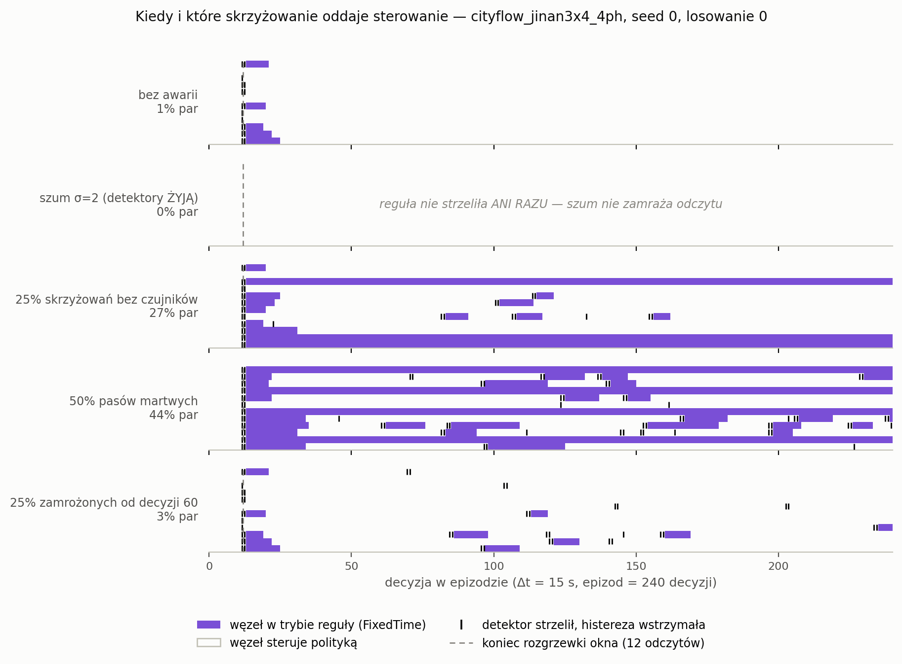

# Ślad bramki — plan `t2_trace`

Rysunek wyjaśniający, nie pomiar: **jeden seed, jedno losowanie awarii**. Liczby do pracy pochodzą z `t2_gate_real` (3 seedy × 5 losowań).

Pole = tryb sterowania węzła po histerezie. Znacznik = detektor strzelił, ale histereza wstrzymała przełączenie (wejście wymaga `k_on` = 3 kolejnych decyzji, wyjście `k_off` = 6 — stąd pole jest SZERSZE niż ciąg znaczników).

## Co ten rysunek pokazał, a czego nie było w żadnej tabeli

**Fałszywe alarmy reguły na czystym ruchu są artefaktem ZIMNEGO STARTU, nie stanem ustalonym.** Cały udział 1,5% mieści się w decyzjach 13–24, tuż po tym, jak bufor 12 odczytów się napełni, i nie wraca do końca epizodu. Mechanizm jest zrozumiały: na starcie sieć jest pusta, a pas bez ruchu raportuje stałe zero — czyli dokładnie to, co detektor martwy (`max − min < 1e−6`). Strażnik rozgrzewki kończy się, gdy bufor jest PEŁNY, a nie gdy jest pełny SENSOWNYCH odczytów.

Trzy wnioski: (1) w stanie ustalonym reguła na czystym nie strzela w ogóle, czyli jest LEPSZA, niż mówi `gate_share`; (2) to wyjaśnia, czemu udział na czystym wynosił 1,5%, a budżet kalibracji 0,5% — różnica nie jest przekroczeniem budżetu, tylko innym zjawiskiem; (3) poprawka jest tania i warta zmierzenia: wydłużyć rozgrzewkę albo wymagać, by podejrzany ruch miał kiedykolwiek NIEZEROWY odczyt. Niezmierzone — zapisać jako otwarte.

Dla porównania, pod awarią zimny start odpowiada za 13–14% przypadków (`mask0p5`, `mask0p25_intersection`) i 44% przy `hold` — tam reszta rozkłada się na cały epizod, bo awaria trwa.

## cityflow_jinan3x4_4ph

| scenariusz | udział par w trybie reguły | węzły, które choć raz przejęły |
|---|---:|---:|
| `clean` | 1.5% | 5/12 |
| `gauss2` | 0.0% | 0/12 |
| `mask0p25_intersection` | 27.2% | 10/12 |
| `mask0p5` | 43.5% | 11/12 |
| `mask0p25_hold_t60` | 3.3% | 6/12 |
