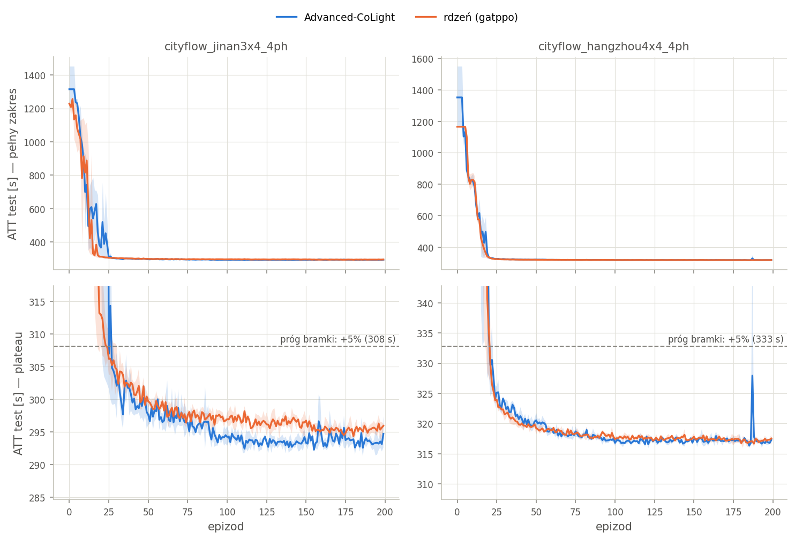
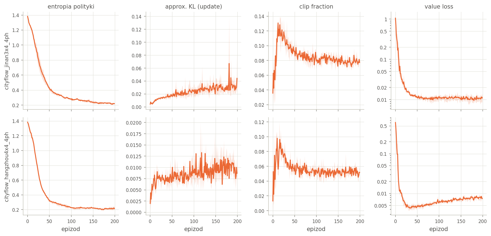

# GATE Fazy 1 — rdzeń (GAT + PPO + CTDE) vs Advanced-CoLight

Wygenerowane: 2026-09-11 18:08. Suity `p1_reference` + `p1_gate`, tryb realistyczny (yellow=5), protokół `configs/tsc/thesis_protocol.yml`.
ATT = średnia z 10 ostatnich epizodów testowych biegu; niżej średnia ± std po seedach.
Kod jednakowy dla wszystkich biegów: libsignal `5bcd823`, tsc_marl `544112a`; maszyna: `glider-B760-Pro-RS`.

| sieć | Advanced-CoLight | rdzeń (gatppo) | Δ | p (Welch) | n | w progu |
|---|---:|---:|---:|---:|:-:|:-:|
| cityflow_jinan3x4_4ph | 293.5 ± 0.6 | 295.6 ± 0.8 | +0.73% | 0.021 | 3 / 3 | TAK |
| cityflow_hangzhou4x4_4ph | 316.9 ± 0.1 | 317.2 ± 0.3 | +0.09% | 0.233 | 3 / 3 | TAK |

## Po seedach

| sieć | agent | ATT (10 ost. testów) |
|---|---|---|
| cityflow_jinan3x4_4ph | Advanced-CoLight | s0 292.8 · s1 293.8 · s2 293.8 |
| cityflow_jinan3x4_4ph | rdzeń (gatppo) | s0 294.7 · s1 296.1 · s2 296.0 |
| cityflow_hangzhou4x4_4ph | Advanced-CoLight | s0 317.0 · s1 317.0 · s2 316.8 |
| cityflow_hangzhou4x4_4ph | rdzeń (gatppo) | s0 317.4 · s1 317.4 · s2 316.9 |

## Stabilność i koszt

| sieć | agent | najgorszy test (ost. 50) | zbieżność [epizod] | throughput | queue | czas biegu [s] | urządzenie |
|---|---|---:|---:|---:|---:|---:|---|
| cityflow_jinan3x4_4ph | Advanced-CoLight | 300.7 | 34–55 | 6173 | 7.88 | 3096 | cpu |
| cityflow_jinan3x4_4ph | rdzeń (gatppo) | 297.7 | 36–56 | 6172 | 8.05 | 1349 | cuda:0 |
| cityflow_hangzhou4x4_4ph | Advanced-CoLight | 349.7 | 33–39 | 2931 | 1.13 | 2686 | cpu |
| cityflow_hangzhou4x4_4ph | rdzeń (gatppo) | 318.4 | 31–32 | 2930 | 1.15 | 1052 | cuda:0 |

Zbieżność = pierwszy epizod, od którego kroczące 10 testów mieści się w 2% od wyniku końcowego (zakres po seedach). Najgorszy test w ogonie łapie jednorazowe załamania polityki, których średnia z 10 nie pokazuje.

## Krzywe uczenia

Rysunki w `results/figures/` (PNG tutaj, PDF do pracy), przeliczane razem z tym raportem.

*Test ATT po epizodach. Linia = średnia po seedach, wstęga = min–max (n = 3). Górny rząd: pełny zakres; dolny: przybliżenie na plateau z progiem bramki (ATT Advanced-CoLight + 5%).*

*Sygnały update'u PPO — rdzeń (gatppo), jeden update na epizod. Wiersze = sieci; linia = średnia po seedach, wstęga = min–max (n = 3). Value loss w skali log.*

*Strata TD Advanced-CoLight po epizodach (skala log; epizody przed `learning_start` pominięte). Linia = średnia po seedach, wstęga = min–max (n = 3).*

## Kryterium wyjścia

Rdzeń w granicach **5%** ATT Advanced-CoLighta na każdej sieci (Δ > 0 = rdzeń gorszy). Próg to górna granica sformułowania z `p1_gate.yml` („w granicach kilku procent”), zapisana jako `GATE_TOLERANCE` w `analysis/report.py` PO obejrzeniu wyników — dlatego niżej jest też najmniejszy próg, przy którym werdykt się utrzymuje.

* **cityflow_jinan3x4_4ph** — różnica rozróżnialna statystycznie (Welch, p = 0.021) na korzyść: Advanced-CoLight; praktycznie 0.73% ATT.
* **cityflow_hangzhou4x4_4ph** — metody nierozróżnialne (Welch, p = 0.233); Δ +0.09% mieści się w rozrzucie po seedach.

## Werdykt

**GATE Fazy 1: ZALICZONA.** Największe Δ = +0.73%; werdykt utrzymuje się przy każdym progu ≥ 0.73%.

## Skąd różnica czasu biegu

**Czasów NIE da się porównać wprost: Advanced-CoLight liczył na `cpu`, rdzeń na `cuda:0`.** Symulacja jest w obu ścieżkach ta sama (epizod treningowy + testowy po 3600 s), ale różnica czasu miesza dwie przyczyny, których z tych biegów nie da się rozdzielić:

* **Advanced-CoLight** — w `external/LibSignal/trainer/tsc_trainer.py` blok treningu (l. 172) stoi na poziomie `while`, POZA `if i % action_interval == 0` (l. 139). Przy `update_model_rate: 1` (`configs/tsc/base.yml`) warunek jest prawdziwy w każdym takcie symulatora: po `learning_start` to 3600 kroków optymalizatora na epizod, każdy z trzema przebiegami GAT w przód (target na b_tp, model dwa razy na b_t).
* **rdzeń** — jeden update PPO na epizod: `epochs × n_minibatches` = 10 × 4 = 40 kroków optymalizatora (`configs/tsc/gatppo.yml`).
* **sprzęt** — Advanced-CoLight nie może zejść na GPU (`p1_reference.yml`: submoduł nie ma `.cuda()`), rdzeń poszedł na GPU zgodnie z `ngpu` w `p1_gate.yml`. Ile z różnicy czasu to karta, a ile liczba kroków — nie wiadomo.

Wniosek do pracy: twierdzenie odporne na sprzęt to ~90× mniej kroków optymalizatora na epizod przy tym samym ATT. Czasu biegu NIE cytować jako przewagi metody bez biegu rdzenia na CPU (`--ngpu -1`). Część różnicy to też artefakt pętli LibSignala, której świadomie nie ruszamy, bo zmiana kadencji zmieniłaby baseline dopasowany do literatury (`t1_baseline.md`).

## Czego ta tabela NIE mówi

* Czas biegu to `duration_s` z `meta.json` — CAŁOŚĆ. Rozbicie na symulację i update nie jest logowane w żadnej ze ścieżek; powyższy podział wynika z kodu, nie z pomiaru.
* HangZhou słabo różnicuje metody w trybie realistycznym: klasyczne baseline'y lądują blisko (`t1_baseline.md`, kolumna „realistyczny”), a odtwarzalność literatury na tej sieci jest słaba. Ciężar dowodu bramki niesie JiNan.
