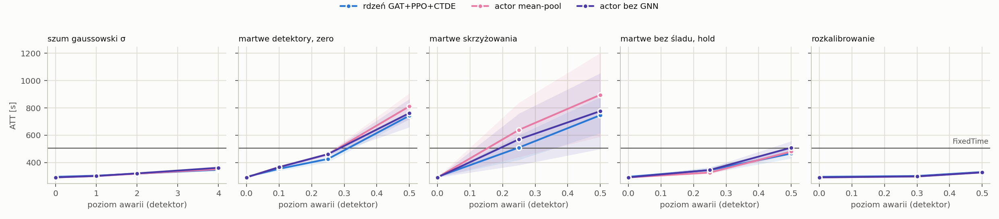
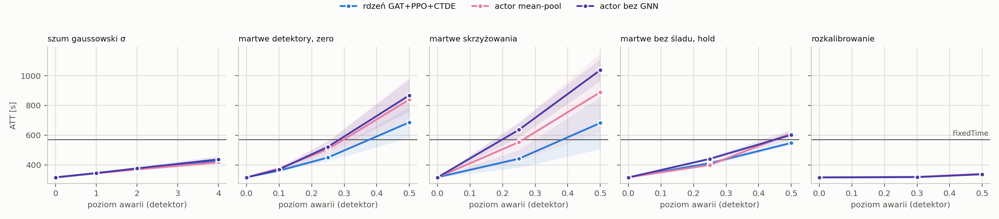

# T2 bez mechanizmu — plan `t2_ablations`

Tryb realistic (yellow=5), 5 losowań awarii na scenariusz, ewaluacja ZAMROŻONYCH sterowników (`tsc degrade`). Wszystkie czytają tę samą warstwę detektorów: MaxPressure liczy decyzję z popsutego wektora stanu, nie z silnika.

Komórka = ATT [s], średnia po losowaniach, potem po seedach polityki (± std po seedach); w nawiasie Δ względem czystego wyniku tego samego sterownika. **▲ = gorzej niż FixedTime** — tylko tam dolna warstwa fallbacku ma pole do zysku.

## cityflow_jinan3x4_4ph

FixedTime (niezależny od odczytów): **507.0 s**.

| scenariusz | rdzeń GAT+PPO+CTDE (n=5) | actor mean-pool (n=5) | actor bez GNN (n=5) |
|---|---:|---:|---:|
| `clean` | 295.8 ± 1.2 | 291.3 ± 0.5 | 291.7 ± 0.8 |
| `gauss1` | 304.1 ± 1.2 (+2.8%) | 301.1 ± 0.6 (+3.4%) | 301.9 ± 1.0 (+3.5%) |
| `gauss2` | 319.0 ± 2.0 (+7.9%) | 318.7 ± 1.8 (+9.4%) | 321.1 ± 3.0 (+10.1%) |
| `gauss4` | 347.4 ± 6.7 (+17.5%) | 352.1 ± 4.5 (+20.9%) | 361.9 ± 11.4 (+24.1%) |
| `mask0p1` | 354.3 ± 16.1 (+19.8%) | 367.3 ± 7.6 (+26.1%) | 366.5 ± 5.5 (+25.6%) |
| `mask0p25` | 426.5 ± 23.9 (+44.2%) | 460.3 ± 12.0 (+58.0%) | 461.8 ± 9.6 (+58.3%) |
| `mask0p5` | 743.4 ± 25.2 (+151.4%) ▲ | 811.9 ± 95.3 (+178.7%) ▲ | 762.2 ± 103.4 (+161.3%) ▲ |
| `mask0p25_intersection` | 510.0 ± 90.2 (+72.4%) ▲ | 639.4 ± 199.4 (+119.5%) ▲ | 570.4 ± 188.8 (+95.6%) ▲ |
| `mask0p5_intersection` | 746.5 ± 132.4 (+152.4%) ▲ | 896.0 ± 306.7 (+207.6%) ▲ | 776.8 ± 278.0 (+166.3%) ▲ |
| `mask0p25_hold_t60` | 344.8 ± 22.2 (+16.6%) | 327.0 ± 9.7 (+12.3%) | 345.7 ± 16.9 (+18.5%) |
| `mask0p5_hold_t60` | 466.9 ± 36.1 (+57.9%) | 480.6 ± 22.0 (+65.0%) | 509.4 ± 47.4 (+74.6%) ▲ |
| `drift0p3` | 301.7 ± 0.7 (+2.0%) | 297.9 ± 0.5 (+2.3%) | 298.7 ± 0.6 (+2.4%) |
| `drift0p5` | 331.0 ± 4.6 (+11.9%) | 328.2 ± 2.9 (+12.7%) | 327.9 ± 5.3 (+12.4%) |

* **rdzeń GAT+PPO+CTDE** — najgorszy scenariusz `mask0p5_intersection`: 746.5 s (+152.4%). Gorzej niż FixedTime w 3 scenariuszach: `mask0p25_intersection`, `mask0p5`, `mask0p5_intersection`.
* **actor mean-pool** — najgorszy scenariusz `mask0p5_intersection`: 896.0 s (+207.6%). Gorzej niż FixedTime w 3 scenariuszach: `mask0p25_intersection`, `mask0p5`, `mask0p5_intersection`.
* **actor bez GNN** — najgorszy scenariusz `mask0p5_intersection`: 776.8 s (+166.3%). Gorzej niż FixedTime w 4 scenariuszach: `mask0p25_intersection`, `mask0p5`, `mask0p5_hold_t60`, `mask0p5_intersection`.

## cityflow_hangzhou4x4_4ph

FixedTime (niezależny od odczytów): **568.9 s**.

| scenariusz | rdzeń GAT+PPO+CTDE (n=5) | actor mean-pool (n=5) | actor bez GNN (n=5) |
|---|---:|---:|---:|
| `clean` | 317.5 ± 0.7 | 316.7 ± 0.3 | 316.2 ± 0.3 |
| `gauss1` | 345.7 ± 1.3 (+8.9%) | 343.6 ± 2.6 (+8.5%) | 345.5 ± 2.7 (+9.3%) |
| `gauss2` | 374.7 ± 4.8 (+18.0%) | 370.0 ± 5.6 (+16.8%) | 377.3 ± 7.5 (+19.3%) |
| `gauss4` | 425.7 ± 13.5 (+34.1%) | 417.5 ± 15.2 (+31.8%) | 437.7 ± 24.4 (+38.4%) |
| `mask0p1` | 361.9 ± 3.6 (+14.0%) | 376.3 ± 13.3 (+18.8%) | 370.1 ± 11.5 (+17.0%) |
| `mask0p25` | 450.1 ± 24.7 (+41.7%) | 506.9 ± 46.8 (+60.0%) | 522.2 ± 41.0 (+65.1%) |
| `mask0p5` | 686.6 ± 102.7 (+116.2%) ▲ | 839.9 ± 150.3 (+165.2%) ▲ | 868.4 ± 107.1 (+174.7%) ▲ |
| `mask0p25_intersection` | 442.1 ± 59.6 (+39.2%) | 553.4 ± 127.3 (+74.7%) | 636.3 ± 50.8 (+101.2%) ▲ |
| `mask0p5_intersection` | 682.3 ± 175.7 (+114.9%) ▲ | 889.2 ± 263.7 (+180.7%) ▲ | 1037.8 ± 75.0 (+228.2%) ▲ |
| `mask0p25_hold_t60` | 412.2 ± 13.8 (+29.8%) | 400.3 ± 10.5 (+26.4%) | 441.2 ± 9.9 (+39.5%) |
| `mask0p5_hold_t60` | 548.4 ± 14.3 (+72.7%) | 613.3 ± 17.0 (+93.6%) ▲ | 602.3 ± 36.9 (+90.5%) ▲ |
| `drift0p3` | 319.5 ± 0.2 (+0.6%) | 318.6 ± 0.3 (+0.6%) | 318.5 ± 0.2 (+0.7%) |
| `drift0p5` | 338.7 ± 2.5 (+6.7%) | 340.8 ± 4.5 (+7.6%) | 337.3 ± 3.1 (+6.7%) |

* **rdzeń GAT+PPO+CTDE** — najgorszy scenariusz `mask0p5`: 686.6 s (+116.2%). Gorzej niż FixedTime w 2 scenariuszach: `mask0p5`, `mask0p5_intersection`.
* **actor mean-pool** — najgorszy scenariusz `mask0p5_intersection`: 889.2 s (+180.7%). Gorzej niż FixedTime w 3 scenariuszach: `mask0p5`, `mask0p5_hold_t60`, `mask0p5_intersection`.
* **actor bez GNN** — najgorszy scenariusz `mask0p5_intersection`: 1037.8 s (+228.2%). Gorzej niż FixedTime w 4 scenariuszach: `mask0p25_intersection`, `mask0p5`, `mask0p5_hold_t60`, `mask0p5_intersection`.

## Kontrola: ewaluator mierzy tę samą politykę co T1

Czysty wynik ewaluatora vs ostatni test treningu, 30 biegów uczonych: największa różnica **0.000 s** — zgodne co do precyzji logu.

## Czego ta tabela NIE mówi

* Poziomy są poziomami DETEKTORA. Na cechę `gauss` przenosi się ze współczynnikiem ~0,8–0,9, `urand` jest ~1,6× słabszy przy tym samym `level` (`results/sensor_severity.md`).
* Maska z podstawieniem `zero` zmienia znacznie mniej komórek cech, niż wynosi ułamek martwych pasów (zero jest wartością modalną) — ta sama liczba nie znaczy tego samego na sieciach o różnym obciążeniu.
* Scenariusze `hold` zaczynają się w decyzji 60 (15. minuta), więc pierwsza ćwiartka epizodu jest czysta — ich Δ nie jest porównywalne wprost z maską od początku.
