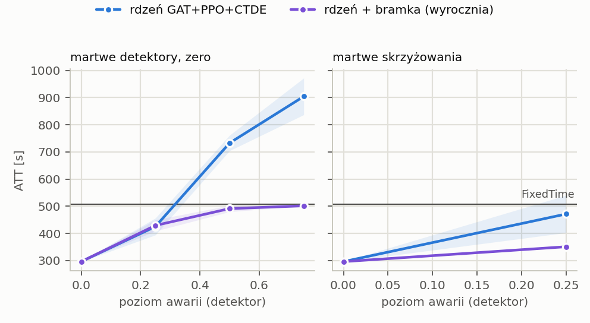

# T2 z bramką fallbacku — plan `t2_gate`

Tryb realistic (yellow=5), 5 losowań awarii na scenariusz, ewaluacja ZAMROŻONYCH sterowników (`tsc degrade`). Wszystkie czytają tę samą warstwę detektorów: MaxPressure liczy decyzję z popsutego wektora stanu, nie z silnika.

Komórka = ATT [s], średnia po losowaniach, potem po seedach polityki (± std po seedach); w nawiasie Δ względem czystego wyniku tego samego sterownika. **▲ = gorzej niż FixedTime** — tylko tam dolna warstwa fallbacku ma pole do zysku.

## cityflow_jinan3x4_4ph

FixedTime (niezależny od odczytów): **507.0 s**.

| scenariusz | rdzeń GAT+PPO+CTDE (n=3) | rdzeń + bramka (wyrocznia) (n=3) |
|---|---:|---:|
| `clean` | 295.9 ± 0.6 | 295.9 ± 0.6 |
| `mask0p25` | 424.9 ± 31.1 (+43.6%) | 429.1 ± 20.7 (+45.0%) |
| `mask0p25_intersection` | 471.1 ± 68.8 (+59.2%) | 350.7 ± 1.4 (+18.5%) |
| `mask0p5` | 732.6 ± 28.5 (+147.5%) ▲ | 491.1 ± 11.7 (+65.9%) |
| `mask0p75` | 904.0 ± 67.5 (+205.5%) ▲ | 501.4 ± 0.4 (+69.4%) |

* **rdzeń GAT+PPO+CTDE** — najgorszy scenariusz `mask0p75`: 904.0 s (+205.5%). Gorzej niż FixedTime w 2 scenariuszach: `mask0p5`, `mask0p75`.
* **rdzeń + bramka (wyrocznia)** — najgorszy scenariusz `mask0p75`: 501.4 s (+69.4%). Nigdzie nie spada poniżej FixedTime — przy tych poziomach fallback do FixedTime nie ma z czego zarobić.

## Mechanizm: rdzeń + bramka (wyrocznia) vs rdzeń GAT+PPO+CTDE

Obie kolumny liczą się z TEGO SAMEGO checkpointu i tych samych losowań awarii (`draw` wybiera, które detektory padły), więc porównujemy je **parami**, nie przez ±std z tabeli wyżej: wspólny rozrzut między seedami i losowaniami skraca się w różnicy. `Δ` < 0 = mechanizm lepszy. `|t| ≥ 2.8` to próg po poprawce na tyle porównań, ile ma ta tabela.

`gate_share` = odsetek par (decyzja, węzeł), w których sterowanie przejęła reguła. `gate_switches` = liczba ZMIAN trybu na węzłach w epizodzie — to one psują ruch (przełączenie resetuje fazę), a nie sam udział.

### cityflow_jinan3x4_4ph

| scenariusz | gate_share | gate_switches | Δ ATT [s] | sd | t | lepszy w |
|---|---:|---:|---:|---:|---:|---:|
| `clean` | 0.0% | 0.00 | +0.00 | 0.0 | — | 0/3 |
| `mask0p25` | 6.7% | 0.00 | +4.12 | 51.1 | +0.31 | 3/15 |
| `mask0p25_intersection` | 26.7% | 0.00 | **-120.35** | 89.9 | -5.18 | 15/15 |
| `mask0p5` | 61.7% | 0.00 | **-241.52** | 65.5 | -14.27 | 15/15 |
| `mask0p75` | 96.7% | 0.00 | **-402.64** | 103.6 | -15.05 | 15/15 |

* Powyżej progu: `mask0p25_intersection` (-120.35 s, t = -5.18, lepszy w 15/15 parach), `mask0p5` (-241.52 s, t = -14.27, lepszy w 15/15 parach), `mask0p75` (-402.64 s, t = -15.05, lepszy w 15/15 parach)

## Kontrola: ewaluator mierzy tę samą politykę co T1

Czysty wynik ewaluatora vs ostatni test treningu, 3 biegów uczonych: największa różnica **0.000 s** — zgodne co do precyzji logu.

## Czego ta tabela NIE mówi

* Poziomy są poziomami DETEKTORA. Na cechę `gauss` przenosi się ze współczynnikiem ~0,8–0,9, `urand` jest ~1,6× słabszy przy tym samym `level` (`results/sensor_severity.md`).
* Maska z podstawieniem `zero` zmienia znacznie mniej komórek cech, niż wynosi ułamek martwych pasów (zero jest wartością modalną) — ta sama liczba nie znaczy tego samego na sieciach o różnym obciążeniu.
* Scenariusze `hold` zaczynają się w decyzji 60 (15. minuta), więc pierwsza ćwiartka epizodu jest czysta — ich Δ nie jest porównywalne wprost z maską od początku.
