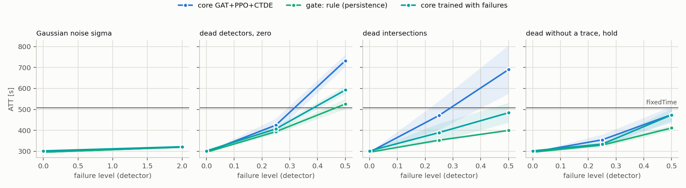
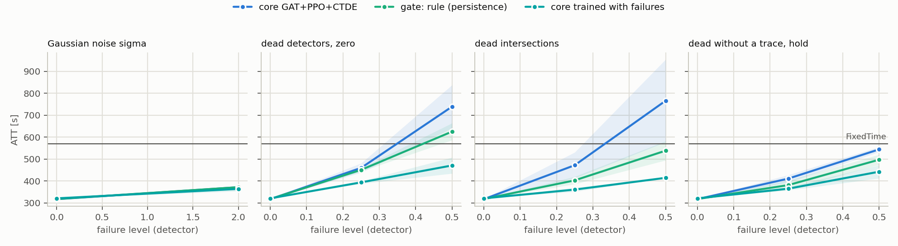

# T2: plan `t2_gate_dr`

Mode realistic (yellow=5), 5 failure draws per scenario, evaluation of FROZEN controllers (`tsc degrade`). All read the same detector layer: MaxPressure computes its decision from the broken state vector, not the engine.

Cell = ATT [s], the mean over draws, then over policy seeds (+- std over seeds); in brackets delta relative to the same controller's clean result. **(!) = worse than FixedTime**, the only place the fallback's lower layer can gain.

## cityflow_jinan3x4_4ph

FixedTime (independent of readings): **507.0 s**.

| scenario | core GAT+PPO+CTDE (n=3) | gate: rule (persistence) (n=3) | core trained with failures (n=3) | core with failures + gate: rule (n=3) |
|---|---:|---:|---:|---:|
| `clean` | 295.9 +- 0.6 | 295.7 +- 0.8 | 302.0 +- 1.7 | 305.2 +- 1.0 |
| `gauss2` | 319.9 +- 2.2 (+8.1%) | 319.9 +- 2.2 (+8.2%) | 321.8 +- 3.2 (+6.6%) | 321.8 +- 3.2 (+5.4%) |
| `mask0p25` | 424.9 +- 31.1 (+43.6%) | 393.7 +- 10.4 (+33.2%) | 407.0 +- 12.5 (+34.8%) | 388.4 +- 4.9 (+27.3%) |
| `mask0p5` | 732.6 +- 28.5 (+147.5%) (!) | 525.7 +- 23.8 (+77.8%) (!) | 592.5 +- 19.4 (+96.2%) (!) | 481.1 +- 11.3 (+57.6%) |
| `mask0p25_intersection` | 471.1 +- 68.8 (+59.2%) | 353.1 +- 5.3 (+19.4%) | 389.2 +- 42.7 (+28.9%) | 357.0 +- 8.4 (+16.9%) |
| `mask0p5_intersection` | 690.0 +- 115.3 (+133.2%) (!) | 399.5 +- 2.9 (+35.1%) | 483.8 +- 47.4 (+60.2%) | 399.1 +- 4.7 (+30.7%) |
| `mask0p25_hold_t60` | 354.7 +- 24.8 (+19.9%) | 329.6 +- 10.4 (+11.5%) | 334.4 +- 8.7 (+10.7%) | 337.2 +- 6.1 (+10.5%) |
| `mask0p5_hold_t60` | 475.0 +- 38.9 (+60.5%) | 411.2 +- 13.6 (+39.1%) | 473.6 +- 29.4 (+56.8%) | 406.0 +- 10.6 (+33.0%) |

* **core GAT+PPO+CTDE**: worst scenario `mask0p5`: 732.6 s (+147.5%). Worse than FixedTime in 2 scenarios: `mask0p5`, `mask0p5_intersection`.
* **gate: rule (persistence)**: worst scenario `mask0p5`: 525.7 s (+77.8%). Worse than FixedTime in 1 scenarios: `mask0p5`.
* **core trained with failures**: worst scenario `mask0p5`: 592.5 s (+96.2%). Worse than FixedTime in 1 scenarios: `mask0p5`.
* **core with failures + gate: rule**: worst scenario `mask0p5`: 481.1 s (+57.6%). Never falls below FixedTime: at these levels a fallback to FixedTime has nothing to gain.

## cityflow_hangzhou4x4_4ph

FixedTime (independent of readings): **568.9 s**.

| scenario | core GAT+PPO+CTDE (n=3) | gate: rule (persistence) (n=3) | core trained with failures (n=3) | core with failures + gate: rule (n=3) |
|---|---:|---:|---:|---:|
| `clean` | 317.5 +- 1.0 | 318.1 +- 0.1 | 321.2 +- 0.3 | 322.4 +- 0.2 |
| `gauss2` | 372.1 +- 4.2 (+17.2%) | 372.1 +- 4.2 (+16.9%) | 364.3 +- 10.4 (+13.4%) | 364.3 +- 10.4 (+13.0%) |
| `mask0p25` | 460.1 +- 21.2 (+44.9%) | 451.2 +- 7.6 (+41.8%) | 394.1 +- 5.9 (+22.7%) | 395.7 +- 7.6 (+22.8%) |
| `mask0p5` | 739.2 +- 98.5 (+132.8%) (!) | 625.4 +- 38.6 (+96.6%) (!) | 471.1 +- 36.5 (+46.7%) | 472.9 +- 29.7 (+46.7%) |
| `mask0p25_intersection` | 472.2 +- 58.9 (+48.7%) | 403.2 +- 17.0 (+26.7%) | 361.1 +- 9.4 (+12.4%) | 352.9 +- 3.1 (+9.5%) |
| `mask0p5_intersection` | 765.9 +- 188.2 (+141.2%) (!) | 538.4 +- 43.6 (+69.2%) | 414.7 +- 1.0 (+29.1%) | 392.3 +- 7.0 (+21.7%) |
| `mask0p25_hold_t60` | 411.1 +- 16.8 (+29.5%) | 381.5 +- 21.4 (+19.9%) | 365.3 +- 7.3 (+13.7%) | 372.7 +- 11.7 (+15.6%) |
| `mask0p5_hold_t60` | 544.4 +- 11.8 (+71.5%) | 497.4 +- 22.9 (+56.4%) | 442.6 +- 30.1 (+37.8%) | 452.4 +- 38.2 (+40.3%) |

* **core GAT+PPO+CTDE**: worst scenario `mask0p5_intersection`: 765.9 s (+141.2%). Worse than FixedTime in 2 scenarios: `mask0p5`, `mask0p5_intersection`.
* **gate: rule (persistence)**: worst scenario `mask0p5`: 625.4 s (+96.6%). Worse than FixedTime in 1 scenarios: `mask0p5`.
* **core trained with failures**: worst scenario `mask0p5`: 471.1 s (+46.7%). Never falls below FixedTime: at these levels a fallback to FixedTime has nothing to gain.
* **core with failures + gate: rule**: worst scenario `mask0p5`: 472.9 s (+46.7%). Never falls below FixedTime: at these levels a fallback to FixedTime has nothing to gain.

## Mechanism: gate: rule (persistence) vs core GAT+PPO+CTDE

Both columns are computed from THE SAME checkpoint and the same failure draws (`draw` chooses which detectors failed), so they are compared **in pairs**, not through the +-std of the table above: the shared spread between seeds and draws cancels in the difference. `delta` < 0 = the mechanism is better. `|t| >= 2.8` is the threshold corrected for as many comparisons as this table has.

`gate_share` = share of (decision, node) pairs where the rule took control. `gate_switches` = number of mode CHANGES at nodes per episode; these hurt traffic (a switch resets the phase), not the share itself. `gate_precision` and `gate_recall` are relative to the ORACLE (the truth from the failure layer, diagnostic only) and separate "the detector is weak" from "switching gains little", two things ATT alone merges.

### cityflow_jinan3x4_4ph

| scenario | gate_share | gate_switches | gate_precision | gate_recall | delta ATT [s] | sd | t | better in |
|---|---:|---:|---:|---:|---:|---:|---:|---:|
| `clean` | 1.6% | 11.33 | 0.00 | - | -0.26 | 0.6 | -0.74 | 2/3 |
| `gauss2` | 0.0% | 0.00 | - | - | +0.00 | 0.0 | - | 0/0 |
| `mask0p25` | 15.8% | 34.80 | 0.17 | 0.31 | **-31.21** | 42.5 | -2.85 | 14/15 |
| `mask0p5` | 57.4% | 40.20 | 0.73 | 0.70 | **-206.88** | 59.2 | -13.55 | 15/15 |
| `mask0p25_intersection` | 26.2% | 18.67 | 0.89 | 0.90 | **-118.02** | 88.8 | -5.15 | 15/15 |
| `mask0p5_intersection` | 49.2% | 23.07 | 0.92 | 0.95 | **-290.45** | 148.6 | -7.57 | 15/15 |
| `mask0p25_hold_t60` | 11.0% | 25.47 | 0.15 | 0.27 | -25.11 | 43.3 | -2.25 | 11/15 |
| `mask0p5_hold_t60` | 42.1% | 34.87 | 0.71 | 0.67 | **-63.76** | 52.2 | -4.73 | 13/15 |

* Above the threshold: `mask0p25` (-31.21 s, t = -2.85, better in 14/15 pairs), `mask0p25_intersection` (-118.02 s, t = -5.15, better in 15/15 pairs), `mask0p5` (-206.88 s, t = -13.55, better in 15/15 pairs), `mask0p5_hold_t60` (-63.76 s, t = -4.73, better in 13/15 pairs), `mask0p5_intersection` (-290.45 s, t = -7.57, better in 15/15 pairs)

### cityflow_hangzhou4x4_4ph

| scenario | gate_share | gate_switches | gate_precision | gate_recall | delta ATT [s] | sd | t | better in |
|---|---:|---:|---:|---:|---:|---:|---:|---:|
| `clean` | 1.3% | 14.00 | 0.00 | - | +0.62 | 1.0 | +1.08 | 1/3 |
| `gauss2` | 0.0% | 0.00 | - | - | +0.00 | 0.0 | - | 0/0 |
| `mask0p25` | 3.4% | 25.20 | 0.26 | 0.08 | -8.93 | 32.3 | -1.07 | 7/15 |
| `mask0p5` | 14.4% | 58.67 | 0.89 | 0.19 | **-113.77** | 86.1 | -5.12 | 14/15 |
| `mask0p25_intersection` | 6.6% | 33.00 | 0.74 | 0.23 | **-68.98** | 83.8 | -3.19 | 12/15 |
| `mask0p5_intersection` | 18.7% | 59.80 | 0.95 | 0.36 | **-227.48** | 174.0 | -5.06 | 14/15 |
| `mask0p25_hold_t60` | 1.6% | 16.33 | 0.02 | 0.00 | -29.56 | 56.5 | -2.03 | 12/15 |
| `mask0p5_hold_t60` | 7.0% | 38.80 | 0.66 | 0.10 | -46.99 | 73.2 | -2.49 | 12/15 |

* Above the threshold: `mask0p25_intersection` (-68.98 s, t = -3.19, better in 12/15 pairs), `mask0p5` (-113.77 s, t = -5.12, better in 14/15 pairs), `mask0p5_intersection` (-227.48 s, t = -5.06, better in 14/15 pairs)

## Arm: core trained with failures vs core GAT+PPO+CTDE

The columns have DIFFERENT checkpoints (separate trainings), so pairing is by (network, scenario, seed, draw): traffic and failure pattern stay shared, the spread between seeds enters the difference. The reference column is set in the plan (`baseline: gatppo`), not assumed. `delta` < 0 = the arm is better. `|t| >= 2.8` is the threshold corrected for as many comparisons as this table has.

The columns differ in HOW THEY WERE TRAINED, not in a mechanism switched on at inference, so there is no "did the mechanism start" diagnostic. The spread between seeds enters the difference in full, and the number of INDEPENDENT replications is the number of seeds, not of pairs: failure draws share a checkpoint, so |t| is optimistic with respect to them.

### cityflow_jinan3x4_4ph

| scenario | delta ATT [s] | sd | t | better in |
|---|---:|---:|---:|---:|
| `clean` | **+6.06** | 2.2 | +4.76 | 0/3 |
| `gauss2` | +1.94 | 4.7 | +1.59 | 6/15 |
| `mask0p25` | -17.92 | 26.4 | -2.63 | 12/15 |
| `mask0p5` | **-140.03** | 50.3 | -10.77 | 15/15 |
| `mask0p25_intersection` | -81.83 | 115.0 | -2.76 | 12/15 |
| `mask0p5_intersection` | **-206.15** | 170.4 | -4.69 | 14/15 |
| `mask0p25_hold_t60` | -20.35 | 47.7 | -1.65 | 8/15 |
| `mask0p5_hold_t60` | -1.42 | 85.2 | -0.06 | 7/15 |

* Above the threshold: `clean` (+6.06 s, t = +4.76, better in 0/3 pairs), `mask0p5` (-140.03 s, t = -10.77, better in 15/15 pairs), `mask0p5_intersection` (-206.15 s, t = -4.69, better in 14/15 pairs)

### cityflow_hangzhou4x4_4ph

| scenario | delta ATT [s] | sd | t | better in |
|---|---:|---:|---:|---:|
| `clean` | **+3.66** | 0.7 | +8.57 | 0/3 |
| `gauss2` | **-7.76** | 6.5 | -4.61 | 12/15 |
| `mask0p25` | **-66.06** | 68.9 | -3.71 | 14/15 |
| `mask0p5` | **-268.04** | 157.6 | -6.59 | 15/15 |
| `mask0p25_intersection` | **-111.06** | 152.9 | -2.81 | 12/15 |
| `mask0p5_intersection` | **-351.20** | 230.9 | -5.89 | 15/15 |
| `mask0p25_hold_t60` | **-45.85** | 51.5 | -3.45 | 14/15 |
| `mask0p5_hold_t60` | **-101.78** | 78.1 | -5.05 | 13/15 |

* Above the threshold: `clean` (+3.66 s, t = +8.57, better in 0/3 pairs), `gauss2` (-7.76 s, t = -4.61, better in 12/15 pairs), `mask0p25` (-66.06 s, t = -3.71, better in 14/15 pairs), `mask0p25_hold_t60` (-45.85 s, t = -3.45, better in 14/15 pairs), `mask0p25_intersection` (-111.06 s, t = -2.81, better in 12/15 pairs), `mask0p5` (-268.04 s, t = -6.59, better in 15/15 pairs), `mask0p5_hold_t60` (-101.78 s, t = -5.05, better in 13/15 pairs), `mask0p5_intersection` (-351.20 s, t = -5.89, better in 15/15 pairs)

## Mechanism: core with failures + gate: rule vs core trained with failures

Both columns are computed from THE SAME checkpoint and the same failure draws (`draw` chooses which detectors failed), so they are compared **in pairs**, not through the +-std of the table above: the shared spread between seeds and draws cancels in the difference. `delta` < 0 = the mechanism is better. `|t| >= 2.8` is the threshold corrected for as many comparisons as this table has.

`gate_share` = share of (decision, node) pairs where the rule took control. `gate_switches` = number of mode CHANGES at nodes per episode; these hurt traffic (a switch resets the phase), not the share itself. `gate_precision` and `gate_recall` are relative to the ORACLE (the truth from the failure layer, diagnostic only) and separate "the detector is weak" from "switching gains little", two things ATT alone merges.

### cityflow_jinan3x4_4ph

| scenario | gate_share | gate_switches | gate_precision | gate_recall | delta ATT [s] | sd | t | better in |
|---|---:|---:|---:|---:|---:|---:|---:|---:|
| `clean` | 1.2% | 9.33 | 0.00 | - | **+3.25** | 0.9 | +6.08 | 0/3 |
| `gauss2` | 0.0% | 0.00 | - | - | +0.00 | 0.0 | - | 0/0 |
| `mask0p25` | 15.3% | 31.60 | 0.16 | 0.30 | -18.58 | 27.7 | -2.60 | 12/15 |
| `mask0p5` | 55.8% | 35.20 | 0.74 | 0.69 | **-111.40** | 51.1 | -8.45 | 15/15 |
| `mask0p25_intersection` | 25.9% | 18.20 | 0.90 | 0.90 | -32.29 | 51.8 | -2.41 | 9/15 |
| `mask0p5_intersection` | 48.9% | 23.07 | 0.93 | 0.95 | **-84.78** | 61.0 | -5.38 | 15/15 |
| `mask0p25_hold_t60` | 10.2% | 21.33 | 0.15 | 0.25 | +2.82 | 22.8 | +0.48 | 7/15 |
| `mask0p5_hold_t60` | 40.5% | 27.13 | 0.73 | 0.66 | **-67.52** | 67.0 | -3.90 | 13/15 |

* Above the threshold: `clean` (+3.25 s, t = +6.08, better in 0/3 pairs), `mask0p5` (-111.40 s, t = -8.45, better in 15/15 pairs), `mask0p5_hold_t60` (-67.52 s, t = -3.90, better in 13/15 pairs), `mask0p5_intersection` (-84.78 s, t = -5.38, better in 15/15 pairs)

### cityflow_hangzhou4x4_4ph

| scenario | gate_share | gate_switches | gate_precision | gate_recall | delta ATT [s] | sd | t | better in |
|---|---:|---:|---:|---:|---:|---:|---:|---:|
| `clean` | 1.4% | 14.67 | 0.00 | - | **+1.19** | 0.2 | +13.52 | 0/3 |
| `gauss2` | 0.0% | 0.00 | - | - | +0.00 | 0.0 | - | 0/0 |
| `mask0p25` | 2.8% | 21.80 | 0.23 | 0.06 | +1.65 | 14.2 | +0.45 | 4/15 |
| `mask0p5` | 10.3% | 45.33 | 0.88 | 0.14 | +1.78 | 13.9 | +0.50 | 7/15 |
| `mask0p25_intersection` | 5.2% | 26.07 | 0.72 | 0.19 | -8.16 | 12.1 | -2.62 | 10/15 |
| `mask0p5_intersection` | 15.0% | 42.27 | 0.94 | 0.29 | **-22.38** | 27.9 | -3.10 | 13/15 |
| `mask0p25_hold_t60` | 1.6% | 16.13 | 0.02 | 0.00 | +7.40 | 37.6 | +0.76 | 6/15 |
| `mask0p5_hold_t60` | 6.0% | 33.87 | 0.65 | 0.09 | +9.78 | 46.3 | +0.82 | 6/15 |

* Above the threshold: `clean` (+1.19 s, t = +13.52, better in 0/3 pairs), `mask0p5_intersection` (-22.38 s, t = -3.10, better in 13/15 pairs)

## Check: the evaluator measures the same policy as T1

The evaluator's clean result vs the last training test, 12 learned runs: largest difference **0.000 s**, consistent to the log's precision.

## What this table does NOT say

* Levels are DETECTOR levels. For `gauss` they transfer to the feature with a factor of ~0.8-0.9, `urand` is ~1.6x weaker at the same `level` (`results/sensor_severity.md`).
* A mask with `zero` substitution changes far fewer feature cells than the fraction of dead lanes (zero is the modal value); the same number does not mean the same thing on networks with different loads.
* `hold` scenarios start at decision 60 (minute 15), so the first quarter of the episode is clean; their delta is not directly comparable with a mask from the start.
