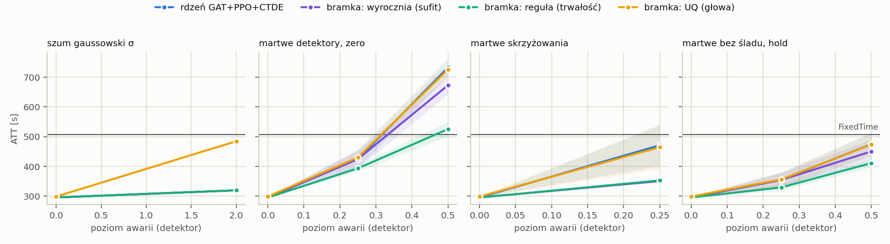
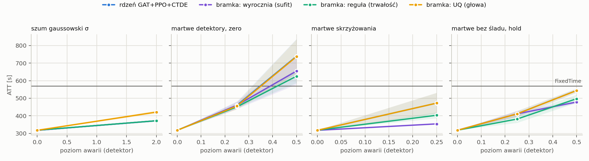

# T2 z bramką realną (reguła vs UQ) — plan `t2_gate_real`

Tryb realistic (yellow=5), 5 losowań awarii na scenariusz, ewaluacja ZAMROŻONYCH sterowników (`tsc degrade`). Wszystkie czytają tę samą warstwę detektorów: MaxPressure liczy decyzję z popsutego wektora stanu, nie z silnika.

Komórka = ATT [s], średnia po losowaniach, potem po seedach polityki (± std po seedach); w nawiasie Δ względem czystego wyniku tego samego sterownika. **▲ = gorzej niż FixedTime** — tylko tam dolna warstwa fallbacku ma pole do zysku.

## cityflow_jinan3x4_4ph

FixedTime (niezależny od odczytów): **507.0 s**.

| scenariusz | rdzeń GAT+PPO+CTDE (n=3) | bramka: reguła (trwałość) (n=3) | bramka: UQ (głowa) (n=3) | bramka: wyrocznia (sufit) (n=3) |
|---|---:|---:|---:|---:|
| `clean` | 295.9 ± 0.6 | 295.7 ± 0.8 | 298.9 ± 1.6 | 295.9 ± 0.6 |
| `gauss2` | 319.9 ± 2.2 (+8.1%) | 319.9 ± 2.2 (+8.2%) | 484.9 ± 1.7 (+62.2%) | 319.9 ± 2.2 (+8.1%) |
| `mask0p25` | 424.9 ± 31.1 (+43.6%) | 393.7 ± 10.4 (+33.2%) | 430.5 ± 18.8 (+44.0%) | 424.9 ± 31.1 (+43.6%) |
| `mask0p5` | 732.6 ± 28.5 (+147.5%) ▲ | 525.7 ± 23.8 (+77.8%) ▲ | 725.7 ± 22.4 (+142.8%) ▲ | 673.0 ± 30.8 (+127.4%) ▲ |
| `mask0p25_intersection` | 471.1 ± 68.8 (+59.2%) | 353.1 ± 5.3 (+19.4%) | 464.5 ± 72.7 (+55.4%) | 350.7 ± 1.4 (+18.5%) |
| `mask0p25_hold_t60` | 354.7 ± 24.8 (+19.9%) | 329.6 ± 10.4 (+11.5%) | 356.5 ± 24.0 (+19.3%) | 354.7 ± 24.8 (+19.9%) |
| `mask0p5_hold_t60` | 475.0 ± 38.9 (+60.5%) | 411.2 ± 13.6 (+39.1%) | 473.8 ± 37.9 (+58.5%) | 450.4 ± 40.8 (+52.2%) |

* **rdzeń GAT+PPO+CTDE** — najgorszy scenariusz `mask0p5`: 732.6 s (+147.5%). Gorzej niż FixedTime w 1 scenariuszach: `mask0p5`.
* **bramka: reguła (trwałość)** — najgorszy scenariusz `mask0p5`: 525.7 s (+77.8%). Gorzej niż FixedTime w 1 scenariuszach: `mask0p5`.
* **bramka: UQ (głowa)** — najgorszy scenariusz `mask0p5`: 725.7 s (+142.8%). Gorzej niż FixedTime w 1 scenariuszach: `mask0p5`.
* **bramka: wyrocznia (sufit)** — najgorszy scenariusz `mask0p5`: 673.0 s (+127.4%). Gorzej niż FixedTime w 1 scenariuszach: `mask0p5`.

## cityflow_hangzhou4x4_4ph

FixedTime (niezależny od odczytów): **568.9 s**.

| scenariusz | rdzeń GAT+PPO+CTDE (n=3) | bramka: reguła (trwałość) (n=3) | bramka: UQ (głowa) (n=3) | bramka: wyrocznia (sufit) (n=3) |
|---|---:|---:|---:|---:|
| `clean` | 317.5 ± 1.0 | 318.1 ± 0.1 | 317.5 ± 1.0 | 317.5 ± 1.0 |
| `gauss2` | 372.1 ± 4.2 (+17.2%) | 372.1 ± 4.2 (+16.9%) | 421.3 ± 8.9 (+32.7%) | 372.1 ± 4.2 (+17.2%) |
| `mask0p25` | 460.1 ± 21.2 (+44.9%) | 451.2 ± 7.6 (+41.8%) | 455.8 ± 19.3 (+43.5%) | 460.1 ± 21.2 (+44.9%) |
| `mask0p5` | 739.2 ± 98.5 (+132.8%) ▲ | 625.4 ± 38.6 (+96.6%) ▲ | 736.9 ± 98.1 (+132.1%) ▲ | 654.7 ± 76.8 (+106.2%) ▲ |
| `mask0p25_intersection` | 472.2 ± 58.9 (+48.7%) | 403.2 ± 17.0 (+26.7%) | 472.2 ± 58.9 (+48.7%) | 354.1 ± 0.1 (+11.5%) |
| `mask0p25_hold_t60` | 411.1 ± 16.8 (+29.5%) | 381.5 ± 21.4 (+19.9%) | 411.0 ± 16.7 (+29.4%) | 411.1 ± 16.8 (+29.5%) |
| `mask0p5_hold_t60` | 544.4 ± 11.8 (+71.5%) | 497.4 ± 22.9 (+56.4%) | 544.0 ± 11.3 (+71.3%) | 478.6 ± 7.3 (+50.7%) |

* **rdzeń GAT+PPO+CTDE** — najgorszy scenariusz `mask0p5`: 739.2 s (+132.8%). Gorzej niż FixedTime w 1 scenariuszach: `mask0p5`.
* **bramka: reguła (trwałość)** — najgorszy scenariusz `mask0p5`: 625.4 s (+96.6%). Gorzej niż FixedTime w 1 scenariuszach: `mask0p5`.
* **bramka: UQ (głowa)** — najgorszy scenariusz `mask0p5`: 736.9 s (+132.1%). Gorzej niż FixedTime w 1 scenariuszach: `mask0p5`.
* **bramka: wyrocznia (sufit)** — najgorszy scenariusz `mask0p5`: 654.7 s (+106.2%). Gorzej niż FixedTime w 1 scenariuszach: `mask0p5`.

## Mechanizmy × scenariusz

Δ ATT [s] względem `rdzeń GAT+PPO+CTDE`, sparowana po (seed, losowanie); w nawiasie odsetek par (decyzja, węzeł) przejętych przez regułę. **pogrubienie** = |t| ≥ 2.8. Δ < 0 = bramka lepsza.

### cityflow_jinan3x4_4ph

| mechanizm | `clean` | `gauss2` | `mask0p25` | `mask0p5` | `mask0p25_intersection` | `mask0p25_hold_t60` | `mask0p5_hold_t60` |
|---|---:|---:|---:|---:|---:|---:|---:|
| bramka: reguła (trwałość) | -0.3 (2%) | +0.0 (0%) | **-31.2** (16%) | **-206.9** (57%) | **-118.0** (26%) | -25.1 (11%) | **-63.8** (42%) |
| bramka: UQ (głowa) | **+3.0** (3%) | **+165.0** (92%) | +5.5 (8%) | -6.8 (3%) | -6.5 (4%) | +1.8 (4%) | -1.2 (6%) |
| bramka: wyrocznia (sufit) | +0.0 (0%) | +0.0 (0%) | +0.0 (0%) | **-59.5** (10%) | **-120.4** (27%) | +0.0 (0%) | **-24.6** (8%) |

Jakość detekcji względem wyroczni (precyzja / czułość; „—” = nie było czego wykrywać albo bramka nie strzeliła):

| mechanizm | `clean` | `gauss2` | `mask0p25` | `mask0p5` | `mask0p25_intersection` | `mask0p25_hold_t60` | `mask0p5_hold_t60` |
|---|---:|---:|---:|---:|---:|---:|---:|
| bramka: reguła (trwałość) | 0.00 / — | — | 0.17 / 0.31 | 0.73 / 0.70 | 0.89 / 0.90 | 0.15 / 0.27 | 0.71 / 0.67 |
| bramka: UQ (głowa) | 0.00 / — | 0.00 / — | 0.10 / 0.13 | 0.61 / 0.04 | 0.50 / 0.14 | 0.02 / 0.02 | 0.61 / 0.06 |

### cityflow_hangzhou4x4_4ph

| mechanizm | `clean` | `gauss2` | `mask0p25` | `mask0p5` | `mask0p25_intersection` | `mask0p25_hold_t60` | `mask0p5_hold_t60` |
|---|---:|---:|---:|---:|---:|---:|---:|
| bramka: reguła (trwałość) | +0.6 (1%) | +0.0 (0%) | -8.9 (3%) | **-113.8** (14%) | **-69.0** (7%) | -29.6 (2%) | -47.0 (7%) |
| bramka: UQ (głowa) | +0.0 (0%) | **+49.3** (26%) | -4.3 (0%) | -2.2 (0%) | +0.1 (0%) | -0.1 (0%) | -0.4 (0%) |
| bramka: wyrocznia (sufit) | +0.0 (0%) | +0.0 (0%) | +0.0 (0%) | **-84.4** (14%) | **-118.0** (22%) | +0.0 (0%) | **-65.8** (10%) |

Jakość detekcji względem wyroczni (precyzja / czułość; „—” = nie było czego wykrywać albo bramka nie strzeliła):

| mechanizm | `clean` | `gauss2` | `mask0p25` | `mask0p5` | `mask0p25_intersection` | `mask0p25_hold_t60` | `mask0p5_hold_t60` |
|---|---:|---:|---:|---:|---:|---:|---:|
| bramka: reguła (trwałość) | 0.00 / — | — | 0.26 / 0.08 | 0.89 / 0.19 | 0.74 / 0.23 | 0.02 / 0.00 | 0.66 / 0.10 |
| bramka: UQ (głowa) | — | 0.00 / — | 0.83 / 0.01 | 0.30 / 0.00 | 1.00 / 0.00 | 0.00 / 0.00 | 1.00 / 0.00 |

## Kontrola: ewaluator mierzy tę samą politykę co T1

Czysty wynik ewaluatora vs ostatni test treningu, 6 biegów uczonych: największa różnica **0.000 s** — zgodne co do precyzji logu.

## Czego ta tabela NIE mówi

* Poziomy są poziomami DETEKTORA. Na cechę `gauss` przenosi się ze współczynnikiem ~0,8–0,9, `urand` jest ~1,6× słabszy przy tym samym `level` (`results/sensor_severity.md`).
* Maska z podstawieniem `zero` zmienia znacznie mniej komórek cech, niż wynosi ułamek martwych pasów (zero jest wartością modalną) — ta sama liczba nie znaczy tego samego na sieciach o różnym obciążeniu.
* Scenariusze `hold` zaczynają się w decyzji 60 (15. minuta), więc pierwsza ćwiartka epizodu jest czysta — ich Δ nie jest porównywalne wprost z maską od początku.
