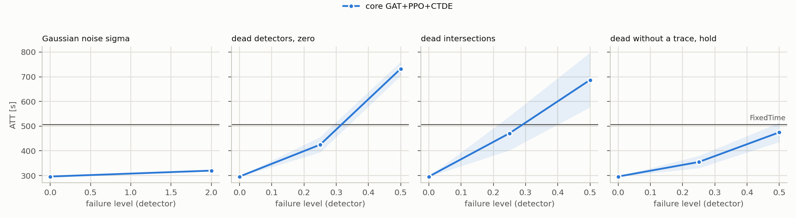
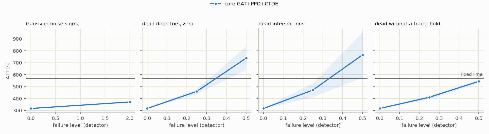

# T2: plan `t2_gate_thr`

Mode realistic (yellow=5), 5 failure draws per scenario, evaluation of FROZEN controllers (`tsc degrade`). All read the same detector layer: MaxPressure computes its decision from the broken state vector, not the engine.

Cell = ATT [s], the mean over draws, then over policy seeds (+- std over seeds); in brackets delta relative to the same controller's clean result. **(!) = worse than FixedTime**, the only place the fallback's lower layer can gain.

## cityflow_jinan3x4_4ph

FixedTime (independent of readings): **507.0 s**.

| scenario | core GAT+PPO+CTDE (n=3) | gatppo_gate_t0p125 (n=3) | gatppo_gate_t0p250 (n=3) | gatppo_gate_t0p500 (n=3) | gatppo_gate_auto (n=3) |
|---|---:|---:|---:|---:|---:|
| `clean` | 295.9 +- 0.6 | 306.9 +- 3.2 | 295.7 +- 0.8 | 295.9 +- 0.6 | 295.7 +- 0.8 |
| `gauss2` | 319.9 +- 2.2 (+8.1%) | 319.9 +- 2.2 (+4.2%) | 319.9 +- 2.2 (+8.2%) | 319.9 +- 2.2 (+8.1%) | 319.9 +- 2.2 (+8.2%) |
| `mask0p25` | 424.9 +- 31.1 (+43.6%) | 407.1 +- 1.6 (+32.6%) | 393.7 +- 10.4 (+33.2%) | 415.9 +- 26.4 (+40.5%) | 393.7 +- 10.4 (+33.2%) |
| `mask0p5` | 732.6 +- 28.5 (+147.5%) (!) | 497.9 +- 21.4 (+62.3%) | 525.7 +- 23.8 (+77.8%) (!) | 627.3 +- 12.1 (+112.0%) (!) | 525.7 +- 23.8 (+77.8%) (!) |
| `mask0p25_intersection` | 471.1 +- 68.8 (+59.2%) | 368.3 +- 5.4 (+20.0%) | 353.1 +- 5.3 (+19.4%) | 362.9 +- 9.3 (+22.6%) | 353.1 +- 5.3 (+19.4%) |
| `mask0p5_intersection` | 687.0 +- 110.5 (+132.2%) (!) | 413.1 +- 3.9 (+34.6%) | 399.5 +- 2.9 (+35.1%) | 405.3 +- 8.1 (+36.9%) | 399.5 +- 2.9 (+35.1%) |
| `mask0p25_hold_t60` | 354.7 +- 24.8 (+19.9%) | 363.1 +- 4.5 (+18.3%) | 329.6 +- 10.4 (+11.5%) | 350.3 +- 24.3 (+18.4%) | 329.6 +- 10.4 (+11.5%) |
| `mask0p5_hold_t60` | 475.0 +- 38.9 (+60.5%) | 412.4 +- 9.1 (+34.4%) | 411.2 +- 13.6 (+39.1%) | 429.5 +- 34.3 (+45.1%) | 411.2 +- 13.6 (+39.1%) |

* **core GAT+PPO+CTDE**: worst scenario `mask0p5`: 732.6 s (+147.5%). Worse than FixedTime in 2 scenarios: `mask0p5`, `mask0p5_intersection`.
* **gatppo_gate_t0p125**: worst scenario `mask0p5`: 497.9 s (+62.3%). Never falls below FixedTime: at these levels a fallback to FixedTime has nothing to gain.
* **gatppo_gate_t0p250**: worst scenario `mask0p5`: 525.7 s (+77.8%). Worse than FixedTime in 1 scenarios: `mask0p5`.
* **gatppo_gate_t0p500**: worst scenario `mask0p5`: 627.3 s (+112.0%). Worse than FixedTime in 1 scenarios: `mask0p5`.
* **gatppo_gate_auto**: worst scenario `mask0p5`: 525.7 s (+77.8%). Worse than FixedTime in 1 scenarios: `mask0p5`.

## cityflow_hangzhou4x4_4ph

FixedTime (independent of readings): **568.9 s**.

| scenario | core GAT+PPO+CTDE (n=3) | gatppo_gate_t0p125 (n=3) | gatppo_gate_t0p250 (n=3) | gatppo_gate_t0p500 (n=3) | gatppo_gate_auto (n=3) |
|---|---:|---:|---:|---:|---:|
| `clean` | 317.5 +- 1.0 | 467.1 +- 7.4 | 350.0 +- 5.5 | 322.0 +- 0.5 | 318.1 +- 0.1 |
| `gauss2` | 372.1 +- 4.2 (+17.2%) | 372.1 +- 4.2 (-20.3%) | 372.1 +- 4.2 (+6.3%) | 372.1 +- 4.2 (+15.6%) | 372.1 +- 4.2 (+16.9%) |
| `mask0p25` | 460.1 +- 21.2 (+44.9%) | 550.7 +- 2.8 (+17.9%) | 518.9 +- 7.5 (+48.2%) | 425.7 +- 5.4 (+32.2%) | 451.2 +- 7.6 (+41.8%) |
| `mask0p5` | 739.2 +- 98.5 (+132.8%) (!) | 564.7 +- 2.2 (+20.9%) | 564.4 +- 3.4 (+61.2%) | 547.5 +- 11.8 (+70.1%) | 625.4 +- 38.6 (+96.6%) (!) |
| `mask0p25_intersection` | 472.2 +- 58.9 (+48.7%) | 513.5 +- 8.6 (+9.9%) | 398.2 +- 0.7 (+13.8%) | 362.2 +- 0.8 (+12.5%) | 403.2 +- 17.0 (+26.7%) |
| `mask0p5_intersection` | 765.9 +- 188.2 (+141.2%) (!) | 541.0 +- 6.5 (+15.8%) | 489.0 +- 1.9 (+39.7%) | 450.8 +- 4.8 (+40.0%) | 538.4 +- 43.6 (+69.2%) |
| `mask0p25_hold_t60` | 411.1 +- 16.8 (+29.5%) | 537.5 +- 0.6 (+15.1%) | 435.6 +- 18.9 (+24.4%) | 378.8 +- 22.3 (+17.7%) | 381.5 +- 21.4 (+19.9%) |
| `mask0p5_hold_t60` | 544.4 +- 11.8 (+71.5%) | 542.8 +- 1.1 (+16.2%) | 457.6 +- 21.9 (+30.7%) | 431.3 +- 21.7 (+34.0%) | 497.4 +- 22.9 (+56.4%) |

* **core GAT+PPO+CTDE**: worst scenario `mask0p5_intersection`: 765.9 s (+141.2%). Worse than FixedTime in 2 scenarios: `mask0p5`, `mask0p5_intersection`.
* **gatppo_gate_t0p125**: worst scenario `mask0p5`: 564.7 s (+20.9%). Never falls below FixedTime: at these levels a fallback to FixedTime has nothing to gain.
* **gatppo_gate_t0p250**: worst scenario `mask0p5`: 564.4 s (+61.2%). Never falls below FixedTime: at these levels a fallback to FixedTime has nothing to gain.
* **gatppo_gate_t0p500**: worst scenario `mask0p5`: 547.5 s (+70.1%). Never falls below FixedTime: at these levels a fallback to FixedTime has nothing to gain.
* **gatppo_gate_auto**: worst scenario `mask0p5`: 625.4 s (+96.6%). Worse than FixedTime in 1 scenarios: `mask0p5`.

## Mechanisms x scenario

delta ATT [s] of the ASSESSED COLUMN relative to `core GAT+PPO+CTDE`, paired by (seed, draw). In brackets the share of (decision, node) pairs taken over by the rule. **bold** = |t| >= 2.8. delta < 0 = the assessed column is better than the reference.

### cityflow_jinan3x4_4ph

| mechanism | `clean` | `gauss2` | `mask0p25` | `mask0p5` | `mask0p25_intersection` | `mask0p5_intersection` | `mask0p25_hold_t60` | `mask0p5_hold_t60` |
|---|---:|---:|---:|---:|---:|---:|---:|---:|
| gatppo_gate_t0p125 | **+10.9** (12%) | +0.0 (0%) | -17.9 (55%) | **-234.7** (85%) | **-102.8** (36%) | **-273.9** (57%) | +8.4 (46%) | **-62.6** (69%) |
| gatppo_gate_t0p250 | -0.3 (2%) | +0.0 (0%) | **-31.2** (16%) | **-206.9** (57%) | **-118.0** (26%) | **-287.5** (49%) | -25.1 (11%) | **-63.8** (42%) |
| gatppo_gate_t0p500 | +0.0 (0%) | +0.0 (0%) | -9.1 (1%) | **-105.3** (23%) | **-108.2** (19%) | **-281.8** (43%) | -4.4 (0%) | **-45.5** (12%) |
| gatppo_gate_auto | -0.3 (2%) | +0.0 (0%) | **-31.2** (16%) | **-206.9** (57%) | **-118.0** (26%) | **-287.5** (49%) | -25.1 (11%) | **-63.8** (42%) |

Detection quality relative to the oracle (precision / recall; "-" = nothing to detect or the gate did not fire):

| mechanism | `clean` | `gauss2` | `mask0p25` | `mask0p5` | `mask0p25_intersection` | `mask0p5_intersection` | `mask0p25_hold_t60` | `mask0p5_hold_t60` |
|---|---:|---:|---:|---:|---:|---:|---:|---:|
| gatppo_gate_t0p125 | 0.00 / - | - | 0.09 / 0.72 | 0.64 / 0.87 | 0.62 / 0.90 | 0.79 / 0.95 | 0.08 / 0.72 | 0.59 / 0.87 |
| gatppo_gate_t0p250 | 0.00 / - | - | 0.17 / 0.31 | 0.73 / 0.70 | 0.89 / 0.90 | 0.92 / 0.95 | 0.15 / 0.27 | 0.71 / 0.67 |
| gatppo_gate_t0p500 | - | - | 0.33 / 0.04 | 0.89 / 0.32 | 0.94 / 0.63 | 1.00 / 0.88 | 0.67 / 0.02 | 0.96 / 0.23 |
| gatppo_gate_auto | 0.00 / - | - | 0.17 / 0.31 | 0.73 / 0.70 | 0.89 / 0.90 | 0.92 / 0.95 | 0.15 / 0.27 | 0.71 / 0.67 |

### cityflow_hangzhou4x4_4ph

| mechanism | `clean` | `gauss2` | `mask0p25` | `mask0p5` | `mask0p25_intersection` | `mask0p5_intersection` | `mask0p25_hold_t60` | `mask0p5_hold_t60` |
|---|---:|---:|---:|---:|---:|---:|---:|---:|
| gatppo_gate_t0p125 | **+149.6** (60%) | +0.0 (0%) | **+90.5** (82%) | **-174.5** (91%) | +41.4 (75%) | **-225.0** (86%) | **+126.4** (79%) | -1.6 (87%) |
| gatppo_gate_t0p250 | **+32.5** (30%) | +0.0 (0%) | **+58.8** (60%) | **-174.7** (81%) | -73.9 (51%) | **-276.9** (72%) | +24.5 (54%) | **-86.8** (72%) |
| gatppo_gate_t0p500 | **+4.4** (9%) | +0.0 (0%) | -34.5 (23%) | **-191.6** (55%) | **-110.0** (26%) | **-315.1** (49%) | -32.3 (18%) | **-113.1** (41%) |
| gatppo_gate_auto | +0.6 (1%) | +0.0 (0%) | -8.9 (3%) | **-113.8** (14%) | **-69.0** (7%) | **-227.5** (19%) | -29.6 (2%) | -47.0 (7%) |

Detection quality relative to the oracle (precision / recall; "-" = nothing to detect or the gate did not fire):

| mechanism | `clean` | `gauss2` | `mask0p25` | `mask0p5` | `mask0p25_intersection` | `mask0p5_intersection` | `mask0p25_hold_t60` | `mask0p5_hold_t60` |
|---|---:|---:|---:|---:|---:|---:|---:|---:|
| gatppo_gate_t0p125 | 0.00 / - | - | 0.14 / 0.81 | 0.70 / 0.92 | 0.25 / 0.81 | 0.50 / 0.90 | 0.10 / 0.79 | 0.57 / 0.95 |
| gatppo_gate_t0p250 | 0.00 / - | - | 0.12 / 0.56 | 0.72 / 0.86 | 0.37 / 0.83 | 0.60 / 0.91 | 0.09 / 0.50 | 0.60 / 0.85 |
| gatppo_gate_t0p500 | 0.00 / - | - | 0.17 / 0.31 | 0.78 / 0.62 | 0.63 / 0.72 | 0.85 / 0.87 | 0.14 / 0.25 | 0.69 / 0.55 |
| gatppo_gate_auto | 0.00 / - | - | 0.26 / 0.08 | 0.89 / 0.19 | 0.74 / 0.23 | 0.95 / 0.36 | 0.02 / 0.00 | 0.66 / 0.10 |

## Check: the evaluator measures the same policy as T1

The evaluator's clean result vs the last training test, 6 learned runs: largest difference **0.000 s**, consistent to the log's precision.

## What this table does NOT say

* Levels are DETECTOR levels. For `gauss` they transfer to the feature with a factor of ~0.8-0.9, `urand` is ~1.6x weaker at the same `level` (`results/sensor_severity.md`).
* A mask with `zero` substitution changes far fewer feature cells than the fraction of dead lanes (zero is the modal value); the same number does not mean the same thing on networks with different loads.
* `hold` scenarios start at decision 60 (minute 15), so the first quarter of the episode is clean; their delta is not directly comparable with a mask from the start.
