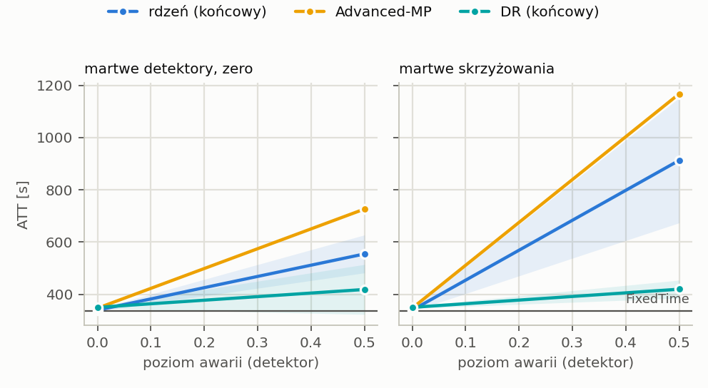
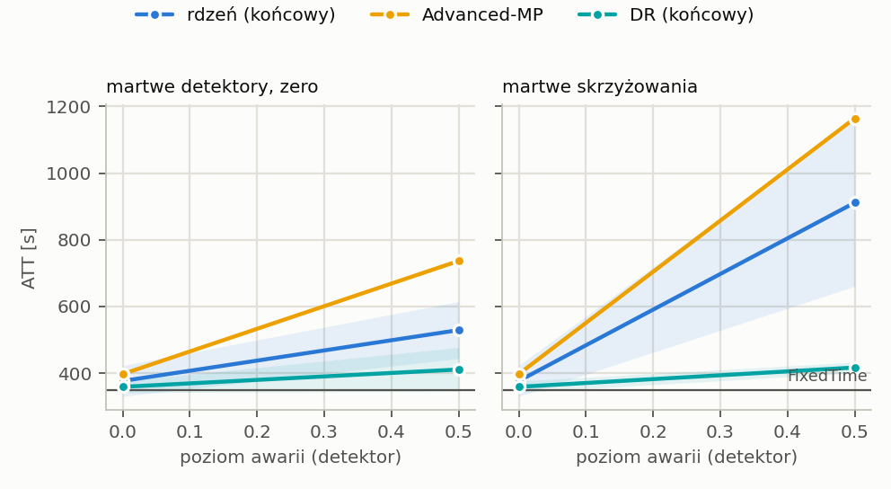

# T2 — plan `t2_krakow_best`

Tryb realistic (yellow=5), 3 losowań awarii na scenariusz, ewaluacja ZAMROŻONYCH sterowników (`tsc degrade`). Wszystkie czytają tę samą warstwę detektorów: MaxPressure liczy decyzję z popsutego wektora stanu, nie z silnika.

Komórka = ATT [s], średnia po losowaniach, potem po seedach polityki (± std po seedach); w nawiasie Δ względem czystego wyniku tego samego sterownika. **▲ = gorzej niż FixedTime** — tylko tam dolna warstwa fallbacku ma pole do zysku.

## sumo_krakow3w_mid_s1

FixedTime (niezależny od odczytów): **336.6 s**.

| scenariusz | rdzeń (końcowy) (n=3) | rdzeń (najlepszy) (n=3) | DR (końcowy) (n=3) | DR (najlepszy) (n=3) | DR (najlepszy) + bramka-reguła (n=3) | Advanced-MP (n=1) |
|---|---:|---:|---:|---:|---:|---:|
| `clean` | 339.4 ± 4.4 ▲ | 340.5 ± 0.9 ▲ | 350.2 ± 4.0 ▲ | 352.6 ± 10.6 ▲ | 359.8 ± 18.8 ▲ | 347.0 ▲ |
| `mask0p5` | 554.6 ± 72.6 (+63.4%) ▲ | 633.8 ± 127.6 (+86.1%) ▲ | 418.6 ± 95.6 (+19.5%) ▲ | 396.8 ± 27.4 (+12.6%) ▲ | 379.2 ± 23.7 (+5.4%) ▲ | 726.3 (+109.3%) ▲ |
| `mask0p5_intersection` | 912.7 ± 239.2 (+168.9%) ▲ | 737.8 ± 137.5 (+116.7%) ▲ | 419.6 ± 34.5 (+19.8%) ▲ | 453.4 ± 30.3 (+28.6%) ▲ | 353.2 ± 5.2 (-1.9%) ▲ | 1167.3 (+236.4%) ▲ |

* **rdzeń (końcowy)** — najgorszy scenariusz `mask0p5_intersection`: 912.7 s (+168.9%). Gorzej niż FixedTime w 2 scenariuszach: `mask0p5`, `mask0p5_intersection`.
* **rdzeń (najlepszy)** — najgorszy scenariusz `mask0p5_intersection`: 737.8 s (+116.7%). Gorzej niż FixedTime w 2 scenariuszach: `mask0p5`, `mask0p5_intersection`.
* **DR (końcowy)** — najgorszy scenariusz `mask0p5_intersection`: 419.6 s (+19.8%). Gorzej niż FixedTime w 2 scenariuszach: `mask0p5`, `mask0p5_intersection`.
* **DR (najlepszy)** — najgorszy scenariusz `mask0p5_intersection`: 453.4 s (+28.6%). Gorzej niż FixedTime w 2 scenariuszach: `mask0p5`, `mask0p5_intersection`.
* **DR (najlepszy) + bramka-reguła** — najgorszy scenariusz `mask0p5`: 379.2 s (+5.4%). Gorzej niż FixedTime w 2 scenariuszach: `mask0p5`, `mask0p5_intersection`.
* **Advanced-MP** — najgorszy scenariusz `mask0p5_intersection`: 1167.3 s (+236.4%). Gorzej niż FixedTime w 2 scenariuszach: `mask0p5`, `mask0p5_intersection`.

## sumo_krakow3w_mid

FixedTime (niezależny od odczytów): **347.6 s**.

| scenariusz | rdzeń (końcowy) (n=3) | rdzeń (najlepszy) (n=3) | DR (końcowy) (n=3) | DR (najlepszy) (n=3) | DR (najlepszy) + bramka-reguła (n=3) | Advanced-MP (n=1) |
|---|---:|---:|---:|---:|---:|---:|
| `clean` | 376.3 ± 46.1 ▲ | 326.8 ± 9.4 | 358.7 ± 17.2 ▲ | 323.9 ± 5.6 | 341.9 ± 23.7 | 396.9 ▲ |
| `mask0p5` | 529.0 ± 85.4 (+40.6%) ▲ | 561.8 ± 32.7 (+71.9%) ▲ | 410.8 ± 66.0 (+14.5%) ▲ | 452.2 ± 55.6 (+39.6%) ▲ | 399.0 ± 15.8 (+16.7%) ▲ | 736.5 (+85.6%) ▲ |
| `mask0p5_intersection` | 911.4 ± 250.9 (+142.2%) ▲ | 771.9 ± 143.4 (+136.2%) ▲ | 416.7 ± 16.0 (+16.2%) ▲ | 453.3 ± 24.7 (+39.9%) ▲ | 365.5 ± 3.7 (+6.9%) ▲ | 1164.6 (+193.4%) ▲ |

* **rdzeń (końcowy)** — najgorszy scenariusz `mask0p5_intersection`: 911.4 s (+142.2%). Gorzej niż FixedTime w 2 scenariuszach: `mask0p5`, `mask0p5_intersection`.
* **rdzeń (najlepszy)** — najgorszy scenariusz `mask0p5_intersection`: 771.9 s (+136.2%). Gorzej niż FixedTime w 2 scenariuszach: `mask0p5`, `mask0p5_intersection`.
* **DR (końcowy)** — najgorszy scenariusz `mask0p5_intersection`: 416.7 s (+16.2%). Gorzej niż FixedTime w 2 scenariuszach: `mask0p5`, `mask0p5_intersection`.
* **DR (najlepszy)** — najgorszy scenariusz `mask0p5_intersection`: 453.3 s (+39.9%). Gorzej niż FixedTime w 2 scenariuszach: `mask0p5`, `mask0p5_intersection`.
* **DR (najlepszy) + bramka-reguła** — najgorszy scenariusz `mask0p5`: 399.0 s (+16.7%). Gorzej niż FixedTime w 2 scenariuszach: `mask0p5`, `mask0p5_intersection`.
* **Advanced-MP** — najgorszy scenariusz `mask0p5_intersection`: 1164.6 s (+193.4%). Gorzej niż FixedTime w 2 scenariuszach: `mask0p5`, `mask0p5_intersection`.

## Ramię: rdzeń (najlepszy) vs rdzeń (końcowy)

Kolumny mają RÓŻNE checkpointy (osobne treningi), więc parujemy po (sieć, scenariusz, seed, losowanie): wspólne zostają ruch i wzorzec awarii, rozrzut między seedami wchodzi do różnicy. Kolumna odniesienia jest wskazana w planie (`baseline: gatppo`), a nie domyślona. `Δ` < 0 = ramię lepsze. `|t| ≥ 2.8` to próg po poprawce na tyle porównań, ile ma ta tabela.

Kolumny różni SPOSÓB TRENOWANIA, nie mechanizm włączany w inferencji, więc nie ma diagnostyki „czy mechanizm wystartował” — jest albo go nie ma już na poziomie wag. Rozrzut między seedami wchodzi tu do różnicy w całości (patrz zdanie o parowaniu wyżej), a liczba NIEZALEŻNYCH replikacji to liczba seedów, nie liczba par: losowania awarii dzielą checkpoint, więc |t| jest wobec nich optymistyczne.

### sumo_krakow3w_mid_s1

| scenariusz | Δ ATT [s] | sd | t | lepszy w |
|---|---:|---:|---:|---:|
| `clean` | +1.10 | 3.6 | +0.53 | 1/3 |
| `mask0p5` | +79.21 | 240.4 | +0.99 | 7/9 |
| `mask0p5_intersection` | -174.90 | 298.3 | -1.76 | 6/9 |

* Żaden scenariusz nie przekracza progu — ramię jest wobec ATT **neutralne**.

### sumo_krakow3w_mid

| scenariusz | Δ ATT [s] | sd | t | lepszy w |
|---|---:|---:|---:|---:|
| `clean` | -49.56 | 51.3 | -1.67 | 3/3 |
| `mask0p5` | +32.83 | 133.2 | +0.74 | 5/9 |
| `mask0p5_intersection` | -139.50 | 309.9 | -1.35 | 6/9 |

* Żaden scenariusz nie przekracza progu — ramię jest wobec ATT **neutralne**.

## Ramię: DR (najlepszy) vs DR (końcowy)

Kolumny mają RÓŻNE checkpointy (osobne treningi), więc parujemy po (sieć, scenariusz, seed, losowanie): wspólne zostają ruch i wzorzec awarii, rozrzut między seedami wchodzi do różnicy. Kolumna odniesienia jest wskazana w planie (`baseline: gatppo_fail`), a nie domyślona. `Δ` < 0 = ramię lepsze. `|t| ≥ 2.8` to próg po poprawce na tyle porównań, ile ma ta tabela.

Kolumny różni SPOSÓB TRENOWANIA, nie mechanizm włączany w inferencji, więc nie ma diagnostyki „czy mechanizm wystartował” — jest albo go nie ma już na poziomie wag. Rozrzut między seedami wchodzi tu do różnicy w całości (patrz zdanie o parowaniu wyżej), a liczba NIEZALEŻNYCH replikacji to liczba seedów, nie liczba par: losowania awarii dzielą checkpoint, więc |t| jest wobec nich optymistyczne.

### sumo_krakow3w_mid_s1

| scenariusz | Δ ATT [s] | sd | t | lepszy w |
|---|---:|---:|---:|---:|
| `clean` | +2.40 | 12.4 | +0.33 | 2/3 |
| `mask0p5` | -21.75 | 163.9 | -0.40 | 3/9 |
| `mask0p5_intersection` | +33.78 | 70.3 | +1.44 | 3/9 |

* Żaden scenariusz nie przekracza progu — ramię jest wobec ATT **neutralne**.

### sumo_krakow3w_mid

| scenariusz | Δ ATT [s] | sd | t | lepszy w |
|---|---:|---:|---:|---:|
| `clean` | **-34.74** | 20.6 | -2.92 | 3/3 |
| `mask0p5` | +41.46 | 176.0 | +0.71 | 4/9 |
| `mask0p5_intersection` | +36.60 | 65.1 | +1.69 | 3/9 |

* Powyżej progu: `clean` (-34.74 s, t = -2.92, lepszy w 3/3 parach)

## Mechanizm: DR (najlepszy) + bramka-reguła vs DR (najlepszy)

Obie kolumny liczą się z TEGO SAMEGO checkpointu i tych samych losowań awarii (`draw` wybiera, które detektory padły), więc porównujemy je **parami**, nie przez ±std z tabeli wyżej: wspólny rozrzut między seedami i losowaniami skraca się w różnicy. `Δ` < 0 = mechanizm lepszy. `|t| ≥ 2.8` to próg po poprawce na tyle porównań, ile ma ta tabela.

`gate_share` = odsetek par (decyzja, węzeł), w których sterowanie przejęła reguła. `gate_switches` = liczba ZMIAN trybu na węzłach w epizodzie — to one psują ruch (przełączenie resetuje fazę), a nie sam udział. `gate_precision` i `gate_recall` liczą się względem WYROCZNI (prawda z warstwy awarii, wyłącznie diagnostycznie) i rozdzielają „detektor jest słaby” od „przełączanie mało daje” — dwie rzeczy, które samo ATT skleja.

### sumo_krakow3w_mid_s1

| scenariusz | gate_share | gate_switches | gate_precision | gate_recall | Δ ATT [s] | sd | t | lepszy w |
|---|---:|---:|---:|---:|---:|---:|---:|---:|
| `clean` | 1.2% | 13.33 | 0.00 | — | +7.29 | 8.5 | +1.49 | 1/3 |
| `mask0p5` | 21.9% | 47.56 | 0.91 | 0.39 | -17.57 | 39.4 | -1.34 | 6/9 |
| `mask0p5_intersection` | 39.9% | 46.67 | 0.96 | 0.82 | **-100.21** | 61.8 | -4.87 | 9/9 |

* Powyżej progu: `mask0p5_intersection` (-100.21 s, t = -4.87, lepszy w 9/9 parach)

### sumo_krakow3w_mid

| scenariusz | gate_share | gate_switches | gate_precision | gate_recall | Δ ATT [s] | sd | t | lepszy w |
|---|---:|---:|---:|---:|---:|---:|---:|---:|
| `clean` | 0.1% | 2.00 | 0.00 | — | +17.99 | 18.5 | +1.68 | 0/2 |
| `mask0p5` | 15.9% | 43.56 | 0.94 | 0.29 | -53.29 | 116.9 | -1.37 | 5/9 |
| `mask0p5_intersection` | 37.4% | 39.89 | 1.00 | 0.80 | **-87.77** | 69.9 | -3.77 | 9/9 |

* Powyżej progu: `mask0p5_intersection` (-87.77 s, t = -3.77, lepszy w 9/9 parach)

## Kontrola: ewaluator mierzy tę samą politykę co T1

Czysty wynik ewaluatora vs ostatni test treningu, 6 biegów uczonych: największa różnica **0.000 s** — zgodne co do precyzji logu.

## Czego ta tabela NIE mówi

* Poziomy są poziomami DETEKTORA. Na cechę `gauss` przenosi się ze współczynnikiem ~0,8–0,9, `urand` jest ~1,6× słabszy przy tym samym `level` (`results/sensor_severity.md`).
* Maska z podstawieniem `zero` zmienia znacznie mniej komórek cech, niż wynosi ułamek martwych pasów (zero jest wartością modalną) — ta sama liczba nie znaczy tego samego na sieciach o różnym obciążeniu.
* Scenariusze `hold` zaczynają się w decyzji 60 (15. minuta), więc pierwsza ćwiartka epizodu jest czysta — ich Δ nie jest porównywalne wprost z maską od początku.
