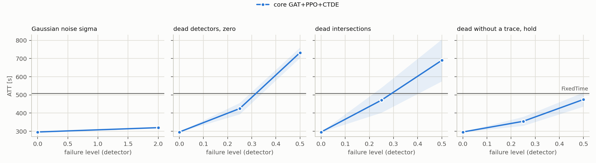
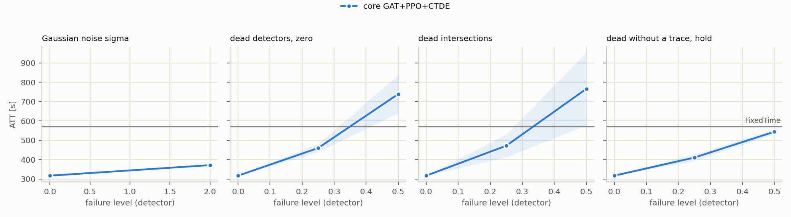

# T2: plan `t2_mask`

Mode realistic (yellow=5), 5 failure draws per scenario, evaluation of FROZEN controllers (`tsc degrade`). All read the same detector layer: MaxPressure computes its decision from the broken state vector, not the engine.

Cell = ATT [s], the mean over draws, then over policy seeds (+- std over seeds); in brackets delta relative to the same controller's clean result. **(!) = worse than FixedTime**, the only place the fallback's lower layer can gain.

## cityflow_jinan3x4_4ph

FixedTime (independent of readings): **507.0 s**.

| scenario | core GAT+PPO+CTDE (n=3) | gatppo_mask_k24 (n=3) | gatppo_mask_k16 (n=3) | gatppo_mask_k8 (n=3) | gatppo_mask_k4 (n=3) |
|---|---:|---:|---:|---:|---:|
| `clean` | 295.9 +- 0.6 | 296.5 +- 0.3 | 296.6 +- 0.7 | 308.8 +- 0.6 | 438.9 +- 2.8 |
| `gauss2` | 319.9 +- 2.2 (+8.1%) | 319.5 +- 2.2 (+7.8%) | 320.4 +- 1.5 (+8.0%) | 330.1 +- 2.1 (+6.9%) | 450.2 +- 4.5 (+2.6%) |
| `mask0p25` | 424.9 +- 31.1 (+43.6%) | 398.0 +- 16.7 (+34.2%) | 386.8 +- 15.1 (+30.4%) | 377.7 +- 6.9 (+22.3%) | 459.9 +- 8.2 (+4.8%) |
| `mask0p5` | 732.6 +- 28.5 (+147.5%) (!) | 664.5 +- 23.4 (+124.1%) (!) | 636.7 +- 20.3 (+114.7%) (!) | 571.3 +- 6.0 (+85.0%) (!) | 522.0 +- 3.6 (+18.9%) (!) |
| `mask0p25_intersection` | 471.1 +- 68.8 (+59.2%) | 455.4 +- 47.5 (+53.6%) | 435.0 +- 38.0 (+46.6%) | 402.5 +- 24.0 (+30.4%) | 468.8 +- 14.3 (+6.8%) |
| `mask0p5_intersection` | 690.0 +- 115.3 (+133.2%) (!) | 620.6 +- 89.5 (+109.3%) (!) | 601.6 +- 77.6 (+102.8%) (!) | 520.9 +- 57.4 (+68.7%) (!) | 507.5 +- 17.5 (+15.6%) (!) |
| `mask0p25_hold_t60` | 354.7 +- 24.8 (+19.9%) | 332.7 +- 4.9 (+12.2%) | 323.9 +- 6.4 (+9.2%) | 326.3 +- 5.9 (+5.7%) | 437.2 +- 1.7 (-0.4%) |
| `mask0p5_hold_t60` | 475.0 +- 38.9 (+60.5%) | 433.6 +- 9.1 (+46.2%) | 412.4 +- 34.8 (+39.0%) | 384.5 +- 3.7 (+24.5%) | 451.7 +- 1.4 (+2.9%) |

* **core GAT+PPO+CTDE**: worst scenario `mask0p5`: 732.6 s (+147.5%). Worse than FixedTime in 2 scenarios: `mask0p5`, `mask0p5_intersection`.
* **gatppo_mask_k24**: worst scenario `mask0p5`: 664.5 s (+124.1%). Worse than FixedTime in 2 scenarios: `mask0p5`, `mask0p5_intersection`.
* **gatppo_mask_k16**: worst scenario `mask0p5`: 636.7 s (+114.7%). Worse than FixedTime in 2 scenarios: `mask0p5`, `mask0p5_intersection`.
* **gatppo_mask_k8**: worst scenario `mask0p5`: 571.3 s (+85.0%). Worse than FixedTime in 2 scenarios: `mask0p5`, `mask0p5_intersection`.
* **gatppo_mask_k4**: worst scenario `mask0p5`: 522.0 s (+18.9%). Worse than FixedTime in 2 scenarios: `mask0p5`, `mask0p5_intersection`.

## cityflow_hangzhou4x4_4ph

FixedTime (independent of readings): **568.9 s**.

| scenario | core GAT+PPO+CTDE (n=3) | gatppo_mask_k24 (n=3) | gatppo_mask_k16 (n=3) | gatppo_mask_k8 (n=3) | gatppo_mask_k4 (n=3) |
|---|---:|---:|---:|---:|---:|
| `clean` | 317.5 +- 1.0 | 318.1 +- 0.2 | 319.3 +- 0.5 | 326.6 +- 0.6 | 442.4 +- 1.7 |
| `gauss2` | 372.1 +- 4.2 (+17.2%) | 372.2 +- 4.1 (+17.0%) | 372.0 +- 4.5 (+16.5%) | 372.7 +- 3.7 (+14.1%) | 449.5 +- 6.7 (+1.6%) |
| `mask0p25` | 460.1 +- 21.2 (+44.9%) | 427.5 +- 21.6 (+34.4%) | 418.6 +- 19.6 (+31.1%) | 395.8 +- 12.4 (+21.2%) | 470.7 +- 6.0 (+6.4%) |
| `mask0p5` | 739.2 +- 98.5 (+132.8%) (!) | 680.2 +- 82.4 (+113.8%) (!) | 636.5 +- 56.2 (+99.3%) (!) | 570.7 +- 32.7 (+74.7%) (!) | 537.8 +- 15.9 (+21.6%) |
| `mask0p25_intersection` | 472.2 +- 58.9 (+48.7%) | 445.3 +- 43.8 (+40.0%) | 429.1 +- 32.6 (+34.4%) | 404.7 +- 14.2 (+23.9%) | 477.8 +- 3.8 (+8.0%) |
| `mask0p5_intersection` | 765.9 +- 188.2 (+141.2%) (!) | 692.6 +- 117.7 (+117.8%) (!) | 653.3 +- 98.9 (+104.6%) (!) | 569.0 +- 51.2 (+74.2%) (!) | 550.0 +- 13.4 (+24.3%) |
| `mask0p25_hold_t60` | 411.1 +- 16.8 (+29.5%) | 385.8 +- 26.7 (+21.3%) | 356.9 +- 12.6 (+11.8%) | 354.6 +- 11.3 (+8.6%) | 445.1 +- 1.6 (+0.6%) |
| `mask0p5_hold_t60` | 544.4 +- 11.8 (+71.5%) | 493.8 +- 27.3 (+55.2%) | 427.9 +- 18.4 (+34.0%) | 388.5 +- 12.3 (+18.9%) | 448.0 +- 1.5 (+1.3%) |

* **core GAT+PPO+CTDE**: worst scenario `mask0p5_intersection`: 765.9 s (+141.2%). Worse than FixedTime in 2 scenarios: `mask0p5`, `mask0p5_intersection`.
* **gatppo_mask_k24**: worst scenario `mask0p5_intersection`: 692.6 s (+117.8%). Worse than FixedTime in 2 scenarios: `mask0p5`, `mask0p5_intersection`.
* **gatppo_mask_k16**: worst scenario `mask0p5_intersection`: 653.3 s (+104.6%). Worse than FixedTime in 2 scenarios: `mask0p5`, `mask0p5_intersection`.
* **gatppo_mask_k8**: worst scenario `mask0p5`: 570.7 s (+74.7%). Worse than FixedTime in 2 scenarios: `mask0p5`, `mask0p5_intersection`.
* **gatppo_mask_k4**: worst scenario `mask0p5_intersection`: 550.0 s (+24.3%). Never falls below FixedTime: at these levels a fallback to FixedTime has nothing to gain.

## Mechanisms x scenario

delta ATT [s] of the ASSESSED COLUMN relative to `core GAT+PPO+CTDE`, paired by (seed, draw). **bold** = |t| >= 2.8. delta < 0 = the assessed column is better than the reference.

### cityflow_jinan3x4_4ph

| mechanism | `clean` | `gauss2` | `mask0p25` | `mask0p5` | `mask0p25_intersection` | `mask0p5_intersection` | `mask0p25_hold_t60` | `mask0p5_hold_t60` |
|---|---:|---:|---:|---:|---:|---:|---:|---:|
| gatppo_mask_k24 | +0.6 | -0.3 | **-26.9** | **-68.1** | -15.6 | **-69.4** | -22.0 | -41.3 |
| gatppo_mask_k16 | +0.7 | +0.6 | **-38.1** | **-95.8** | **-36.1** | **-88.4** | -30.9 | **-62.6** |
| gatppo_mask_k8 | **+12.8** | **+10.3** | **-47.3** | **-161.3** | **-68.6** | **-169.1** | -28.4 | **-90.5** |
| gatppo_mask_k4 | **+143.0** | **+130.3** | +34.9 | **-210.5** | -2.3 | **-182.5** | **+82.5** | -23.3 |

### cityflow_hangzhou4x4_4ph

| mechanism | `clean` | `gauss2` | `mask0p25` | `mask0p5` | `mask0p25_intersection` | `mask0p5_intersection` | `mask0p25_hold_t60` | `mask0p5_hold_t60` |
|---|---:|---:|---:|---:|---:|---:|---:|---:|
| gatppo_mask_k24 | +0.6 | +0.1 | **-32.7** | **-59.0** | **-26.9** | **-73.3** | -25.3 | -50.7 |
| gatppo_mask_k16 | +1.8 | -0.0 | **-41.6** | **-102.7** | **-43.1** | **-112.6** | **-54.2** | **-116.5** |
| gatppo_mask_k8 | **+9.1** | +0.6 | **-64.4** | **-168.4** | **-67.4** | **-196.9** | **-56.5** | **-155.9** |
| gatppo_mask_k4 | **+124.8** | **+77.4** | +10.6 | **-201.4** | +5.7 | **-215.9** | +34.0 | **-96.5** |

## Check: the evaluator measures the same policy as T1

The evaluator's clean result vs the last training test, 30 learned runs: largest difference **146.716 s**, a MISMATCH, investigate!

## What this table does NOT say

* Levels are DETECTOR levels. For `gauss` they transfer to the feature with a factor of ~0.8-0.9, `urand` is ~1.6x weaker at the same `level` (`results/sensor_severity.md`).
* A mask with `zero` substitution changes far fewer feature cells than the fraction of dead lanes (zero is the modal value); the same number does not mean the same thing on networks with different loads.
* `hold` scenarios start at decision 60 (minute 15), so the first quarter of the episode is clean; their delta is not directly comparable with a mask from the start.
