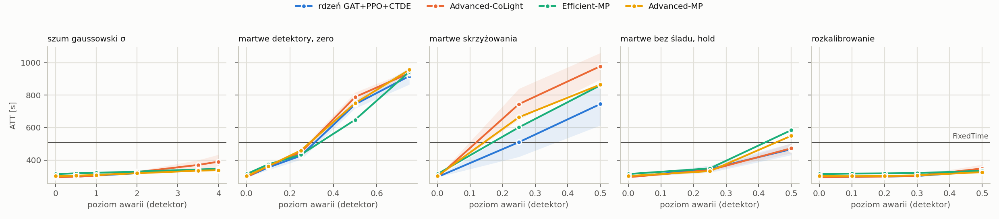
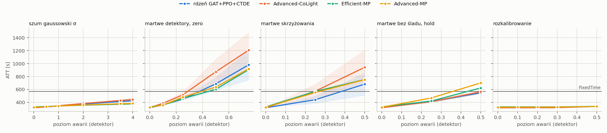

# T2 bez mechanizmu — plan `t2_nomech`

Tryb realistic (yellow=5), 5 losowań awarii na scenariusz, ewaluacja ZAMROŻONYCH sterowników (`tsc degrade`). Wszystkie czytają tę samą warstwę detektorów: MaxPressure liczy decyzję z popsutego wektora stanu, nie z silnika.

Komórka = ATT [s], średnia po losowaniach, potem po seedach polityki (± std po seedach); w nawiasie Δ względem czystego wyniku tego samego sterownika. **▲ = gorzej niż FixedTime** — tylko tam dolna warstwa fallbacku ma pole do zysku.

## cityflow_jinan3x4_4ph

FixedTime (niezależny od odczytów): **507.0 s**.

| scenariusz | rdzeń GAT+PPO+CTDE (n=5) | Advanced-CoLight (n=5) | Efficient-MP (n=1) | Advanced-MP (n=1) |
|---|---:|---:|---:|---:|
| `clean` | 295.8 ± 1.2 | 294.4 ± 1.8 | 313.9 | 301.8 |
| `gauss0p5` | 297.7 ± 0.8 (+0.7%) | 297.2 ± 1.3 (+1.0%) | 318.3 (+1.4%) | 303.8 (+0.7%) |
| `gauss1` | 304.1 ± 1.2 (+2.8%) | 304.3 ± 2.4 (+3.4%) | 321.5 (+2.4%) | 308.0 (+2.1%) |
| `gauss2` | 319.0 ± 2.0 (+7.9%) | 325.9 ± 6.5 (+10.7%) | 329.0 (+4.8%) | 318.6 (+5.6%) |
| `gauss3p5` | 340.1 ± 4.7 (+15.0%) | 370.0 ± 29.4 (+25.7%) | 342.1 (+9.0%) | 334.4 (+10.8%) |
| `gauss4` | 347.4 ± 6.7 (+17.5%) | 389.8 ± 43.3 (+32.4%) | 344.6 (+9.8%) | 338.0 (+12.0%) |
| `urand2` | 305.9 ± 0.7 (+3.4%) | 306.9 ± 2.7 (+4.3%) | 322.5 (+2.7%) | 309.9 (+2.7%) |
| `urand4` | 322.9 ± 2.9 (+9.2%) | 335.5 ± 8.3 (+14.0%) | 332.3 (+5.9%) | 324.1 (+7.4%) |
| `mask0p1` | 354.3 ± 16.1 (+19.8%) | 362.7 ± 11.0 (+23.2%) | 373.4 (+19.0%) | 362.2 (+20.0%) |
| `mask0p25` | 426.5 ± 23.9 (+44.2%) | 447.0 ± 17.2 (+51.8%) | 432.6 (+37.8%) | 459.3 (+52.2%) |
| `mask0p5` | 743.4 ± 25.2 (+151.4%) ▲ | 787.9 ± 28.8 (+167.7%) ▲ | 647.6 (+106.3%) ▲ | 750.0 (+148.5%) ▲ |
| `mask0p75` | 917.1 ± 51.7 (+210.1%) ▲ | 935.5 ± 15.0 (+217.8%) ▲ | 943.8 (+200.7%) ▲ | 956.3 (+216.9%) ▲ |
| `mask0p25_intersection` | 510.0 ± 90.2 (+72.4%) ▲ | 744.4 ± 95.1 (+152.9%) ▲ | 601.5 (+91.6%) ▲ | 663.7 (+119.9%) ▲ |
| `mask0p5_intersection` | 744.8 ± 131.3 (+151.8%) ▲ | 977.5 ± 82.0 (+232.1%) ▲ | 859.9 (+174.0%) ▲ | 864.7 (+186.5%) ▲ |
| `mask0p25_hold_t60` | 344.8 ± 22.2 (+16.6%) | 338.3 ± 8.5 (+14.9%) | 348.7 (+11.1%) | 331.7 (+9.9%) |
| `mask0p5_hold_t60` | 466.9 ± 36.1 (+57.9%) | 472.4 ± 30.4 (+60.5%) | 584.0 (+86.1%) ▲ | 549.1 (+82.0%) ▲ |
| `drift0p1` | 296.4 ± 0.8 (+0.2%) | 296.4 ± 2.9 (+0.7%) | 316.8 (+0.9%) | 301.0 (-0.3%) |
| `drift0p2` | 298.1 ± 1.2 (+0.8%) | 298.1 ± 3.6 (+1.3%) | 317.9 (+1.3%) | 302.3 (+0.2%) |
| `drift0p3` | 301.7 ± 0.7 (+2.0%) | 302.7 ± 4.2 (+2.8%) | 319.9 (+1.9%) | 305.8 (+1.3%) |
| `drift0p5` | 331.0 ± 4.6 (+11.9%) | 348.0 ± 24.1 (+18.2%) | 333.9 (+6.4%) | 325.5 (+7.9%) |

* **rdzeń GAT+PPO+CTDE** — najgorszy scenariusz `mask0p75`: 917.1 s (+210.1%). Gorzej niż FixedTime w 4 scenariuszach: `mask0p25_intersection`, `mask0p5`, `mask0p5_intersection`, `mask0p75`.
* **Advanced-CoLight** — najgorszy scenariusz `mask0p5_intersection`: 977.5 s (+232.1%). Gorzej niż FixedTime w 4 scenariuszach: `mask0p25_intersection`, `mask0p5`, `mask0p5_intersection`, `mask0p75`.
* **Efficient-MP** — najgorszy scenariusz `mask0p75`: 943.8 s (+200.7%). Gorzej niż FixedTime w 5 scenariuszach: `mask0p25_intersection`, `mask0p5`, `mask0p5_hold_t60`, `mask0p5_intersection`, `mask0p75`.
* **Advanced-MP** — najgorszy scenariusz `mask0p75`: 956.3 s (+216.9%). Gorzej niż FixedTime w 5 scenariuszach: `mask0p25_intersection`, `mask0p5`, `mask0p5_hold_t60`, `mask0p5_intersection`, `mask0p75`.

## cityflow_hangzhou4x4_4ph

FixedTime (niezależny od odczytów): **568.9 s**.

| scenariusz | rdzeń GAT+PPO+CTDE (n=5) | Advanced-CoLight (n=5) | Efficient-MP (n=1) | Advanced-MP (n=1) |
|---|---:|---:|---:|---:|
| `clean` | 317.5 ± 0.7 | 317.4 ± 0.5 | 331.2 | 325.5 |
| `gauss0p5` | 329.2 ± 0.5 (+3.7%) | 331.0 ± 1.9 (+4.3%) | 336.8 (+1.7%) | 333.8 (+2.5%) |
| `gauss1` | 345.7 ± 1.3 (+8.9%) | 348.9 ± 3.3 (+9.9%) | 344.8 (+4.1%) | 344.7 (+5.9%) |
| `gauss2` | 374.7 ± 4.8 (+18.0%) | 383.3 ± 7.8 (+20.8%) | 356.8 (+7.7%) | 360.2 (+10.6%) |
| `gauss3p5` | 413.1 ± 11.8 (+30.1%) | 430.0 ± 19.1 (+35.5%) | 372.6 (+12.5%) | 379.2 (+16.5%) |
| `gauss4` | 425.7 ± 13.5 (+34.1%) | 445.3 ± 25.3 (+40.3%) | 376.6 (+13.7%) | 384.0 (+18.0%) |
| `urand2` | 352.8 ± 2.3 (+11.1%) | 357.8 ± 4.4 (+12.7%) | 347.2 (+4.8%) | 347.8 (+6.9%) |
| `urand4` | 387.8 ± 6.2 (+22.1%) | 398.6 ± 10.4 (+25.6%) | 362.4 (+9.4%) | 366.3 (+12.5%) |
| `mask0p1` | 361.9 ± 3.6 (+14.0%) | 387.3 ± 15.4 (+22.0%) | 358.6 (+8.3%) | 359.0 (+10.3%) |
| `mask0p25` | 450.1 ± 24.7 (+41.7%) | 516.4 ± 48.8 (+62.7%) | 459.0 (+38.6%) | 480.9 (+47.7%) |
| `mask0p5` | 686.6 ± 102.7 (+116.2%) ▲ | 872.6 ± 201.8 (+174.9%) ▲ | 601.9 (+81.7%) ▲ | 637.6 (+95.9%) ▲ |
| `mask0p75` | 981.6 ± 236.6 (+209.1%) ▲ | 1208.6 ± 277.4 (+280.8%) ▲ | 908.0 (+174.1%) ▲ | 918.2 (+182.1%) ▲ |
| `mask0p25_intersection` | 442.1 ± 59.6 (+39.2%) | 573.1 ± 114.5 (+80.6%) ▲ | 569.3 (+71.9%) ▲ | 553.0 (+69.9%) |
| `mask0p5_intersection` | 682.3 ± 175.7 (+114.9%) ▲ | 942.8 ± 270.5 (+197.0%) ▲ | 754.8 (+127.9%) ▲ | 752.3 (+131.1%) ▲ |
| `mask0p25_hold_t60` | 412.2 ± 13.8 (+29.8%) | 412.4 ± 19.5 (+29.9%) | 421.4 (+27.2%) | 468.6 (+44.0%) |
| `mask0p5_hold_t60` | 548.4 ± 14.3 (+72.7%) | 564.4 ± 35.5 (+77.8%) | 623.9 (+88.4%) ▲ | 701.7 (+115.6%) ▲ |
| `drift0p1` | 317.2 ± 0.3 (-0.1%) | 317.4 ± 0.3 (-0.0%) | 330.7 (-0.1%) | 325.9 (+0.1%) |
| `drift0p2` | 318.1 ± 0.1 (+0.2%) | 318.2 ± 0.4 (+0.2%) | 330.4 (-0.3%) | 326.7 (+0.4%) |
| `drift0p3` | 319.5 ± 0.2 (+0.6%) | 319.5 ± 0.4 (+0.7%) | 330.8 (-0.1%) | 327.3 (+0.5%) |
| `drift0p5` | 338.7 ± 2.5 (+6.7%) | 339.4 ± 5.9 (+6.9%) | 338.6 (+2.2%) | 338.4 (+3.9%) |

* **rdzeń GAT+PPO+CTDE** — najgorszy scenariusz `mask0p75`: 981.6 s (+209.1%). Gorzej niż FixedTime w 3 scenariuszach: `mask0p5`, `mask0p5_intersection`, `mask0p75`.
* **Advanced-CoLight** — najgorszy scenariusz `mask0p75`: 1208.6 s (+280.8%). Gorzej niż FixedTime w 4 scenariuszach: `mask0p25_intersection`, `mask0p5`, `mask0p5_intersection`, `mask0p75`.
* **Efficient-MP** — najgorszy scenariusz `mask0p75`: 908.0 s (+174.1%). Gorzej niż FixedTime w 5 scenariuszach: `mask0p25_intersection`, `mask0p5`, `mask0p5_hold_t60`, `mask0p5_intersection`, `mask0p75`.
* **Advanced-MP** — najgorszy scenariusz `mask0p75`: 918.2 s (+182.1%). Gorzej niż FixedTime w 4 scenariuszach: `mask0p5`, `mask0p5_hold_t60`, `mask0p5_intersection`, `mask0p75`.

## Kontrola: ewaluator mierzy tę samą politykę co T1

Czysty wynik ewaluatora vs ostatni test treningu, 20 biegów uczonych: największa różnica **0.047 s** — zgodne co do precyzji logu.

## Czego ta tabela NIE mówi

* Poziomy są poziomami DETEKTORA. Na cechę `gauss` przenosi się ze współczynnikiem ~0,8–0,9, `urand` jest ~1,6× słabszy przy tym samym `level` (`results/sensor_severity.md`).
* Maska z podstawieniem `zero` zmienia znacznie mniej komórek cech, niż wynosi ułamek martwych pasów (zero jest wartością modalną) — ta sama liczba nie znaczy tego samego na sieciach o różnym obciążeniu.
* Scenariusze `hold` zaczynają się w decyzji 60 (15. minuta), więc pierwsza ćwiartka epizodu jest czysta — ich Δ nie jest porównywalne wprost z maską od początku.
