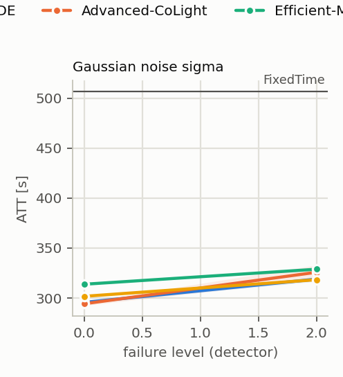
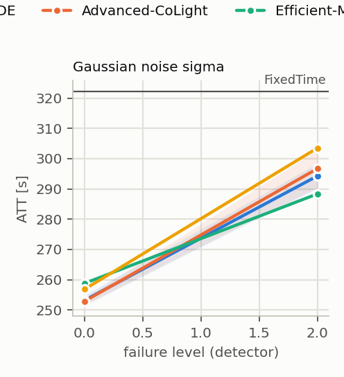
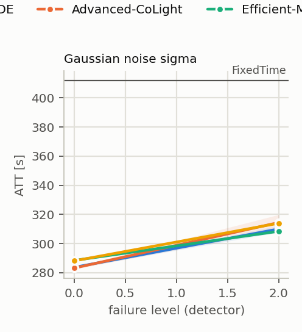
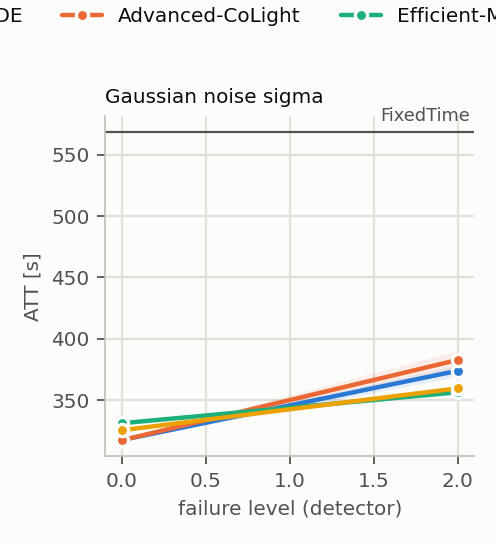
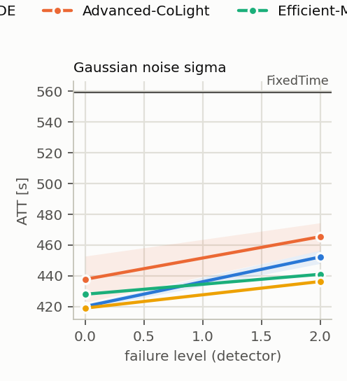

# T2 on traffic outside training: plan `t2_ood`

Mode realistic (yellow=5), 3 failure draws per scenario, evaluation of FROZEN controllers (`tsc degrade`). All read the same detector layer: MaxPressure computes its decision from the broken state vector, not the engine.

Cell = ATT [s], the mean over draws, then over policy seeds (+- std over seeds); in brackets delta relative to the same controller's clean result. **(!) = worse than FixedTime**, the only place the fallback's lower layer can gain.

## cityflow_jinan3x4_4ph

FixedTime (independent of readings): **507.0 s**.

| scenario | core GAT+PPO+CTDE (n=5) | Advanced-CoLight (n=5) | ensemble of 5 actors (seed 0 decides) (n=1) | Efficient-MP (n=1) | Advanced-MP (n=1) |
|---|---:|---:|---:|---:|---:|
| `clean` | 295.8 +- 1.2 | 294.4 +- 1.8 | 295.2 | 313.9 | 301.8 |
| `gauss2` | 319.0 +- 2.2 (+7.9%) | 325.8 +- 7.1 (+10.7%) | 319.4 (+8.2%) | 328.9 (+4.8%) | 318.4 (+5.5%) |

* **core GAT+PPO+CTDE**: worst scenario `gauss2`: 319.0 s (+7.9%). Never falls below FixedTime: at these levels a fallback to FixedTime has nothing to gain.
* **Advanced-CoLight**: worst scenario `gauss2`: 325.8 s (+10.7%). Never falls below FixedTime: at these levels a fallback to FixedTime has nothing to gain.
* **ensemble of 5 actors (seed 0 decides)**: worst scenario `gauss2`: 319.4 s (+8.2%). Never falls below FixedTime: at these levels a fallback to FixedTime has nothing to gain.
* **Efficient-MP**: worst scenario `gauss2`: 328.9 s (+4.8%). Never falls below FixedTime: at these levels a fallback to FixedTime has nothing to gain.
* **Advanced-MP**: worst scenario `gauss2`: 318.4 s (+5.5%). Never falls below FixedTime: at these levels a fallback to FixedTime has nothing to gain.

## cityflow_jinan3x4_4ph_d0p25

FixedTime (independent of readings): **322.3 s**.

| scenario | core GAT+PPO+CTDE (n=5) | Advanced-CoLight (n=5) | ensemble of 5 actors (seed 0 decides) (n=1) | Efficient-MP (n=1) | Advanced-MP (n=1) |
|---|---:|---:|---:|---:|---:|
| `clean` | 253.2 +- 1.7 | 252.9 +- 1.1 | 250.4 | 258.8 | 256.8 |
| `gauss2` | 294.3 +- 4.2 (+16.2%) | 296.7 +- 6.2 (+17.3%) | 295.3 (+17.9%) | 288.4 (+11.4%) | 303.5 (+18.2%) |

* **core GAT+PPO+CTDE**: worst scenario `gauss2`: 294.3 s (+16.2%). Never falls below FixedTime: at these levels a fallback to FixedTime has nothing to gain.
* **Advanced-CoLight**: worst scenario `gauss2`: 296.7 s (+17.3%). Never falls below FixedTime: at these levels a fallback to FixedTime has nothing to gain.
* **ensemble of 5 actors (seed 0 decides)**: worst scenario `gauss2`: 295.3 s (+17.9%). Never falls below FixedTime: at these levels a fallback to FixedTime has nothing to gain.
* **Efficient-MP**: worst scenario `gauss2`: 288.4 s (+11.4%). Never falls below FixedTime: at these levels a fallback to FixedTime has nothing to gain.
* **Advanced-MP**: worst scenario `gauss2`: 303.5 s (+18.2%). Never falls below FixedTime: at these levels a fallback to FixedTime has nothing to gain.

## cityflow_jinan3x4_4ph_r2000

FixedTime (independent of readings): **412.1 s**.

| scenario | core GAT+PPO+CTDE (n=5) | Advanced-CoLight (n=5) | ensemble of 5 actors (seed 0 decides) (n=1) | Efficient-MP (n=1) | Advanced-MP (n=1) |
|---|---:|---:|---:|---:|---:|
| `clean` | 283.6 +- 0.6 | 283.1 +- 0.7 | 283.0 | 288.4 | 288.1 |
| `gauss2` | 310.0 +- 2.3 (+9.3%) | 314.4 +- 5.4 (+11.0%) | 310.6 (+9.8%) | 308.4 (+6.9%) | 313.9 (+9.0%) |

* **core GAT+PPO+CTDE**: worst scenario `gauss2`: 310.0 s (+9.3%). Never falls below FixedTime: at these levels a fallback to FixedTime has nothing to gain.
* **Advanced-CoLight**: worst scenario `gauss2`: 314.4 s (+11.0%). Never falls below FixedTime: at these levels a fallback to FixedTime has nothing to gain.
* **ensemble of 5 actors (seed 0 decides)**: worst scenario `gauss2`: 310.6 s (+9.8%). Never falls below FixedTime: at these levels a fallback to FixedTime has nothing to gain.
* **Efficient-MP**: worst scenario `gauss2`: 308.4 s (+6.9%). Never falls below FixedTime: at these levels a fallback to FixedTime has nothing to gain.
* **Advanced-MP**: worst scenario `gauss2`: 313.9 s (+9.0%). Never falls below FixedTime: at these levels a fallback to FixedTime has nothing to gain.

## cityflow_hangzhou4x4_4ph

FixedTime (independent of readings): **568.9 s**.

| scenario | core GAT+PPO+CTDE (n=5) | Advanced-CoLight (n=5) | ensemble of 5 actors (seed 0 decides) (n=1) | Efficient-MP (n=1) | Advanced-MP (n=1) |
|---|---:|---:|---:|---:|---:|
| `clean` | 317.5 +- 0.7 | 317.4 +- 0.5 | 318.1 | 331.2 | 325.5 |
| `gauss2` | 373.9 +- 4.8 (+17.8%) | 382.8 +- 7.6 (+20.6%) | 366.8 (+15.3%) | 356.4 (+7.6%) | 359.6 (+10.5%) |

* **core GAT+PPO+CTDE**: worst scenario `gauss2`: 373.9 s (+17.8%). Never falls below FixedTime: at these levels a fallback to FixedTime has nothing to gain.
* **Advanced-CoLight**: worst scenario `gauss2`: 382.8 s (+20.6%). Never falls below FixedTime: at these levels a fallback to FixedTime has nothing to gain.
* **ensemble of 5 actors (seed 0 decides)**: worst scenario `gauss2`: 366.8 s (+15.3%). Never falls below FixedTime: at these levels a fallback to FixedTime has nothing to gain.
* **Efficient-MP**: worst scenario `gauss2`: 356.4 s (+7.6%). Never falls below FixedTime: at these levels a fallback to FixedTime has nothing to gain.
* **Advanced-MP**: worst scenario `gauss2`: 359.6 s (+10.5%). Never falls below FixedTime: at these levels a fallback to FixedTime has nothing to gain.

## cityflow_hangzhou4x4_4ph_r5816

FixedTime (independent of readings): **559.5 s**.

| scenario | core GAT+PPO+CTDE (n=5) | Advanced-CoLight (n=5) | ensemble of 5 actors (seed 0 decides) (n=1) | Efficient-MP (n=1) | Advanced-MP (n=1) |
|---|---:|---:|---:|---:|---:|
| `clean` | 420.1 +- 1.5 | 437.7 +- 15.1 | 421.9 | 428.0 | 419.0 |
| `gauss2` | 452.3 +- 4.3 (+7.7%) | 465.4 +- 9.0 (+6.3%) | 446.6 (+5.8%) | 441.0 (+3.0%) | 436.3 (+4.1%) |

* **core GAT+PPO+CTDE**: worst scenario `gauss2`: 452.3 s (+7.7%). Never falls below FixedTime: at these levels a fallback to FixedTime has nothing to gain.
* **Advanced-CoLight**: worst scenario `gauss2`: 465.4 s (+6.3%). Never falls below FixedTime: at these levels a fallback to FixedTime has nothing to gain.
* **ensemble of 5 actors (seed 0 decides)**: worst scenario `gauss2`: 446.6 s (+5.8%). Never falls below FixedTime: at these levels a fallback to FixedTime has nothing to gain.
* **Efficient-MP**: worst scenario `gauss2`: 441.0 s (+3.0%). Never falls below FixedTime: at these levels a fallback to FixedTime has nothing to gain.
* **Advanced-MP**: worst scenario `gauss2`: 436.3 s (+4.1%). Never falls below FixedTime: at these levels a fallback to FixedTime has nothing to gain.

## Check: the evaluator measures the same policy as T1

The evaluator's clean result vs the last training test, 22 learned runs: largest difference **0.047 s**, consistent to the log's precision.

## What this table does NOT say

* Levels are DETECTOR levels. For `gauss` they transfer to the feature with a factor of ~0.8-0.9, `urand` is ~1.6x weaker at the same `level` (`results/sensor_severity.md`).
* A mask with `zero` substitution changes far fewer feature cells than the fraction of dead lanes (zero is the modal value); the same number does not mean the same thing on networks with different loads.
* `hold` scenarios start at decision 60 (minute 15), so the first quarter of the episode is clean; their delta is not directly comparable with a mask from the start.
