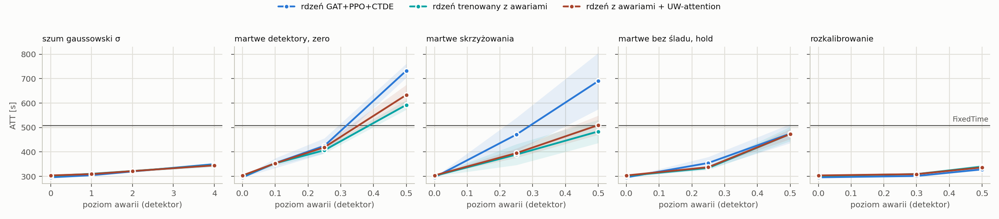

# T2 dla polityki trenowanej z mechanizmem — plan `t2_train_uw`

Tryb realistic (yellow=5), 5 losowań awarii na scenariusz, ewaluacja ZAMROŻONYCH sterowników (`tsc degrade`). Wszystkie czytają tę samą warstwę detektorów: MaxPressure liczy decyzję z popsutego wektora stanu, nie z silnika.

Komórka = ATT [s], średnia po losowaniach, potem po seedach polityki (± std po seedach); w nawiasie Δ względem czystego wyniku tego samego sterownika. **▲ = gorzej niż FixedTime** — tylko tam dolna warstwa fallbacku ma pole do zysku.

## cityflow_jinan3x4_4ph

FixedTime (niezależny od odczytów): **507.0 s**.

| scenariusz | rdzeń GAT+PPO+CTDE (n=3) | rdzeń trenowany z awariami (n=3) | rdzeń z awariami + UW-attention (n=3) |
|---|---:|---:|---:|
| `clean` | 295.9 ± 0.6 | 302.0 ± 1.7 | 303.7 ± 1.1 |
| `gauss1` | 304.5 ± 1.4 (+2.9%) | 310.4 ± 1.2 (+2.8%) | 309.3 ± 1.4 (+1.8%) |
| `gauss2` | 319.9 ± 2.2 (+8.1%) | 321.8 ± 3.2 (+6.6%) | 321.6 ± 1.7 (+5.9%) |
| `gauss4` | 350.0 ± 4.5 (+18.3%) | 345.9 ± 8.4 (+14.5%) | 344.8 ± 1.9 (+13.5%) |
| `mask0p1` | 354.2 ± 20.0 (+19.7%) | 353.4 ± 9.8 (+17.0%) | 353.6 ± 4.1 (+16.4%) |
| `mask0p25` | 424.9 ± 31.1 (+43.6%) | 407.0 ± 12.5 (+34.8%) | 419.1 ± 13.3 (+38.0%) |
| `mask0p5` | 732.6 ± 28.5 (+147.5%) ▲ | 592.5 ± 19.4 (+96.2%) ▲ | 633.5 ± 41.4 (+108.6%) ▲ |
| `mask0p25_intersection` | 471.1 ± 68.8 (+59.2%) | 389.2 ± 42.7 (+28.9%) | 395.2 ± 19.1 (+30.1%) |
| `mask0p5_intersection` | 690.0 ± 115.3 (+133.2%) ▲ | 483.8 ± 47.4 (+60.2%) | 509.8 ± 39.1 (+67.8%) ▲ |
| `mask0p25_hold_t60` | 354.7 ± 24.8 (+19.9%) | 334.4 ± 8.7 (+10.7%) | 337.6 ± 0.5 (+11.2%) |
| `mask0p5_hold_t60` | 475.0 ± 38.9 (+60.5%) | 473.6 ± 29.4 (+56.8%) | 473.2 ± 20.9 (+55.8%) |
| `drift0p3` | 301.5 ± 0.5 (+1.9%) | 309.3 ± 0.7 (+2.4%) | 309.1 ± 2.3 (+1.8%) |
| `drift0p5` | 328.6 ± 4.3 (+11.0%) | 339.9 ± 8.2 (+12.5%) | 336.6 ± 1.1 (+10.8%) |

* **rdzeń GAT+PPO+CTDE** — najgorszy scenariusz `mask0p5`: 732.6 s (+147.5%). Gorzej niż FixedTime w 2 scenariuszach: `mask0p5`, `mask0p5_intersection`.
* **rdzeń trenowany z awariami** — najgorszy scenariusz `mask0p5`: 592.5 s (+96.2%). Gorzej niż FixedTime w 1 scenariuszach: `mask0p5`.
* **rdzeń z awariami + UW-attention** — najgorszy scenariusz `mask0p5`: 633.5 s (+108.6%). Gorzej niż FixedTime w 2 scenariuszach: `mask0p5`, `mask0p5_intersection`.

## Ramię: rdzeń trenowany z awariami vs rdzeń GAT+PPO+CTDE

Kolumny mają RÓŻNE checkpointy (osobne treningi), więc parujemy po (sieć, scenariusz, seed, losowanie): wspólne zostają ruch i wzorzec awarii, rozrzut między seedami wchodzi do różnicy. Kolumna odniesienia jest wskazana w planie (`baseline: gatppo`), a nie domyślona. `Δ` < 0 = ramię lepsze. `|t| ≥ 2.8` to próg po poprawce na tyle porównań, ile ma ta tabela.

Kolumny różni SPOSÓB TRENOWANIA, nie mechanizm włączany w inferencji, więc nie ma diagnostyki „czy mechanizm wystartował” — jest albo go nie ma już na poziomie wag. Rozrzut między seedami wchodzi tu do różnicy w całości (patrz zdanie o parowaniu wyżej), a liczba NIEZALEŻNYCH replikacji to liczba seedów, nie liczba par: losowania awarii dzielą checkpoint, więc |t| jest wobec nich optymistyczne.

### cityflow_jinan3x4_4ph

| scenariusz | Δ ATT [s] | sd | t | lepszy w |
|---|---:|---:|---:|---:|
| `clean` | **+6.06** | 2.2 | +4.76 | 0/3 |
| `gauss1` | **+5.86** | 2.6 | +8.58 | 0/15 |
| `gauss2` | +1.94 | 4.7 | +1.59 | 6/15 |
| `gauss4` | -4.19 | 11.2 | -1.45 | 9/15 |
| `mask0p1` | -0.83 | 13.4 | -0.24 | 6/15 |
| `mask0p25` | -17.92 | 26.4 | -2.63 | 12/15 |
| `mask0p5` | **-140.03** | 50.3 | -10.77 | 15/15 |
| `mask0p25_intersection` | -81.83 | 115.0 | -2.76 | 12/15 |
| `mask0p5_intersection` | **-206.15** | 170.4 | -4.69 | 14/15 |
| `mask0p25_hold_t60` | -20.35 | 47.7 | -1.65 | 8/15 |
| `mask0p5_hold_t60` | -1.42 | 85.2 | -0.06 | 7/15 |
| `drift0p3` | **+7.77** | 2.0 | +14.93 | 0/15 |
| `drift0p5` | +11.27 | 19.3 | +2.27 | 1/15 |

* Powyżej progu: `clean` (+6.06 s, t = +4.76, lepszy w 0/3 parach), `drift0p3` (+7.77 s, t = +14.93, lepszy w 0/15 parach), `gauss1` (+5.86 s, t = +8.58, lepszy w 0/15 parach), `mask0p5` (-140.03 s, t = -10.77, lepszy w 15/15 parach), `mask0p5_intersection` (-206.15 s, t = -4.69, lepszy w 14/15 parach)

## Mechanizm: rdzeń z awariami + UW-attention vs rdzeń trenowany z awariami

Kolumny mają RÓŻNE checkpointy (osobne treningi), więc parujemy po (sieć, scenariusz, seed, losowanie): wspólne zostają ruch i wzorzec awarii, rozrzut między seedami wchodzi do różnicy. Kolumna odniesienia jest wskazana w planie (`baseline: gatppo_fail`), a nie domyślona. `Δ` < 0 = mechanizm lepszy. `|t| ≥ 2.8` to próg po poprawce na tyle porównań, ile ma ta tabela.

`uw_spread` = średni rozstęp log ρ w GRUPIE SOFTMAXU węzła, czyli jedyna część sygnału, którą attention widzi (na stałą wspólną dla grupy jest niezmienniczy). 0 = warstwa nie widzi różnicy między sąsiadami, ln 10 ≈ 2,3 = różnią się 10×. `uw_active` = odsetek krawędzi z niezerowym log ρ.

### cityflow_jinan3x4_4ph

| scenariusz | uw_spread | uw_active | Δ ATT [s] | sd | t | lepszy w |
|---|---:|---:|---:|---:|---:|---:|
| `clean` | 0.46 | 3.4% | +1.72 | 1.7 | +1.79 | 1/3 |
| `gauss1` | 0.79 | 9.0% | -1.04 | 2.0 | -2.03 | 10/15 |
| `gauss2` | 2.19 | 22.9% | -0.25 | 3.6 | -0.26 | 8/15 |
| `gauss4` | 6.00 | 43.8% | -1.08 | 7.6 | -0.55 | 5/15 |
| `mask0p1` | 0.65 | 4.7% | +0.25 | 25.8 | +0.04 | 6/15 |
| `mask0p25` | 0.84 | 6.1% | +12.09 | 29.5 | +1.59 | 7/15 |
| `mask0p5` | 0.88 | 7.4% | +40.95 | 73.4 | +2.16 | 5/15 |
| `mask0p25_intersection` | 0.76 | 6.6% | +5.90 | 82.3 | +0.28 | 7/15 |
| `mask0p5_intersection` | 0.85 | 8.6% | +25.91 | 113.9 | +0.88 | 6/15 |
| `mask0p25_hold_t60` | 0.51 | 4.2% | +3.26 | 14.1 | +0.89 | 6/15 |
| `mask0p5_hold_t60` | 1.04 | 7.8% | -0.33 | 80.6 | -0.02 | 8/15 |
| `drift0p3` | 0.55 | 4.0% | -0.14 | 3.0 | -0.18 | 9/15 |
| `drift0p5` | 0.76 | 5.1% | -3.22 | 21.6 | -0.58 | 9/15 |

* Żaden scenariusz nie przekracza progu — mechanizm jest wobec ATT **neutralny**.

## Kontrola: ewaluator mierzy tę samą politykę co T1

Czysty wynik ewaluatora vs ostatni test treningu, 6 biegów uczonych: największa różnica **0.000 s** — zgodne co do precyzji logu.

## Czego ta tabela NIE mówi

* Poziomy są poziomami DETEKTORA. Na cechę `gauss` przenosi się ze współczynnikiem ~0,8–0,9, `urand` jest ~1,6× słabszy przy tym samym `level` (`results/sensor_severity.md`).
* Maska z podstawieniem `zero` zmienia znacznie mniej komórek cech, niż wynosi ułamek martwych pasów (zero jest wartością modalną) — ta sama liczba nie znaczy tego samego na sieciach o różnym obciążeniu.
* Scenariusze `hold` zaczynają się w decyzji 60 (15. minuta), więc pierwsza ćwiartka epizodu jest czysta — ich Δ nie jest porównywalne wprost z maską od początku.
