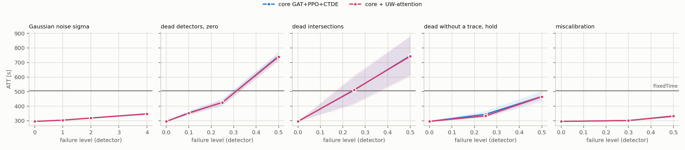
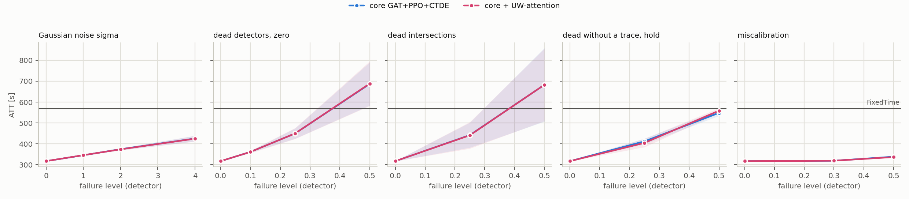

# T2 with UW-attention: plan `t2_uw`

Mode realistic (yellow=5), 5 failure draws per scenario, evaluation of FROZEN controllers (`tsc degrade`). All read the same detector layer: MaxPressure computes its decision from the broken state vector, not the engine.

Cell = ATT [s], the mean over draws, then over policy seeds (+- std over seeds); in brackets delta relative to the same controller's clean result. **(!) = worse than FixedTime**, the only place the fallback's lower layer can gain.

## cityflow_jinan3x4_4ph

FixedTime (independent of readings): **507.0 s**.

| scenario | core GAT+PPO+CTDE (n=5) | core + UW-attention (n=5) |
|---|---:|---:|
| `clean` | 295.8 +- 1.2 | 295.7 +- 0.9 |
| `gauss1` | 304.1 +- 1.2 (+2.8%) | 304.2 +- 0.6 (+2.9%) |
| `gauss2` | 319.0 +- 2.0 (+7.9%) | 318.9 +- 2.5 (+7.8%) |
| `gauss4` | 347.4 +- 6.7 (+17.5%) | 347.3 +- 6.8 (+17.5%) |
| `mask0p1` | 354.3 +- 16.1 (+19.8%) | 352.3 +- 10.8 (+19.2%) |
| `mask0p25` | 426.5 +- 23.9 (+44.2%) | 425.6 +- 20.3 (+43.9%) |
| `mask0p5` | 743.4 +- 25.2 (+151.4%) (!) | 739.0 +- 30.7 (+149.9%) (!) |
| `mask0p25_intersection` | 510.0 +- 90.2 (+72.4%) (!) | 512.2 +- 100.7 (+73.2%) (!) |
| `mask0p5_intersection` | 746.5 +- 132.4 (+152.4%) (!) | 742.2 +- 137.9 (+151.0%) (!) |
| `mask0p25_hold_t60` | 344.8 +- 22.2 (+16.6%) | 333.7 +- 11.4 (+12.8%) |
| `mask0p5_hold_t60` | 466.9 +- 36.1 (+57.9%) | 465.2 +- 16.6 (+57.3%) |
| `drift0p3` | 301.7 +- 0.7 (+2.0%) | 301.7 +- 1.6 (+2.0%) |
| `drift0p5` | 331.0 +- 4.6 (+11.9%) | 332.9 +- 9.2 (+12.6%) |

* **core GAT+PPO+CTDE**: worst scenario `mask0p5_intersection`: 746.5 s (+152.4%). Worse than FixedTime in 3 scenarios: `mask0p25_intersection`, `mask0p5`, `mask0p5_intersection`.
* **core + UW-attention**: worst scenario `mask0p5_intersection`: 742.2 s (+151.0%). Worse than FixedTime in 3 scenarios: `mask0p25_intersection`, `mask0p5`, `mask0p5_intersection`.

## cityflow_hangzhou4x4_4ph

FixedTime (independent of readings): **568.9 s**.

| scenario | core GAT+PPO+CTDE (n=5) | core + UW-attention (n=5) |
|---|---:|---:|
| `clean` | 317.5 +- 0.7 | 317.5 +- 0.5 |
| `gauss1` | 345.7 +- 1.3 (+8.9%) | 346.0 +- 1.4 (+9.0%) |
| `gauss2` | 374.7 +- 4.8 (+18.0%) | 374.0 +- 4.8 (+17.8%) |
| `gauss4` | 425.7 +- 13.5 (+34.1%) | 425.0 +- 13.9 (+33.9%) |
| `mask0p1` | 361.9 +- 3.6 (+14.0%) | 361.7 +- 6.0 (+13.9%) |
| `mask0p25` | 450.1 +- 24.7 (+41.7%) | 450.2 +- 26.2 (+41.8%) |
| `mask0p5` | 686.6 +- 102.7 (+116.2%) (!) | 688.2 +- 106.7 (+116.7%) (!) |
| `mask0p25_intersection` | 442.1 +- 59.6 (+39.2%) | 441.2 +- 63.5 (+38.9%) |
| `mask0p5_intersection` | 682.3 +- 175.7 (+114.9%) (!) | 682.4 +- 173.1 (+114.9%) (!) |
| `mask0p25_hold_t60` | 412.2 +- 13.8 (+29.8%) | 404.8 +- 20.2 (+27.5%) |
| `mask0p5_hold_t60` | 548.4 +- 14.3 (+72.7%) | 558.7 +- 12.1 (+75.9%) |
| `drift0p3` | 319.5 +- 0.2 (+0.6%) | 319.5 +- 0.2 (+0.6%) |
| `drift0p5` | 338.7 +- 2.5 (+6.7%) | 337.0 +- 3.3 (+6.1%) |

* **core GAT+PPO+CTDE**: worst scenario `mask0p5`: 686.6 s (+116.2%). Worse than FixedTime in 2 scenarios: `mask0p5`, `mask0p5_intersection`.
* **core + UW-attention**: worst scenario `mask0p5`: 688.2 s (+116.7%). Worse than FixedTime in 2 scenarios: `mask0p5`, `mask0p5_intersection`.

## Mechanism: core + UW-attention vs core GAT+PPO+CTDE

Both columns are computed from THE SAME checkpoint and the same failure draws (`draw` chooses which detectors failed), so they are compared **in pairs**, not through the +-std of the table above: the shared spread between seeds and draws cancels in the difference. `delta` < 0 = the mechanism is better. `|t| >= 2.8` is the threshold corrected for as many comparisons as this table has.

`uw_spread` = mean log rho spread within a node's SOFTMAX GROUP, the only part of the signal attention sees (it is invariant to a constant shared by the group). 0 = the layer sees no difference between neighbours, ln 10 ~ 2.3 = they differ 10x. `uw_active` = share of edges with a nonzero log rho.

### cityflow_jinan3x4_4ph

| scenario | uw_spread | uw_active | delta ATT [s] | sd | t | better in |
|---|---:|---:|---:|---:|---:|---:|
| `clean` | 0.39 | 3.0% | -0.08 | 1.0 | -0.17 | 3/5 |
| `gauss1` | 0.74 | 8.8% | +0.10 | 1.5 | +0.33 | 12/25 |
| `gauss2` | 2.21 | 23.2% | -0.14 | 1.7 | -0.41 | 13/25 |
| `gauss4` | 6.12 | 44.7% | -0.09 | 2.3 | -0.20 | 14/25 |
| `mask0p1` | 0.64 | 4.5% | -1.99 | 12.1 | -0.82 | 7/25 |
| `mask0p25` | 0.83 | 5.7% | -0.94 | 17.4 | -0.27 | 11/25 |
| `mask0p5` | 1.20 | 9.2% | -4.43 | 28.6 | -0.77 | 14/25 |
| `mask0p25_intersection` | 0.99 | 7.7% | +2.17 | 36.9 | +0.29 | 14/25 |
| `mask0p5_intersection` | 1.42 | 11.2% | -4.34 | 61.8 | -0.35 | 14/25 |
| `mask0p25_hold_t60` | 0.44 | 3.4% | -11.18 | 36.2 | -1.54 | 14/25 |
| `mask0p5_hold_t60` | 0.77 | 5.7% | -1.67 | 65.6 | -0.13 | 12/25 |
| `drift0p3` | 0.48 | 3.5% | +0.02 | 1.6 | +0.06 | 13/25 |
| `drift0p5` | 0.71 | 4.7% | +1.85 | 18.1 | +0.51 | 15/25 |

* No scenario crosses the threshold: the mechanism is **neutral** for ATT.

### cityflow_hangzhou4x4_4ph

| scenario | uw_spread | uw_active | delta ATT [s] | sd | t | better in |
|---|---:|---:|---:|---:|---:|---:|
| `clean` | 0.33 | 2.0% | +0.00 | 0.7 | +0.01 | 3/5 |
| `gauss1` | 0.61 | 6.5% | +0.28 | 0.8 | +1.81 | 11/25 |
| `gauss2` | 2.18 | 19.9% | **-0.69** | 1.0 | -3.58 | 18/24 |
| `gauss4` | 7.25 | 45.9% | -0.71 | 3.4 | -1.06 | 17/25 |
| `mask0p1` | 0.31 | 1.9% | -0.18 | 7.0 | -0.13 | 12/25 |
| `mask0p25` | 0.32 | 1.8% | +0.10 | 9.4 | +0.06 | 12/25 |
| `mask0p5` | 0.30 | 1.7% | +1.66 | 20.5 | +0.41 | 12/23 |
| `mask0p25_intersection` | 0.25 | 1.6% | -0.91 | 9.2 | -0.49 | 14/25 |
| `mask0p5_intersection` | 0.19 | 1.2% | +0.08 | 15.9 | +0.02 | 10/23 |
| `mask0p25_hold_t60` | 0.33 | 2.3% | -7.40 | 37.2 | -1.00 | 13/25 |
| `mask0p5_hold_t60` | 0.39 | 2.9% | +10.29 | 33.4 | +1.54 | 8/25 |
| `drift0p3` | 0.39 | 2.2% | +0.01 | 0.7 | +0.05 | 13/25 |
| `drift0p5` | 0.51 | 2.7% | -1.68 | 4.4 | -1.89 | 15/25 |

* Above the threshold: `gauss2` (-0.69 s, t = -3.58, better in 18/25 pairs)

## Check: the evaluator measures the same policy as T1

The evaluator's clean result vs the last training test, 10 learned runs: largest difference **0.000 s**, consistent to the log's precision.

## What this table does NOT say

* Levels are DETECTOR levels. For `gauss` they transfer to the feature with a factor of ~0.8-0.9, `urand` is ~1.6x weaker at the same `level` (`results/sensor_severity.md`).
* A mask with `zero` substitution changes far fewer feature cells than the fraction of dead lanes (zero is the modal value); the same number does not mean the same thing on networks with different loads.
* `hold` scenarios start at decision 60 (minute 15), so the first quarter of the episode is clean; their delta is not directly comparable with a mask from the start.
