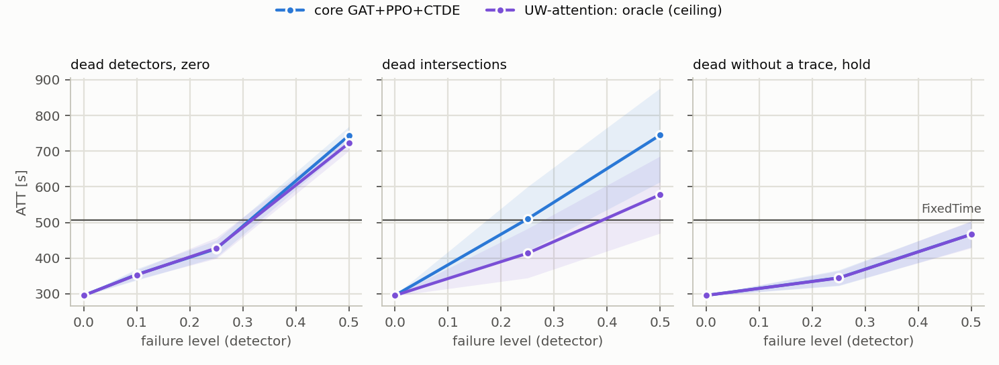
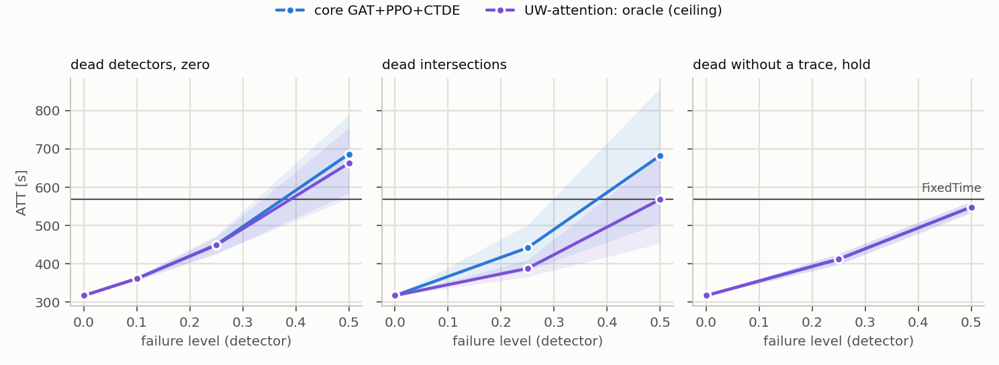

# T2: plan `t2_uw_channels`

Mode realistic (yellow=5), 5 failure draws per scenario, evaluation of FROZEN controllers (`tsc degrade`). All read the same detector layer: MaxPressure computes its decision from the broken state vector, not the engine.

Cell = ATT [s], the mean over draws, then over policy seeds (+- std over seeds); in brackets delta relative to the same controller's clean result. **(!) = worse than FixedTime**, the only place the fallback's lower layer can gain.

## cityflow_jinan3x4_4ph

FixedTime (independent of readings): **507.0 s**.

| scenario | core GAT+PPO+CTDE (n=5) | UW-attention: oracle (ceiling) (n=5) | gatppo_uw_oracle_self (n=5) | gatppo_uw_oracle_edges (n=5) |
|---|---:|---:|---:|---:|
| `clean` | 295.8 +- 1.2 | 295.8 +- 1.2 | 295.8 +- 1.2 | 295.8 +- 1.2 |
| `mask0p1` | 354.3 +- 16.1 (+19.8%) | 353.5 +- 12.9 (+19.5%) | 353.2 +- 9.7 (+19.4%) | 352.8 +- 8.9 (+19.3%) |
| `mask0p25` | 426.5 +- 23.9 (+44.2%) | 428.4 +- 29.3 (+44.8%) | 425.1 +- 26.3 (+43.7%) | 434.1 +- 26.0 (+46.8%) |
| `mask0p5` | 743.4 +- 25.2 (+151.4%) (!) | 722.1 +- 21.2 (+144.2%) (!) | 699.3 +- 21.0 (+136.5%) (!) | 766.8 +- 22.8 (+159.3%) (!) |
| `mask0p25_intersection` | 510.0 +- 90.2 (+72.4%) (!) | 413.8 +- 69.1 (+39.9%) | 462.0 +- 89.3 (+56.2%) | 491.7 +- 102.2 (+66.3%) |
| `mask0p5_intersection` | 744.8 +- 131.3 (+151.8%) (!) | 577.8 +- 107.9 (+95.4%) (!) | 669.0 +- 143.7 (+126.2%) (!) | 699.8 +- 142.3 (+136.6%) (!) |
| `mask0p25_hold_t60` | 344.8 +- 22.2 (+16.6%) | 344.3 +- 20.2 (+16.4%) | 342.8 +- 19.7 (+15.9%) | 345.8 +- 18.4 (+16.9%) |
| `mask0p5_hold_t60` | 466.9 +- 36.1 (+57.9%) | 466.5 +- 38.0 (+57.7%) | 464.4 +- 37.6 (+57.0%) | 474.6 +- 37.9 (+60.5%) |

* **core GAT+PPO+CTDE**: worst scenario `mask0p5_intersection`: 744.8 s (+151.8%). Worse than FixedTime in 3 scenarios: `mask0p25_intersection`, `mask0p5`, `mask0p5_intersection`.
* **UW-attention: oracle (ceiling)**: worst scenario `mask0p5`: 722.1 s (+144.2%). Worse than FixedTime in 2 scenarios: `mask0p5`, `mask0p5_intersection`.
* **gatppo_uw_oracle_self**: worst scenario `mask0p5`: 699.3 s (+136.5%). Worse than FixedTime in 2 scenarios: `mask0p5`, `mask0p5_intersection`.
* **gatppo_uw_oracle_edges**: worst scenario `mask0p5`: 766.8 s (+159.3%). Worse than FixedTime in 2 scenarios: `mask0p5`, `mask0p5_intersection`.

## cityflow_hangzhou4x4_4ph

FixedTime (independent of readings): **568.9 s**.

| scenario | core GAT+PPO+CTDE (n=5) | UW-attention: oracle (ceiling) (n=5) | gatppo_uw_oracle_self (n=5) | gatppo_uw_oracle_edges (n=5) |
|---|---:|---:|---:|---:|
| `clean` | 317.5 +- 0.7 | 317.5 +- 0.7 | 317.5 +- 0.7 | 317.5 +- 0.7 |
| `mask0p1` | 361.9 +- 3.6 (+14.0%) | 361.7 +- 5.2 (+13.9%) | 361.6 +- 6.9 (+13.9%) | 363.1 +- 6.3 (+14.3%) |
| `mask0p25` | 450.1 +- 24.7 (+41.7%) | 449.1 +- 21.0 (+41.4%) | 447.7 +- 23.0 (+41.0%) | 457.4 +- 30.8 (+44.0%) |
| `mask0p5` | 686.6 +- 102.7 (+116.2%) (!) | 662.7 +- 92.0 (+108.7%) (!) | 655.3 +- 88.8 (+106.4%) (!) | 709.7 +- 127.8 (+123.5%) (!) |
| `mask0p25_intersection` | 442.1 +- 59.6 (+39.2%) | 388.3 +- 21.8 (+22.3%) | 422.1 +- 50.2 (+32.9%) | 434.5 +- 41.5 (+36.9%) |
| `mask0p5_intersection` | 682.3 +- 175.7 (+114.9%) (!) | 568.1 +- 114.6 (+78.9%) | 638.2 +- 155.2 (+101.0%) (!) | 685.0 +- 119.6 (+115.7%) (!) |
| `mask0p25_hold_t60` | 412.2 +- 13.8 (+29.8%) | 412.8 +- 14.6 (+30.0%) | 409.4 +- 12.6 (+28.9%) | 414.1 +- 13.8 (+30.4%) |
| `mask0p5_hold_t60` | 548.4 +- 14.3 (+72.7%) | 548.2 +- 14.6 (+72.6%) | 539.4 +- 16.4 (+69.9%) | 563.2 +- 9.2 (+77.4%) |

* **core GAT+PPO+CTDE**: worst scenario `mask0p5`: 686.6 s (+116.2%). Worse than FixedTime in 2 scenarios: `mask0p5`, `mask0p5_intersection`.
* **UW-attention: oracle (ceiling)**: worst scenario `mask0p5`: 662.7 s (+108.7%). Worse than FixedTime in 1 scenarios: `mask0p5`.
* **gatppo_uw_oracle_self**: worst scenario `mask0p5`: 655.3 s (+106.4%). Worse than FixedTime in 2 scenarios: `mask0p5`, `mask0p5_intersection`.
* **gatppo_uw_oracle_edges**: worst scenario `mask0p5`: 709.7 s (+123.5%). Worse than FixedTime in 2 scenarios: `mask0p5`, `mask0p5_intersection`.

## Mechanisms x scenario

delta ATT [s] of the ASSESSED COLUMN relative to `core GAT+PPO+CTDE`, paired by (seed, draw). **bold** = |t| >= 2.8. delta < 0 = the assessed column is better than the reference.

### cityflow_jinan3x4_4ph

| mechanism | `clean` | `mask0p1` | `mask0p25` | `mask0p5` | `mask0p25_intersection` | `mask0p5_intersection` | `mask0p25_hold_t60` | `mask0p5_hold_t60` |
|---|---:|---:|---:|---:|---:|---:|---:|---:|
| UW-attention: oracle (ceiling) | +0.0 | -0.8 | +1.8 | **-21.3** | **-96.2** | **-167.0** | -0.5 | -0.3 |
| gatppo_uw_oracle_self | +0.0 | -1.1 | -1.4 | **-44.1** | **-48.0** | **-75.7** | -2.0 | -2.5 |
| gatppo_uw_oracle_edges | +0.0 | -1.5 | +7.6 | **+23.4** | -18.3 | -44.9 | +0.9 | +7.8 |

### cityflow_hangzhou4x4_4ph

| mechanism | `clean` | `mask0p1` | `mask0p25` | `mask0p5` | `mask0p25_intersection` | `mask0p5_intersection` | `mask0p25_hold_t60` | `mask0p5_hold_t60` |
|---|---:|---:|---:|---:|---:|---:|---:|---:|
| UW-attention: oracle (ceiling) | +0.0 | -0.1 | -1.0 | **-23.9** | **-53.8** | **-114.2** | +0.6 | -0.2 |
| gatppo_uw_oracle_self | +0.0 | -0.2 | -2.4 | **-31.3** | **-19.9** | **-44.1** | -2.8 | **-8.9** |
| gatppo_uw_oracle_edges | +0.0 | +1.2 | +7.3 | +23.1 | -7.5 | +2.7 | +1.8 | **+14.9** |

## Check: the evaluator measures the same policy as T1

The evaluator's clean result vs the last training test, 10 learned runs: largest difference **0.000 s**, consistent to the log's precision.

## What this table does NOT say

* Levels are DETECTOR levels. For `gauss` they transfer to the feature with a factor of ~0.8-0.9, `urand` is ~1.6x weaker at the same `level` (`results/sensor_severity.md`).
* A mask with `zero` substitution changes far fewer feature cells than the fraction of dead lanes (zero is the modal value); the same number does not mean the same thing on networks with different loads.
* `hold` scenarios start at decision 60 (minute 15), so the first quarter of the episode is clean; their delta is not directly comparable with a mask from the start.
