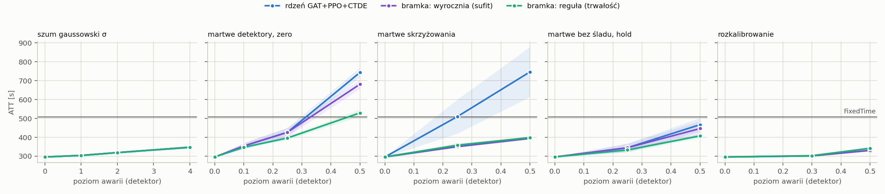
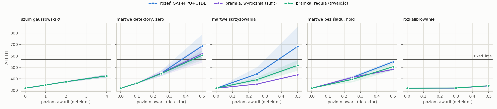

# T2 — plan `t2_uw_rule`

Tryb realistic (yellow=5), 5 losowań awarii na scenariusz, ewaluacja ZAMROŻONYCH sterowników (`tsc degrade`). Wszystkie czytają tę samą warstwę detektorów: MaxPressure liczy decyzję z popsutego wektora stanu, nie z silnika.

Komórka = ATT [s], średnia po losowaniach, potem po seedach polityki (± std po seedach); w nawiasie Δ względem czystego wyniku tego samego sterownika. **▲ = gorzej niż FixedTime** — tylko tam dolna warstwa fallbacku ma pole do zysku.

## cityflow_jinan3x4_4ph

FixedTime (niezależny od odczytów): **507.0 s**.

| scenariusz | rdzeń GAT+PPO+CTDE (n=5) | gatppo_uw_rule (n=5) | bramka: reguła (trwałość) (n=5) | gatppo_gate_rule_uw (n=5) | bramka: wyrocznia (sufit) (n=5) | gatppo_gate_oracle_uw (n=5) |
|---|---:|---:|---:|---:|---:|---:|
| `clean` | 295.8 ± 1.2 | 295.8 ± 1.2 | 296.4 ± 1.4 | 296.3 ± 1.5 | 295.8 ± 1.2 | 295.8 ± 1.2 |
| `gauss1` | 304.1 ± 1.2 (+2.8%) | 304.1 ± 1.2 (+2.8%) | 304.1 ± 1.2 (+2.6%) | 304.1 ± 1.2 (+2.6%) | 304.1 ± 1.2 (+2.8%) | 304.1 ± 1.2 (+2.8%) |
| `gauss2` | 319.0 ± 2.0 (+7.9%) | 319.0 ± 2.0 (+7.8%) | 319.0 ± 2.0 (+7.6%) | 319.0 ± 2.0 (+7.7%) | 319.0 ± 2.0 (+7.9%) | 319.0 ± 2.0 (+7.9%) |
| `gauss4` | 347.4 ± 6.7 (+17.5%) | 347.4 ± 6.7 (+17.4%) | 347.4 ± 6.7 (+17.2%) | 347.4 ± 6.7 (+17.3%) | 347.4 ± 6.7 (+17.5%) | 347.4 ± 6.7 (+17.5%) |
| `mask0p1` | 354.3 ± 16.1 (+19.8%) | 354.4 ± 11.1 (+19.8%) | 347.3 ± 5.3 (+17.2%) | 346.9 ± 4.2 (+17.1%) | 354.3 ± 16.1 (+19.8%) | 353.5 ± 12.9 (+19.5%) |
| `mask0p25` | 426.5 ± 23.9 (+44.2%) | 425.3 ± 25.0 (+43.8%) | 396.2 ± 9.3 (+33.7%) | 397.0 ± 8.3 (+34.0%) | 426.5 ± 23.9 (+44.2%) | 428.4 ± 29.3 (+44.8%) |
| `mask0p5` | 743.4 ± 25.2 (+151.4%) ▲ | 726.6 ± 17.2 (+145.6%) ▲ | 529.3 ± 18.5 (+78.6%) ▲ | 528.8 ± 18.7 (+78.5%) ▲ | 681.1 ± 24.4 (+130.3%) ▲ | 661.9 ± 21.7 (+123.8%) ▲ |
| `mask0p25_intersection` | 510.0 ± 90.2 (+72.4%) ▲ | 447.8 ± 90.7 (+51.4%) | 358.5 ± 10.6 (+21.0%) | 357.7 ± 13.6 (+20.7%) | 350.4 ± 1.1 (+18.5%) | 350.5 ± 0.7 (+18.5%) |
| `mask0p5_intersection` | 746.5 ± 132.4 (+152.4%) ▲ | 624.1 ± 140.4 (+111.0%) ▲ | 398.8 ± 2.3 (+34.6%) | 398.7 ± 2.8 (+34.6%) | 393.9 ± 0.8 (+33.2%) | 394.3 ± 1.0 (+33.3%) |
| `mask0p25_hold_t60` | 344.8 ± 22.2 (+16.6%) | 343.1 ± 15.1 (+16.0%) | 333.1 ± 10.4 (+12.4%) | 331.1 ± 11.3 (+11.7%) | 344.8 ± 22.2 (+16.6%) | 344.3 ± 20.2 (+16.4%) |
| `mask0p5_hold_t60` | 466.9 ± 36.1 (+57.9%) | 466.3 ± 43.6 (+57.6%) | 407.6 ± 10.8 (+37.5%) | 402.6 ± 3.3 (+35.9%) | 446.5 ± 39.2 (+51.0%) | 442.2 ± 36.9 (+49.5%) |
| `drift0p3` | 301.7 ± 0.7 (+2.0%) | 301.9 ± 1.4 (+2.0%) | 302.8 ± 1.3 (+2.2%) | 303.2 ± 1.5 (+2.3%) | 301.7 ± 0.7 (+2.0%) | 301.7 ± 0.7 (+2.0%) |
| `drift0p5` | 331.0 ± 4.6 (+11.9%) | 330.4 ± 2.1 (+11.7%) | 342.2 ± 6.4 (+15.5%) | 339.4 ± 4.9 (+14.6%) | 331.0 ± 4.6 (+11.9%) | 331.0 ± 4.6 (+11.9%) |

* **rdzeń GAT+PPO+CTDE** — najgorszy scenariusz `mask0p5_intersection`: 746.5 s (+152.4%). Gorzej niż FixedTime w 3 scenariuszach: `mask0p25_intersection`, `mask0p5`, `mask0p5_intersection`.
* **gatppo_uw_rule** — najgorszy scenariusz `mask0p5`: 726.6 s (+145.6%). Gorzej niż FixedTime w 2 scenariuszach: `mask0p5`, `mask0p5_intersection`.
* **bramka: reguła (trwałość)** — najgorszy scenariusz `mask0p5`: 529.3 s (+78.6%). Gorzej niż FixedTime w 1 scenariuszach: `mask0p5`.
* **gatppo_gate_rule_uw** — najgorszy scenariusz `mask0p5`: 528.8 s (+78.5%). Gorzej niż FixedTime w 1 scenariuszach: `mask0p5`.
* **bramka: wyrocznia (sufit)** — najgorszy scenariusz `mask0p5`: 681.1 s (+130.3%). Gorzej niż FixedTime w 1 scenariuszach: `mask0p5`.
* **gatppo_gate_oracle_uw** — najgorszy scenariusz `mask0p5`: 661.9 s (+123.8%). Gorzej niż FixedTime w 1 scenariuszach: `mask0p5`.

## cityflow_hangzhou4x4_4ph

FixedTime (niezależny od odczytów): **568.9 s**.

| scenariusz | rdzeń GAT+PPO+CTDE (n=5) | gatppo_uw_rule (n=5) | bramka: reguła (trwałość) (n=5) | gatppo_gate_rule_uw (n=5) | bramka: wyrocznia (sufit) (n=5) | gatppo_gate_oracle_uw (n=5) |
|---|---:|---:|---:|---:|---:|---:|
| `clean` | 317.5 ± 0.7 | 317.2 ± 0.6 | 318.1 ± 0.1 | 318.0 ± 0.5 | 317.5 ± 0.7 | 317.5 ± 0.7 |
| `gauss1` | 345.7 ± 1.3 (+8.9%) | 345.7 ± 1.3 (+9.0%) | 345.7 ± 1.3 (+8.7%) | 345.7 ± 1.3 (+8.7%) | 345.7 ± 1.3 (+8.9%) | 345.7 ± 1.3 (+8.9%) |
| `gauss2` | 374.7 ± 4.8 (+18.0%) | 374.7 ± 4.8 (+18.1%) | 374.7 ± 4.8 (+17.8%) | 374.7 ± 4.8 (+17.8%) | 374.7 ± 4.8 (+18.0%) | 374.7 ± 4.8 (+18.0%) |
| `gauss4` | 425.7 ± 13.5 (+34.1%) | 425.7 ± 13.5 (+34.2%) | 425.7 ± 13.5 (+33.8%) | 425.7 ± 13.5 (+33.9%) | 425.7 ± 13.5 (+34.1%) | 425.7 ± 13.5 (+34.1%) |
| `mask0p1` | 361.9 ± 3.6 (+14.0%) | 361.3 ± 7.3 (+13.9%) | 362.0 ± 3.6 (+13.8%) | 361.8 ± 3.9 (+13.8%) | 361.9 ± 3.6 (+14.0%) | 361.7 ± 5.2 (+13.9%) |
| `mask0p25` | 450.1 ± 24.7 (+41.7%) | 450.9 ± 22.0 (+42.2%) | 446.5 ± 10.6 (+40.4%) | 440.0 ± 17.4 (+38.4%) | 450.1 ± 24.7 (+41.7%) | 449.1 ± 21.0 (+41.4%) |
| `mask0p5` | 686.6 ± 102.7 (+116.2%) ▲ | 646.3 ± 73.9 (+103.8%) ▲ | 605.0 ± 42.3 (+90.2%) ▲ | 592.8 ± 42.1 (+86.5%) ▲ | 618.9 ± 75.9 (+94.9%) ▲ | 612.8 ± 76.4 (+93.0%) ▲ |
| `mask0p25_intersection` | 442.1 ± 59.6 (+39.2%) | 418.0 ± 34.6 (+31.8%) | 392.4 ± 22.3 (+23.3%) | 390.1 ± 19.5 (+22.7%) | 354.0 ± 0.2 (+11.5%) | 353.9 ± 0.2 (+11.4%) |
| `mask0p5_intersection` | 682.3 ± 175.7 (+114.9%) ▲ | 620.7 ± 114.8 (+95.7%) ▲ | 517.4 ± 46.2 (+62.6%) | 511.6 ± 46.8 (+60.9%) | 435.4 ± 0.2 (+37.1%) | 435.2 ± 0.1 (+37.0%) |
| `mask0p25_hold_t60` | 412.2 ± 13.8 (+29.8%) | 394.7 ± 21.8 (+24.4%) | 395.4 ± 25.2 (+24.3%) | 407.6 ± 25.5 (+28.2%) | 412.2 ± 13.8 (+29.8%) | 412.8 ± 14.6 (+30.0%) |
| `mask0p5_hold_t60` | 548.4 ± 14.3 (+72.7%) | 544.4 ± 18.0 (+71.6%) | 505.8 ± 31.3 (+59.0%) | 488.2 ± 30.9 (+53.6%) | 482.6 ± 7.7 (+52.0%) | 483.7 ± 9.9 (+52.3%) |
| `drift0p3` | 319.5 ± 0.2 (+0.6%) | 319.4 ± 0.3 (+0.7%) | 320.1 ± 0.1 (+0.6%) | 319.9 ± 0.2 (+0.6%) | 319.5 ± 0.2 (+0.6%) | 319.5 ± 0.2 (+0.6%) |
| `drift0p5` | 338.7 ± 2.5 (+6.7%) | 338.0 ± 1.8 (+6.6%) | 339.5 ± 2.8 (+6.7%) | 339.6 ± 4.0 (+6.8%) | 338.7 ± 2.5 (+6.7%) | 338.7 ± 2.5 (+6.7%) |

* **rdzeń GAT+PPO+CTDE** — najgorszy scenariusz `mask0p5`: 686.6 s (+116.2%). Gorzej niż FixedTime w 2 scenariuszach: `mask0p5`, `mask0p5_intersection`.
* **gatppo_uw_rule** — najgorszy scenariusz `mask0p5`: 646.3 s (+103.8%). Gorzej niż FixedTime w 2 scenariuszach: `mask0p5`, `mask0p5_intersection`.
* **bramka: reguła (trwałość)** — najgorszy scenariusz `mask0p5`: 605.0 s (+90.2%). Gorzej niż FixedTime w 1 scenariuszach: `mask0p5`.
* **gatppo_gate_rule_uw** — najgorszy scenariusz `mask0p5`: 592.8 s (+86.5%). Gorzej niż FixedTime w 1 scenariuszach: `mask0p5`.
* **bramka: wyrocznia (sufit)** — najgorszy scenariusz `mask0p5`: 618.9 s (+94.9%). Gorzej niż FixedTime w 1 scenariuszach: `mask0p5`.
* **gatppo_gate_oracle_uw** — najgorszy scenariusz `mask0p5`: 612.8 s (+93.0%). Gorzej niż FixedTime w 1 scenariuszach: `mask0p5`.

## Mechanizm: gatppo_uw_rule vs rdzeń GAT+PPO+CTDE

Obie kolumny liczą się z TEGO SAMEGO checkpointu i tych samych losowań awarii (`draw` wybiera, które detektory padły), więc porównujemy je **parami**, nie przez ±std z tabeli wyżej: wspólny rozrzut między seedami i losowaniami skraca się w różnicy. `Δ` < 0 = mechanizm lepszy. `|t| ≥ 2.8` to próg po poprawce na tyle porównań, ile ma ta tabela.

`uw_spread` = średni rozstęp log ρ w GRUPIE SOFTMAXU węzła, czyli jedyna część sygnału, którą attention widzi (na stałą wspólną dla grupy jest niezmienniczy). 0 = warstwa nie widzi różnicy między sąsiadami, ln 10 ≈ 2,3 = różnią się 10×. `uw_active` = odsetek krawędzi z niezerowym log ρ.

### cityflow_jinan3x4_4ph

| scenariusz | uw_spread | uw_active | Δ ATT [s] | sd | t | lepszy w |
|---|---:|---:|---:|---:|---:|---:|
| `clean` | 0.02 | 1.2% | +0.07 | 0.2 | +1.02 | 1/4 |
| `gauss1` | 0.00 | 0.0% | +0.00 | 0.0 | — | 0/0 |
| `gauss2` | 0.00 | 0.0% | +0.00 | 0.0 | — | 0/0 |
| `gauss4` | 0.00 | 0.0% | +0.00 | 0.0 | — | 0/0 |
| `mask0p1` | 0.17 | 5.3% | +0.05 | 12.4 | +0.02 | 10/24 |
| `mask0p25` | 0.48 | 15.1% | -1.25 | 17.2 | -0.36 | 13/25 |
| `mask0p5` | 1.55 | 65.3% | **-16.79** | 22.4 | -3.75 | 19/25 |
| `mask0p25_intersection` | 1.45 | 26.5% | **-62.19** | 53.5 | -5.81 | 24/25 |
| `mask0p5_intersection` | 2.26 | 54.0% | **-122.48** | 74.1 | -8.27 | 22/25 |
| `mask0p25_hold_t60` | 0.33 | 9.9% | -1.70 | 19.5 | -0.44 | 14/25 |
| `mask0p5_hold_t60` | 1.03 | 41.9% | -0.60 | 46.5 | -0.06 | 14/25 |
| `drift0p3` | 0.02 | 1.2% | +0.18 | 1.2 | +0.74 | 8/20 |
| `drift0p5` | 0.14 | 4.3% | -0.58 | 7.5 | -0.39 | 8/20 |

* Powyżej progu: `mask0p25_intersection` (-62.19 s, t = -5.81, lepszy w 24/25 parach), `mask0p5` (-16.79 s, t = -3.75, lepszy w 19/25 parach), `mask0p5_intersection` (-122.48 s, t = -8.27, lepszy w 22/25 parach)

### cityflow_hangzhou4x4_4ph

| scenariusz | uw_spread | uw_active | Δ ATT [s] | sd | t | lepszy w |
|---|---:|---:|---:|---:|---:|---:|
| `clean` | 0.10 | 1.2% | -0.32 | 0.5 | -1.53 | 3/4 |
| `gauss1` | 0.00 | 0.0% | +0.00 | 0.0 | — | 0/0 |
| `gauss2` | 0.00 | 0.0% | +0.00 | 0.0 | — | 0/0 |
| `gauss4` | 0.00 | 0.0% | +0.00 | 0.0 | — | 0/0 |
| `mask0p1` | 0.12 | 1.5% | -0.54 | 11.6 | -0.24 | 11/24 |
| `mask0p25` | 0.26 | 3.0% | +0.84 | 19.3 | +0.22 | 9/25 |
| `mask0p5` | 1.45 | 14.3% | **-40.24** | 44.7 | -4.50 | 23/25 |
| `mask0p25_intersection` | 0.70 | 6.3% | -24.11 | 49.8 | -2.42 | 15/25 |
| `mask0p5_intersection` | 1.76 | 19.2% | **-61.55** | 72.5 | -4.24 | 21/25 |
| `mask0p25_hold_t60` | 0.17 | 1.7% | -17.49 | 35.3 | -2.48 | 14/24 |
| `mask0p5_hold_t60` | 0.94 | 8.1% | -3.92 | 42.9 | -0.46 | 15/25 |
| `drift0p3` | 0.10 | 1.1% | -0.09 | 0.6 | -0.81 | 13/22 |
| `drift0p5` | 0.10 | 1.2% | -0.71 | 2.7 | -1.31 | 13/25 |

* Powyżej progu: `mask0p5` (-40.24 s, t = -4.50, lepszy w 23/25 parach), `mask0p5_intersection` (-61.55 s, t = -4.24, lepszy w 21/25 parach)

## Mechanizm: bramka: reguła (trwałość) vs rdzeń GAT+PPO+CTDE

Obie kolumny liczą się z TEGO SAMEGO checkpointu i tych samych losowań awarii (`draw` wybiera, które detektory padły), więc porównujemy je **parami**, nie przez ±std z tabeli wyżej: wspólny rozrzut między seedami i losowaniami skraca się w różnicy. `Δ` < 0 = mechanizm lepszy. `|t| ≥ 2.8` to próg po poprawce na tyle porównań, ile ma ta tabela.

`gate_share` = odsetek par (decyzja, węzeł), w których sterowanie przejęła reguła. `gate_switches` = liczba ZMIAN trybu na węzłach w epizodzie — to one psują ruch (przełączenie resetuje fazę), a nie sam udział. `gate_precision` i `gate_recall` liczą się względem WYROCZNI (prawda z warstwy awarii, wyłącznie diagnostycznie) i rozdzielają „detektor jest słaby” od „przełączanie mało daje” — dwie rzeczy, które samo ATT skleja.

### cityflow_jinan3x4_4ph

| scenariusz | gate_share | gate_switches | gate_precision | gate_recall | Δ ATT [s] | sd | t | lepszy w |
|---|---:|---:|---:|---:|---:|---:|---:|---:|
| `clean` | 1.7% | 12.40 | 0.00 | — | +0.62 | 1.3 | +1.06 | 2/5 |
| `gauss1` | 0.0% | 0.00 | — | — | +0.00 | 0.0 | — | 0/0 |
| `gauss2` | 0.0% | 0.00 | — | — | +0.00 | 0.0 | — | 0/0 |
| `gauss4` | 0.0% | 0.00 | — | — | +0.00 | 0.0 | — | 0/0 |
| `mask0p1` | 6.5% | 21.72 | 0.04 | 0.06 | -6.97 | 28.6 | -1.22 | 12/25 |
| `mask0p25` | 16.3% | 36.88 | 0.16 | 0.31 | **-30.28** | 36.7 | -4.12 | 24/25 |
| `mask0p5` | 57.4% | 40.36 | 0.73 | 0.70 | **-214.12** | 54.9 | -19.49 | 25/25 |
| `mask0p25_intersection` | 26.5% | 20.12 | 0.88 | 0.90 | **-151.43** | 104.8 | -7.23 | 25/25 |
| `mask0p5_intersection` | 49.2% | 23.20 | 0.92 | 0.95 | **-347.73** | 160.9 | -10.80 | 25/25 |
| `mask0p25_hold_t60` | 11.3% | 27.00 | 0.13 | 0.26 | -11.70 | 40.6 | -1.44 | 15/25 |
| `mask0p5_hold_t60` | 41.8% | 34.28 | 0.71 | 0.67 | **-59.21** | 54.5 | -5.43 | 22/25 |
| `drift0p3` | 1.7% | 12.56 | 0.00 | — | **+1.11** | 1.5 | +3.78 | 6/25 |
| `drift0p5` | 5.2% | 14.16 | 0.00 | — | **+11.22** | 18.2 | +3.08 | 6/25 |

* Powyżej progu: `drift0p3` (+1.11 s, t = +3.78, lepszy w 6/25 parach), `drift0p5` (+11.22 s, t = +3.08, lepszy w 6/25 parach), `mask0p25` (-30.28 s, t = -4.12, lepszy w 24/25 parach), `mask0p25_intersection` (-151.43 s, t = -7.23, lepszy w 25/25 parach), `mask0p5` (-214.12 s, t = -19.49, lepszy w 25/25 parach), `mask0p5_hold_t60` (-59.21 s, t = -5.43, lepszy w 22/25 parach), `mask0p5_intersection` (-347.73 s, t = -10.80, lepszy w 25/25 parach)

### cityflow_hangzhou4x4_4ph

| scenariusz | gate_share | gate_switches | gate_precision | gate_recall | Δ ATT [s] | sd | t | lepszy w |
|---|---:|---:|---:|---:|---:|---:|---:|---:|
| `clean` | 1.3% | 14.00 | 0.00 | — | +0.60 | 0.7 | +1.86 | 1/5 |
| `gauss1` | 0.0% | 0.00 | — | — | +0.00 | 0.0 | — | 0/0 |
| `gauss2` | 0.0% | 0.00 | — | — | +0.00 | 0.0 | — | 0/0 |
| `gauss4` | 0.0% | 0.00 | — | — | +0.00 | 0.0 | — | 0/0 |
| `mask0p1` | 1.9% | 17.04 | 0.00 | — | +0.15 | 10.0 | +0.07 | 10/25 |
| `mask0p25` | 3.3% | 25.44 | 0.25 | 0.07 | -3.52 | 28.5 | -0.62 | 12/25 |
| `mask0p5` | 13.7% | 58.08 | 0.89 | 0.18 | **-81.60** | 78.4 | -5.20 | 24/25 |
| `mask0p25_intersection` | 6.5% | 31.92 | 0.74 | 0.23 | **-49.70** | 70.6 | -3.52 | 20/25 |
| `mask0p5_intersection` | 18.3% | 57.80 | 0.95 | 0.36 | **-164.92** | 157.1 | -5.25 | 23/25 |
| `mask0p25_hold_t60` | 1.7% | 17.60 | 0.05 | 0.01 | -16.79 | 54.5 | -1.54 | 18/25 |
| `mask0p5_hold_t60` | 7.4% | 41.24 | 0.68 | 0.11 | **-42.57** | 75.7 | -2.81 | 20/25 |
| `drift0p3` | 1.3% | 14.40 | 0.00 | — | **+0.62** | 0.7 | +4.70 | 4/25 |
| `drift0p5` | 1.5% | 14.72 | 0.00 | — | +0.79 | 4.7 | +0.85 | 10/25 |

* Powyżej progu: `drift0p3` (+0.62 s, t = +4.70, lepszy w 4/25 parach), `mask0p25_intersection` (-49.70 s, t = -3.52, lepszy w 20/25 parach), `mask0p5` (-81.60 s, t = -5.20, lepszy w 24/25 parach), `mask0p5_hold_t60` (-42.57 s, t = -2.81, lepszy w 20/25 parach), `mask0p5_intersection` (-164.92 s, t = -5.25, lepszy w 23/25 parach)

## Mechanizm: gatppo_gate_rule_uw vs bramka: reguła (trwałość)

Obie kolumny liczą się z TEGO SAMEGO checkpointu i tych samych losowań awarii (`draw` wybiera, które detektory padły), więc porównujemy je **parami**, nie przez ±std z tabeli wyżej: wspólny rozrzut między seedami i losowaniami skraca się w różnicy. `Δ` < 0 = mechanizm lepszy. `|t| ≥ 2.8` to próg po poprawce na tyle porównań, ile ma ta tabela.

`gate_share` = odsetek par (decyzja, węzeł), w których sterowanie przejęła reguła. `gate_switches` = liczba ZMIAN trybu na węzłach w epizodzie — to one psują ruch (przełączenie resetuje fazę), a nie sam udział. `gate_precision` i `gate_recall` liczą się względem WYROCZNI (prawda z warstwy awarii, wyłącznie diagnostycznie) i rozdzielają „detektor jest słaby” od „przełączanie mało daje” — dwie rzeczy, które samo ATT skleja. `uw_spread` = średni rozstęp log ρ w GRUPIE SOFTMAXU węzła, czyli jedyna część sygnału, którą attention widzi (na stałą wspólną dla grupy jest niezmienniczy). 0 = warstwa nie widzi różnicy między sąsiadami, ln 10 ≈ 2,3 = różnią się 10×. `uw_active` = odsetek krawędzi z niezerowym log ρ.

### cityflow_jinan3x4_4ph

| scenariusz | gate_share | gate_switches | gate_precision | gate_recall | uw_spread | uw_active | Δ ATT [s] | sd | t | lepszy w |
|---|---:|---:|---:|---:|---:|---:|---:|---:|---:|---:|
| `clean` | 1.6% | 12.00 | 0.00 | — | 0.02 | 1.2% | -0.09 | 0.9 | -0.24 | 3/4 |
| `gauss1` | 0.0% | 0.00 | — | — | 0.00 | 0.0% | +0.00 | 0.0 | — | 0/0 |
| `gauss2` | 0.0% | 0.00 | — | — | 0.00 | 0.0% | +0.00 | 0.0 | — | 0/0 |
| `gauss4` | 0.0% | 0.00 | — | — | 0.00 | 0.0% | +0.00 | 0.0 | — | 0/0 |
| `mask0p1` | 6.5% | 21.88 | 0.04 | 0.06 | 0.15 | 4.8% | -0.48 | 5.0 | -0.48 | 14/24 |
| `mask0p25` | 16.3% | 37.56 | 0.16 | 0.31 | 0.43 | 13.3% | +0.77 | 8.3 | +0.47 | 10/25 |
| `mask0p5` | 57.2% | 40.28 | 0.73 | 0.70 | 1.35 | 53.8% | -0.48 | 14.9 | -0.16 | 14/25 |
| `mask0p25_intersection` | 26.4% | 19.88 | 0.89 | 0.90 | 1.42 | 24.5% | -0.87 | 9.1 | -0.48 | 15/25 |
| `mask0p5_intersection` | 49.3% | 23.16 | 0.92 | 0.95 | 2.26 | 49.4% | -0.09 | 2.2 | -0.20 | 14/25 |
| `mask0p25_hold_t60` | 11.0% | 27.04 | 0.14 | 0.26 | 0.32 | 9.0% | -2.07 | 14.1 | -0.74 | 13/25 |
| `mask0p5_hold_t60` | 41.6% | 33.72 | 0.72 | 0.67 | 1.00 | 39.0% | -5.07 | 15.5 | -1.63 | 15/25 |
| `drift0p3` | 1.8% | 12.48 | 0.00 | — | 0.03 | 1.3% | +0.39 | 1.5 | +1.31 | 6/18 |
| `drift0p5` | 5.1% | 13.24 | 0.00 | — | 0.14 | 4.3% | -2.80 | 7.8 | -1.80 | 12/21 |

* Żaden scenariusz nie przekracza progu — mechanizm jest wobec ATT **neutralny**.

### cityflow_hangzhou4x4_4ph

| scenariusz | gate_share | gate_switches | gate_precision | gate_recall | uw_spread | uw_active | Δ ATT [s] | sd | t | lepszy w |
|---|---:|---:|---:|---:|---:|---:|---:|---:|---:|---:|
| `clean` | 1.3% | 14.40 | 0.00 | — | 0.07 | 0.9% | -0.17 | 0.5 | -0.74 | 3/5 |
| `gauss1` | 0.0% | 0.00 | — | — | 0.00 | 0.0% | +0.00 | 0.0 | — | 0/0 |
| `gauss2` | 0.0% | 0.00 | — | — | 0.00 | 0.0% | +0.00 | 0.0 | — | 0/0 |
| `gauss4` | 0.0% | 0.00 | — | — | 0.00 | 0.0% | +0.00 | 0.0 | — | 0/0 |
| `mask0p1` | 1.9% | 17.68 | 0.00 | — | 0.12 | 1.4% | -0.20 | 6.1 | -0.17 | 13/24 |
| `mask0p25` | 3.4% | 24.80 | 0.23 | 0.07 | 0.24 | 2.7% | -6.52 | 19.2 | -1.70 | 14/25 |
| `mask0p5` | 13.4% | 59.08 | 0.87 | 0.17 | 1.21 | 11.4% | **-12.13** | 17.6 | -3.44 | 19/25 |
| `mask0p25_intersection` | 6.5% | 33.88 | 0.75 | 0.23 | 0.62 | 5.3% | -2.23 | 14.0 | -0.80 | 15/25 |
| `mask0p5_intersection` | 17.9% | 56.04 | 0.95 | 0.35 | 1.64 | 16.3% | -5.75 | 22.0 | -1.31 | 14/25 |
| `mask0p25_hold_t60` | 2.0% | 19.16 | 0.11 | 0.03 | 0.15 | 1.4% | +12.13 | 49.5 | +1.23 | 8/25 |
| `mask0p5_hold_t60` | 7.5% | 42.00 | 0.71 | 0.11 | 0.75 | 6.2% | -17.54 | 59.1 | -1.48 | 14/25 |
| `drift0p3` | 1.3% | 14.32 | 0.00 | — | 0.07 | 0.9% | -0.15 | 0.7 | -1.11 | 12/25 |
| `drift0p5` | 1.4% | 14.40 | 0.00 | — | 0.09 | 1.1% | +0.12 | 5.1 | +0.12 | 14/25 |

* Powyżej progu: `mask0p5` (-12.13 s, t = -3.44, lepszy w 19/25 parach)

## Mechanizm: bramka: wyrocznia (sufit) vs rdzeń GAT+PPO+CTDE

Obie kolumny liczą się z TEGO SAMEGO checkpointu i tych samych losowań awarii (`draw` wybiera, które detektory padły), więc porównujemy je **parami**, nie przez ±std z tabeli wyżej: wspólny rozrzut między seedami i losowaniami skraca się w różnicy. `Δ` < 0 = mechanizm lepszy. `|t| ≥ 2.8` to próg po poprawce na tyle porównań, ile ma ta tabela.

`gate_share` = odsetek par (decyzja, węzeł), w których sterowanie przejęła reguła. `gate_switches` = liczba ZMIAN trybu na węzłach w epizodzie — to one psują ruch (przełączenie resetuje fazę), a nie sam udział. `gate_precision` i `gate_recall` liczą się względem WYROCZNI (prawda z warstwy awarii, wyłącznie diagnostycznie) i rozdzielają „detektor jest słaby” od „przełączanie mało daje” — dwie rzeczy, które samo ATT skleja.

### cityflow_jinan3x4_4ph

| scenariusz | gate_share | gate_switches | gate_precision | gate_recall | Δ ATT [s] | sd | t | lepszy w |
|---|---:|---:|---:|---:|---:|---:|---:|---:|
| `clean` | 0.0% | 0.00 | — | — | +0.00 | 0.0 | — | 0/0 |
| `gauss1` | 0.0% | 0.00 | — | — | +0.00 | 0.0 | — | 0/0 |
| `gauss2` | 0.0% | 0.00 | — | — | +0.00 | 0.0 | — | 0/0 |
| `gauss4` | 0.0% | 0.00 | — | — | +0.00 | 0.0 | — | 0/0 |
| `mask0p1` | 0.0% | 0.00 | — | — | +0.00 | 0.0 | — | 0/0 |
| `mask0p25` | 0.0% | 0.00 | — | — | +0.00 | 0.0 | — | 0/0 |
| `mask0p5` | 10.0% | 0.00 | — | — | **-62.36** | 71.4 | -4.36 | 15/15 |
| `mask0p25_intersection` | 26.7% | 0.00 | — | — | **-159.59** | 117.0 | -6.82 | 25/25 |
| `mask0p5_intersection` | 48.3% | 0.00 | — | — | **-352.60** | 160.5 | -10.98 | 25/25 |
| `mask0p25_hold_t60` | 0.0% | 0.00 | — | — | +0.00 | 0.0 | — | 0/0 |
| `mask0p5_hold_t60` | 7.5% | 1.20 | — | — | **-20.41** | 22.6 | -4.52 | 14/15 |
| `drift0p3` | 0.0% | 0.00 | — | — | +0.00 | 0.0 | — | 0/0 |
| `drift0p5` | 0.0% | 0.00 | — | — | +0.00 | 0.0 | — | 0/0 |

* Powyżej progu: `mask0p25_intersection` (-159.59 s, t = -6.82, lepszy w 25/25 parach), `mask0p5` (-62.36 s, t = -4.36, lepszy w 15/25 parach), `mask0p5_hold_t60` (-20.41 s, t = -4.52, lepszy w 14/25 parach), `mask0p5_intersection` (-352.60 s, t = -10.98, lepszy w 25/25 parach)

### cityflow_hangzhou4x4_4ph

| scenariusz | gate_share | gate_switches | gate_precision | gate_recall | Δ ATT [s] | sd | t | lepszy w |
|---|---:|---:|---:|---:|---:|---:|---:|---:|
| `clean` | 0.0% | 0.00 | — | — | +0.00 | 0.0 | — | 0/0 |
| `gauss1` | 0.0% | 0.00 | — | — | +0.00 | 0.0 | — | 0/0 |
| `gauss2` | 0.0% | 0.00 | — | — | +0.00 | 0.0 | — | 0/0 |
| `gauss4` | 0.0% | 0.00 | — | — | +0.00 | 0.0 | — | 0/0 |
| `mask0p1` | 0.0% | 0.00 | — | — | +0.00 | 0.0 | — | 0/0 |
| `mask0p25` | 0.0% | 0.00 | — | — | +0.00 | 0.0 | — | 0/0 |
| `mask0p5` | 13.8% | 0.00 | — | — | **-67.64** | 78.7 | -4.30 | 19/20 |
| `mask0p25_intersection` | 22.5% | 0.00 | — | — | **-88.10** | 112.0 | -3.93 | 24/25 |
| `mask0p5_intersection` | 47.5% | 0.00 | — | — | **-246.94** | 203.8 | -6.06 | 25/25 |
| `mask0p25_hold_t60` | 0.0% | 0.00 | — | — | +0.00 | 0.0 | — | 0/0 |
| `mask0p5_hold_t60` | 10.3% | 2.20 | — | — | **-65.71** | 65.1 | -5.05 | 19/20 |
| `drift0p3` | 0.0% | 0.00 | — | — | +0.00 | 0.0 | — | 0/0 |
| `drift0p5` | 0.0% | 0.00 | — | — | +0.00 | 0.0 | — | 0/0 |

* Powyżej progu: `mask0p25_intersection` (-88.10 s, t = -3.93, lepszy w 24/25 parach), `mask0p5` (-67.64 s, t = -4.30, lepszy w 19/25 parach), `mask0p5_hold_t60` (-65.71 s, t = -5.05, lepszy w 19/25 parach), `mask0p5_intersection` (-246.94 s, t = -6.06, lepszy w 25/25 parach)

## Mechanizm: gatppo_gate_oracle_uw vs bramka: wyrocznia (sufit)

Obie kolumny liczą się z TEGO SAMEGO checkpointu i tych samych losowań awarii (`draw` wybiera, które detektory padły), więc porównujemy je **parami**, nie przez ±std z tabeli wyżej: wspólny rozrzut między seedami i losowaniami skraca się w różnicy. `Δ` < 0 = mechanizm lepszy. `|t| ≥ 2.8` to próg po poprawce na tyle porównań, ile ma ta tabela.

`gate_share` = odsetek par (decyzja, węzeł), w których sterowanie przejęła reguła. `gate_switches` = liczba ZMIAN trybu na węzłach w epizodzie — to one psują ruch (przełączenie resetuje fazę), a nie sam udział. `gate_precision` i `gate_recall` liczą się względem WYROCZNI (prawda z warstwy awarii, wyłącznie diagnostycznie) i rozdzielają „detektor jest słaby” od „przełączanie mało daje” — dwie rzeczy, które samo ATT skleja. `uw_spread` = średni rozstęp log ρ w GRUPIE SOFTMAXU węzła, czyli jedyna część sygnału, którą attention widzi (na stałą wspólną dla grupy jest niezmienniczy). 0 = warstwa nie widzi różnicy między sąsiadami, ln 10 ≈ 2,3 = różnią się 10×. `uw_active` = odsetek krawędzi z niezerowym log ρ.

### cityflow_jinan3x4_4ph

| scenariusz | gate_share | gate_switches | gate_precision | gate_recall | uw_spread | uw_active | Δ ATT [s] | sd | t | lepszy w |
|---|---:|---:|---:|---:|---:|---:|---:|---:|---:|---:|
| `clean` | 0.0% | 0.00 | — | — | 0.00 | 0.0% | +0.00 | 0.0 | — | 0/0 |
| `gauss1` | 0.0% | 0.00 | — | — | 0.00 | 0.0% | +0.00 | 0.0 | — | 0/0 |
| `gauss2` | 0.0% | 0.00 | — | — | 0.00 | 0.0% | +0.00 | 0.0 | — | 0/0 |
| `gauss4` | 0.0% | 0.00 | — | — | 0.00 | 0.0% | +0.00 | 0.0 | — | 0/0 |
| `mask0p1` | 0.0% | 0.00 | — | — | 0.78 | 45.7% | -0.81 | 9.9 | -0.41 | 10/25 |
| `mask0p25` | 0.0% | 0.00 | — | — | 1.28 | 80.4% | +1.82 | 19.6 | +0.47 | 14/25 |
| `mask0p5` | 10.0% | 0.00 | — | — | 1.53 | 95.7% | **-19.13** | 20.0 | -4.79 | 23/25 |
| `mask0p25_intersection` | 26.7% | 0.00 | — | — | 2.80 | 25.7% | +0.07 | 2.1 | +0.18 | 14/25 |
| `mask0p5_intersection` | 48.3% | 0.00 | — | — | 3.33 | 48.7% | +0.32 | 1.9 | +0.83 | 13/25 |
| `mask0p25_hold_t60` | 0.0% | 0.00 | — | — | 0.96 | 60.3% | -0.50 | 6.6 | -0.38 | 12/25 |
| `mask0p5_hold_t60` | 7.5% | 1.20 | — | — | 1.15 | 71.7% | -4.25 | 10.1 | -2.11 | 16/25 |
| `drift0p3` | 0.0% | 0.00 | — | — | 0.00 | 0.0% | +0.00 | 0.0 | — | 0/0 |
| `drift0p5` | 0.0% | 0.00 | — | — | 0.00 | 0.0% | +0.00 | 0.0 | — | 0/0 |

* Powyżej progu: `mask0p5` (-19.13 s, t = -4.79, lepszy w 23/25 parach)

### cityflow_hangzhou4x4_4ph

| scenariusz | gate_share | gate_switches | gate_precision | gate_recall | uw_spread | uw_active | Δ ATT [s] | sd | t | lepszy w |
|---|---:|---:|---:|---:|---:|---:|---:|---:|---:|---:|
| `clean` | 0.0% | 0.00 | — | — | 0.00 | 0.0% | +0.00 | 0.0 | — | 0/0 |
| `gauss1` | 0.0% | 0.00 | — | — | 0.00 | 0.0% | +0.00 | 0.0 | — | 0/0 |
| `gauss2` | 0.0% | 0.00 | — | — | 0.00 | 0.0% | +0.00 | 0.0 | — | 0/0 |
| `gauss4` | 0.0% | 0.00 | — | — | 0.00 | 0.0% | +0.00 | 0.0 | — | 0/0 |
| `mask0p1` | 0.0% | 0.00 | — | — | 0.80 | 60.0% | -0.11 | 8.4 | -0.07 | 10/25 |
| `mask0p25` | 0.0% | 0.00 | — | — | 1.28 | 90.6% | -1.01 | 24.6 | -0.21 | 12/25 |
| `mask0p5` | 13.8% | 0.00 | — | — | 1.47 | 100.0% | -6.08 | 22.7 | -1.34 | 14/25 |
| `mask0p25_intersection` | 22.5% | 0.00 | — | — | 2.45 | 23.8% | -0.10 | 0.5 | -0.92 | 17/25 |
| `mask0p5_intersection` | 47.5% | 0.00 | — | — | 3.25 | 48.4% | -0.19 | 0.4 | -2.38 | 16/25 |
| `mask0p25_hold_t60` | 0.0% | 0.00 | — | — | 0.96 | 68.0% | +0.56 | 6.3 | +0.45 | 14/25 |
| `mask0p5_hold_t60` | 10.3% | 2.20 | — | — | 1.10 | 75.0% | +1.06 | 8.7 | +0.61 | 13/25 |
| `drift0p3` | 0.0% | 0.00 | — | — | 0.00 | 0.0% | +0.00 | 0.0 | — | 0/0 |
| `drift0p5` | 0.0% | 0.00 | — | — | 0.00 | 0.0% | +0.00 | 0.0 | — | 0/0 |

* Żaden scenariusz nie przekracza progu — mechanizm jest wobec ATT **neutralny**.

## Kontrola: ewaluator mierzy tę samą politykę co T1

Czysty wynik ewaluatora vs ostatni test treningu, 10 biegów uczonych: największa różnica **0.000 s** — zgodne co do precyzji logu.

## Czego ta tabela NIE mówi

* Poziomy są poziomami DETEKTORA. Na cechę `gauss` przenosi się ze współczynnikiem ~0,8–0,9, `urand` jest ~1,6× słabszy przy tym samym `level` (`results/sensor_severity.md`).
* Maska z podstawieniem `zero` zmienia znacznie mniej komórek cech, niż wynosi ułamek martwych pasów (zero jest wartością modalną) — ta sama liczba nie znaczy tego samego na sieciach o różnym obciążeniu.
* Scenariusze `hold` zaczynają się w decyzji 60 (15. minuta), więc pierwsza ćwiartka epizodu jest czysta — ich Δ nie jest porównywalne wprost z maską od początku.
