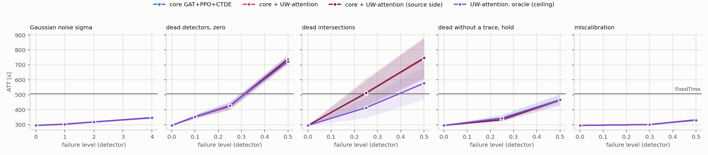
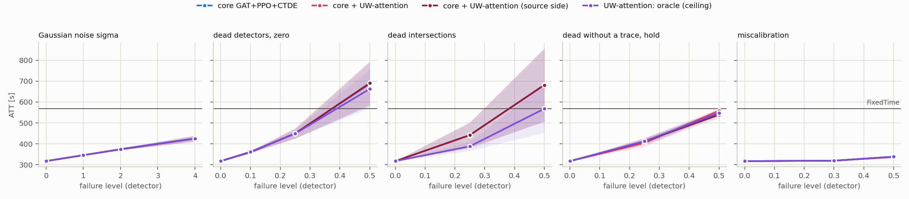

# T2: plan `t2_uw_src`

Mode realistic (yellow=5), 5 failure draws per scenario, evaluation of FROZEN controllers (`tsc degrade`). All read the same detector layer: MaxPressure computes its decision from the broken state vector, not the engine.

Cell = ATT [s], the mean over draws, then over policy seeds (+- std over seeds); in brackets delta relative to the same controller's clean result. **(!) = worse than FixedTime**, the only place the fallback's lower layer can gain.

## cityflow_jinan3x4_4ph

FixedTime (independent of readings): **507.0 s**.

| scenario | core GAT+PPO+CTDE (n=5) | core + UW-attention (n=5) | core + UW-attention (source side) (n=5) | UW-attention: oracle (ceiling) (n=5) |
|---|---:|---:|---:|---:|
| `clean` | 295.8 +- 1.2 | 295.7 +- 0.9 | 295.6 +- 1.3 | 295.8 +- 1.2 |
| `gauss1` | 304.1 +- 1.2 (+2.8%) | 304.2 +- 0.6 (+2.9%) | 303.9 +- 0.8 (+2.8%) | 304.1 +- 1.2 (+2.8%) |
| `gauss2` | 319.0 +- 2.0 (+7.9%) | 318.9 +- 2.5 (+7.8%) | 318.5 +- 2.0 (+7.8%) | 319.0 +- 2.0 (+7.9%) |
| `gauss4` | 347.4 +- 6.7 (+17.5%) | 347.3 +- 6.8 (+17.5%) | 347.2 +- 6.5 (+17.5%) | 347.4 +- 6.7 (+17.5%) |
| `mask0p1` | 354.3 +- 16.1 (+19.8%) | 352.3 +- 10.8 (+19.2%) | 354.1 +- 9.0 (+19.8%) | 353.5 +- 12.9 (+19.5%) |
| `mask0p25` | 426.5 +- 23.9 (+44.2%) | 425.6 +- 20.3 (+43.9%) | 424.8 +- 20.4 (+43.7%) | 428.4 +- 29.3 (+44.8%) |
| `mask0p5` | 743.4 +- 25.2 (+151.4%) (!) | 739.0 +- 30.7 (+149.9%) (!) | 736.2 +- 25.5 (+149.1%) (!) | 722.1 +- 21.2 (+144.2%) (!) |
| `mask0p25_intersection` | 510.0 +- 90.2 (+72.4%) (!) | 512.2 +- 100.7 (+73.2%) (!) | 512.4 +- 83.7 (+73.4%) (!) | 413.8 +- 69.1 (+39.9%) |
| `mask0p5_intersection` | 744.8 +- 131.3 (+151.8%) (!) | 742.2 +- 137.9 (+151.0%) (!) | 746.9 +- 136.9 (+152.7%) (!) | 577.8 +- 107.9 (+95.4%) (!) |
| `mask0p25_hold_t60` | 344.8 +- 22.2 (+16.6%) | 333.7 +- 11.4 (+12.8%) | 333.5 +- 4.3 (+12.8%) | 344.3 +- 20.2 (+16.4%) |
| `mask0p5_hold_t60` | 466.9 +- 36.1 (+57.9%) | 465.2 +- 16.6 (+57.3%) | 464.7 +- 11.3 (+57.2%) | 466.5 +- 38.0 (+57.7%) |
| `drift0p3` | 301.7 +- 0.7 (+2.0%) | 301.7 +- 1.6 (+2.0%) | 301.5 +- 1.4 (+2.0%) | 301.7 +- 0.7 (+2.0%) |
| `drift0p5` | 331.0 +- 4.6 (+11.9%) | 332.9 +- 9.2 (+12.6%) | 332.3 +- 6.0 (+12.4%) | 331.0 +- 4.6 (+11.9%) |

* **core GAT+PPO+CTDE**: worst scenario `mask0p5_intersection`: 744.8 s (+151.8%). Worse than FixedTime in 3 scenarios: `mask0p25_intersection`, `mask0p5`, `mask0p5_intersection`.
* **core + UW-attention**: worst scenario `mask0p5_intersection`: 742.2 s (+151.0%). Worse than FixedTime in 3 scenarios: `mask0p25_intersection`, `mask0p5`, `mask0p5_intersection`.
* **core + UW-attention (source side)**: worst scenario `mask0p5_intersection`: 746.9 s (+152.7%). Worse than FixedTime in 3 scenarios: `mask0p25_intersection`, `mask0p5`, `mask0p5_intersection`.
* **UW-attention: oracle (ceiling)**: worst scenario `mask0p5`: 722.1 s (+144.2%). Worse than FixedTime in 2 scenarios: `mask0p5`, `mask0p5_intersection`.

## cityflow_hangzhou4x4_4ph

FixedTime (independent of readings): **568.9 s**.

| scenario | core GAT+PPO+CTDE (n=5) | core + UW-attention (n=5) | core + UW-attention (source side) (n=5) | UW-attention: oracle (ceiling) (n=5) |
|---|---:|---:|---:|---:|
| `clean` | 317.5 +- 0.7 | 317.5 +- 0.5 | 317.3 +- 0.6 | 317.5 +- 0.7 |
| `gauss1` | 345.7 +- 1.3 (+8.9%) | 346.0 +- 1.4 (+9.0%) | 345.7 +- 1.7 (+9.0%) | 345.7 +- 1.3 (+8.9%) |
| `gauss2` | 374.7 +- 4.8 (+18.0%) | 374.0 +- 4.8 (+17.8%) | 374.1 +- 4.5 (+17.9%) | 374.7 +- 4.8 (+18.0%) |
| `gauss4` | 425.7 +- 13.5 (+34.1%) | 425.0 +- 13.9 (+33.9%) | 425.5 +- 14.3 (+34.1%) | 425.7 +- 13.5 (+34.1%) |
| `mask0p1` | 361.9 +- 3.6 (+14.0%) | 361.7 +- 6.0 (+13.9%) | 359.9 +- 3.0 (+13.4%) | 361.7 +- 5.2 (+13.9%) |
| `mask0p25` | 450.1 +- 24.7 (+41.7%) | 450.2 +- 26.2 (+41.8%) | 449.6 +- 22.8 (+41.7%) | 449.1 +- 21.0 (+41.4%) |
| `mask0p5` | 686.6 +- 102.7 (+116.2%) (!) | 688.2 +- 106.7 (+116.7%) (!) | 690.5 +- 103.5 (+117.6%) (!) | 662.7 +- 92.0 (+108.7%) (!) |
| `mask0p25_intersection` | 442.1 +- 59.6 (+39.2%) | 441.2 +- 63.5 (+38.9%) | 442.3 +- 59.5 (+39.4%) | 388.3 +- 21.8 (+22.3%) |
| `mask0p5_intersection` | 682.3 +- 175.7 (+114.9%) (!) | 682.4 +- 173.1 (+114.9%) (!) | 681.2 +- 174.8 (+114.7%) (!) | 568.1 +- 114.6 (+78.9%) |
| `mask0p25_hold_t60` | 412.2 +- 13.8 (+29.8%) | 404.8 +- 20.2 (+27.5%) | 411.8 +- 18.6 (+29.8%) | 412.8 +- 14.6 (+30.0%) |
| `mask0p5_hold_t60` | 548.4 +- 14.3 (+72.7%) | 558.7 +- 12.1 (+75.9%) | 539.2 +- 15.5 (+69.9%) | 548.2 +- 14.6 (+72.6%) |
| `drift0p3` | 319.5 +- 0.2 (+0.6%) | 319.5 +- 0.2 (+0.6%) | 319.5 +- 0.2 (+0.7%) | 319.5 +- 0.2 (+0.6%) |
| `drift0p5` | 338.7 +- 2.5 (+6.7%) | 337.0 +- 3.3 (+6.1%) | 338.4 +- 2.9 (+6.6%) | 338.7 +- 2.5 (+6.7%) |

* **core GAT+PPO+CTDE**: worst scenario `mask0p5`: 686.6 s (+116.2%). Worse than FixedTime in 2 scenarios: `mask0p5`, `mask0p5_intersection`.
* **core + UW-attention**: worst scenario `mask0p5`: 688.2 s (+116.7%). Worse than FixedTime in 2 scenarios: `mask0p5`, `mask0p5_intersection`.
* **core + UW-attention (source side)**: worst scenario `mask0p5`: 690.5 s (+117.6%). Worse than FixedTime in 2 scenarios: `mask0p5`, `mask0p5_intersection`.
* **UW-attention: oracle (ceiling)**: worst scenario `mask0p5`: 662.7 s (+108.7%). Worse than FixedTime in 1 scenarios: `mask0p5`.

## Mechanisms x scenario

delta ATT [s] of the ASSESSED COLUMN relative to `core GAT+PPO+CTDE`, paired by (seed, draw). **bold** = |t| >= 2.8. delta < 0 = the assessed column is better than the reference.

### cityflow_jinan3x4_4ph

| mechanism | `clean` | `gauss1` | `gauss2` | `gauss4` | `mask0p1` | `mask0p25` | `mask0p5` | `mask0p25_intersection` | `mask0p5_intersection` | `mask0p25_hold_t60` | `mask0p5_hold_t60` | `drift0p3` | `drift0p5` |
|---|---:|---:|---:|---:|---:|---:|---:|---:|---:|---:|---:|---:|---:|
| core + UW-attention | -0.1 | +0.1 | -0.1 | -0.1 | -2.0 | -0.9 | -4.4 | +2.2 | -2.6 | -11.2 | -1.7 | +0.0 | +1.9 |
| core + UW-attention (source side) | -0.2 | -0.2 | -0.5 | -0.2 | -0.2 | -1.7 | -7.2 | +2.4 | +2.1 | -11.4 | -2.2 | -0.2 | +1.3 |
| UW-attention: oracle (ceiling) | +0.0 | +0.0 | +0.0 | +0.0 | -0.8 | +1.8 | **-21.3** | **-96.2** | **-167.0** | -0.5 | -0.3 | +0.0 | +0.0 |

### cityflow_hangzhou4x4_4ph

| mechanism | `clean` | `gauss1` | `gauss2` | `gauss4` | `mask0p1` | `mask0p25` | `mask0p5` | `mask0p25_intersection` | `mask0p5_intersection` | `mask0p25_hold_t60` | `mask0p5_hold_t60` | `drift0p3` | `drift0p5` |
|---|---:|---:|---:|---:|---:|---:|---:|---:|---:|---:|---:|---:|---:|
| core + UW-attention | +0.0 | +0.3 | **-0.7** | -0.7 | -0.2 | +0.1 | +1.7 | -0.9 | +0.1 | -7.4 | +10.3 | +0.0 | -1.7 |
| core + UW-attention (source side) | -0.2 | +0.1 | -0.5 | -0.2 | -2.0 | -0.5 | +3.9 | +0.2 | -1.1 | -0.4 | -9.2 | -0.0 | -0.4 |
| UW-attention: oracle (ceiling) | +0.0 | +0.0 | +0.0 | +0.0 | -0.1 | -1.0 | **-23.9** | **-53.8** | **-114.2** | +0.6 | -0.2 | +0.0 | +0.0 |

## Check: the evaluator measures the same policy as T1

The evaluator's clean result vs the last training test, 10 learned runs: largest difference **0.000 s**, consistent to the log's precision.

## What this table does NOT say

* Levels are DETECTOR levels. For `gauss` they transfer to the feature with a factor of ~0.8-0.9, `urand` is ~1.6x weaker at the same `level` (`results/sensor_severity.md`).
* A mask with `zero` substitution changes far fewer feature cells than the fraction of dead lanes (zero is the modal value); the same number does not mean the same thing on networks with different loads.
* `hold` scenarios start at decision 60 (minute 15), so the first quarter of the episode is clean; their delta is not directly comparable with a mask from the start.
