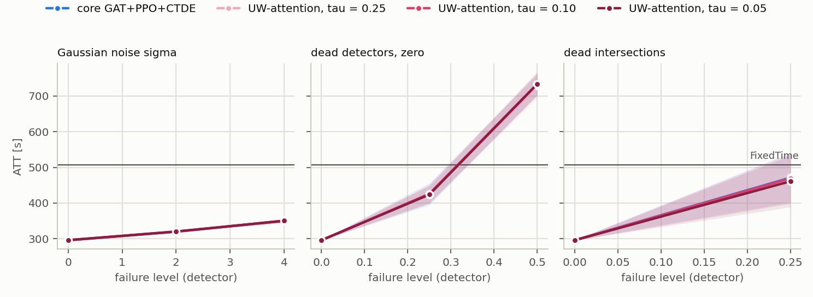

# T2: tau sweep for UW-attention: plan `t2_uw_tau`

Mode realistic (yellow=5), 5 failure draws per scenario, evaluation of FROZEN controllers (`tsc degrade`). All read the same detector layer: MaxPressure computes its decision from the broken state vector, not the engine.

Cell = ATT [s], the mean over draws, then over policy seeds (+- std over seeds); in brackets delta relative to the same controller's clean result. **(!) = worse than FixedTime**, the only place the fallback's lower layer can gain.

## cityflow_jinan3x4_4ph

FixedTime (independent of readings): **507.0 s**.

| scenario | core GAT+PPO+CTDE (n=3) | UW-attention, tau = 0.25 (n=3) | UW-attention, tau = 0.10 (n=3) | UW-attention, tau = 0.05 (n=3) |
|---|---:|---:|---:|---:|
| `clean` | 295.9 +- 0.6 | 295.5 +- 1.1 | 295.6 +- 0.2 | 295.9 +- 0.5 |
| `gauss2` | 319.9 +- 2.2 (+8.1%) | 319.8 +- 2.5 (+8.2%) | 319.6 +- 1.9 (+8.1%) | 320.1 +- 1.1 (+8.2%) |
| `gauss4` | 350.0 +- 4.5 (+18.3%) | 350.1 +- 4.9 (+18.5%) | 350.4 +- 6.1 (+18.5%) | 350.1 +- 4.5 (+18.3%) |
| `mask0p25` | 424.9 +- 31.1 (+43.6%) | 424.6 +- 23.4 (+43.7%) | 425.8 +- 26.1 (+44.0%) | 423.7 +- 25.3 (+43.2%) |
| `mask0p5` | 732.6 +- 28.5 (+147.5%) (!) | 728.4 +- 36.1 (+146.5%) (!) | 733.8 +- 34.0 (+148.2%) (!) | 733.2 +- 31.9 (+147.8%) (!) |
| `mask0p25_intersection` | 471.1 +- 68.8 (+59.2%) | 466.2 +- 67.2 (+57.7%) | 469.2 +- 70.7 (+58.7%) | 460.8 +- 72.0 (+55.7%) |

* **core GAT+PPO+CTDE**: worst scenario `mask0p5`: 732.6 s (+147.5%). Worse than FixedTime in 1 scenarios: `mask0p5`.
* **UW-attention, tau = 0.25**: worst scenario `mask0p5`: 728.4 s (+146.5%). Worse than FixedTime in 1 scenarios: `mask0p5`.
* **UW-attention, tau = 0.10**: worst scenario `mask0p5`: 733.8 s (+148.2%). Worse than FixedTime in 1 scenarios: `mask0p5`.
* **UW-attention, tau = 0.05**: worst scenario `mask0p5`: 733.2 s (+147.8%). Worse than FixedTime in 1 scenarios: `mask0p5`.

## Mechanisms x scenario

delta ATT [s] of the ASSESSED COLUMN relative to `core GAT+PPO+CTDE`, paired by (seed, draw). **bold** = |t| >= 2.8. delta < 0 = the assessed column is better than the reference.

### cityflow_jinan3x4_4ph

| mechanism | `clean` | `gauss2` | `gauss4` | `mask0p25` | `mask0p5` | `mask0p25_intersection` |
|---|---:|---:|---:|---:|---:|---:|
| UW-attention, tau = 0.25 | -0.4 | -0.1 | +0.0 | -0.4 | -4.2 | -4.9 |
| UW-attention, tau = 0.10 | -0.3 | -0.3 | +0.4 | +0.8 | +1.3 | -1.9 |
| UW-attention, tau = 0.05 | -0.0 | +0.3 | +0.1 | -1.3 | +0.6 | -10.2 |

## Check: the evaluator measures the same policy as T1

The evaluator's clean result vs the last training test, 3 learned runs: largest difference **0.000 s**, consistent to the log's precision.

## What this table does NOT say

* Levels are DETECTOR levels. For `gauss` they transfer to the feature with a factor of ~0.8-0.9, `urand` is ~1.6x weaker at the same `level` (`results/sensor_severity.md`).
* A mask with `zero` substitution changes far fewer feature cells than the fraction of dead lanes (zero is the modal value); the same number does not mean the same thing on networks with different loads.
* `hold` scenarios start at decision 60 (minute 15), so the first quarter of the episode is clean; their delta is not directly comparable with a mask from the start.
